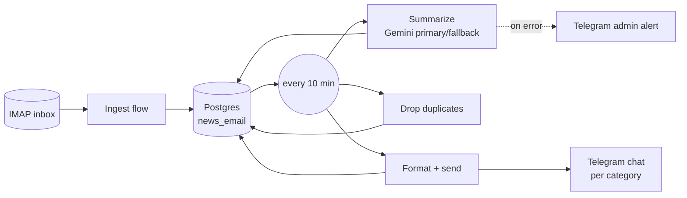

# Workflow orchestrator experiment: Kestra vs Prefect

A local, reproducible comparison of **[Kestra](https://kestra.io)** and **[Prefect](https://www.prefect.io)**
as replacements for **n8n**. A real production n8n workflow is re-implemented in both tools, run
with docker compose, and judged against one behavior spec and one scorecard.

> **Status:** Phases 0 to 6 are done: foundations, shared local infrastructure, golden vectors from the original n8n code, both implementations (**Kestra** and **Prefect**), the parity suite (both pass 13 of 13 scenarios), and the measurements and final report. Phase 7, a smoke test against the real services, is optional. See [docs/plan.md](docs/plan.md).
>
> **Result:** both tools reproduce the workflow. On the weighted scorecard Kestra leads slightly, 3.8 against 3.6 out of 5, a lean rather than a clear win. Kestra is ahead on observability, speed and native tasks; Prefect on footprint, secrets and Python testability. The recommendation and evidence are in [docs/comparison/results.md](docs/comparison/results.md).

## The workflow under test

The baseline is an **email newsletter summarizer**, exported from n8n into [`baseline/`](baseline/):

| n8n workflow | What it does |
|---|---|
| `EmailSummarizerMainUnique` | IMAP (Gmail label `n8n`), then parse the sender, category and translate flag, then insert into Postgres |
| `EmailSummarizerFromPgCron` | Every 10 min: summarize one email with Gemini (with a fallback model; alerts on failure), delete duplicates, send one summary to Telegram (MarkdownV2) |



The full contract, with requirement IDs and known quirks, is in [docs/baseline/workflow-spec.md](docs/baseline/workflow-spec.md).

## Approach

- **Spec first.** The n8n exports are turned into a written behavior spec. Both tools are built from it, independently.
- **Parity-gated.** A tool-agnostic parity suite and golden vectors generated from the original n8n JavaScript decide whether an implementation is "the same workflow". Ergonomics only count after parity.
- **Fully local.** GreenMail stands in for Gmail, and HTTP mocks stand in for Gemini and Telegram, so runs are deterministic and free. A real-service smoke test is optional.
- **Evidence-based scoring.** 13 dimensions (setup, footprint, authoring effort, dev loop, error handling, observability, GitOps, ...). Every score links to a measurement or artifact. See [docs/comparison/criteria.md](docs/comparison/criteria.md).
- **OSS, self-hosted only.** No Kestra Enterprise, no Prefect Cloud.

## Repository layout

```text
baseline/     n8n exports (read-only source of truth)
docs/         all documentation: spec, plan, decisions, per-tool docs, comparison
infra/        shared local services: app Postgres, GreenMail, mocks          (done)
fixtures/     synthetic newsletter emails + generator                        (done)
scripts/      helper scripts: IMAP seeding, run helpers, measurements, screenshots (done)
tests/        golden vectors from the original n8n code + end-to-end parity suite   (done)
kestra/       Kestra compose, YAML flows, Python namespace files + tests      (done)
prefect/      Prefect compose, deployments, Python flows + tests              (done)
```

## Prerequisites

- Docker Desktop with Compose v2.20 or later (for `include:`). Give Docker **at least 8 GB** of
  RAM, since Kestra runs on the JVM.
- GNU Make and [uv](https://docs.astral.sh/uv/). Node.js isn't needed: the golden-vector generator runs in Docker.
- Optional, for the real-service smoke test: a Gmail app password, a Gemini API key, and a Telegram test bot

## Getting started

The shared infrastructure, both tool stacks and the parity suite run today.

```bash
make infra-up      # Postgres, GreenMail (IMAP), mock Telegram, mock Gemini, all healthy
make seed          # load 9 synthetic newsletters into the IMAP folder 'n8n'
make infra-check   # confirm schema, chat seed, mock health, mailbox counts
make infra-down    # stop and remove everything
```

No `.env` is needed: the Makefile falls back to `.env.example` (local-only placeholders).
Details: [docs/infra.md](docs/infra.md).

Kestra (one stack at a time; it brings its own copy of the infrastructure):

```bash
make kestra-up                     # Kestra + its DB + the infra, healthy, flows deployed (UI: localhost:8080)
make kestra-seed                   # load the fixture emails
make kestra-run FLOW=email-ingest  # ingest now (it also polls every minute)
make kestra-run                    # one summarize-and-send tick (it also runs every 10 minutes)
make kestra-down
```

Details: [docs/kestra/README.md](docs/kestra/README.md).

Prefect (stop the Kestra stack first; same host ports):

```bash
make prefect-up                     # Prefect server + worker + their DB + the infra, healthy, deployed (UI: localhost:4200)
make prefect-seed                   # load the fixture emails
make prefect-run FLOW=email-ingest  # ingest now (it also polls every minute)
make prefect-run                    # one summarize-and-send tick (it also runs every 10 minutes)
make prefect-down
```

Details: [docs/prefect/README.md](docs/prefect/README.md).

Parity suite (the same 13 scenarios against either stack, one at a time; it starts the stack if needed):

```bash
make parity-kestra    # about 4 min from a stopped stack
make parity-prefect   # about 8 min (each run waits for the worker's 10 s poll)
```

Details: [docs/parity.md](docs/parity.md).

Measurements (Phase 6; one stack at a time, with nothing else running in Docker):

```bash
make measure-kestra       # C2, C3, C5 numbers into docs/comparison/data (about 10 min; MEASURE_ARGS="--cold" adds a clean build)
make measure-prefect      # the same for Prefect (about 15 min)
make loc                  # lines of code by role (C4)
make screenshots-kestra   # UI walkthrough (C9), after make parity-kestra; screenshots-prefect likewise
```

Details: [docs/comparison/results.md](docs/comparison/results.md) and [D-021](docs/decisions.md).

## Documentation

Start at [docs/README.md](docs/README.md). The key files:

- [docs/plan.md](docs/plan.md): phases, checklist, **open questions for the owner**
- [docs/decisions.md](docs/decisions.md): assumptions and deviations
- [docs/baseline/](docs/baseline/): spec and data model
- [docs/comparison/results.md](docs/comparison/results.md): **the scorecard, the evidence and the recommendation**

## Working with Claude

Claude Code implements and documents this experiment. Its working rules (parity, pinning, secrets,
definition of done, documentation duties) are in [CLAUDE.md](CLAUDE.md).
