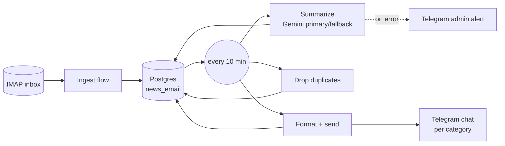

# Workflow orchestrator experiment: Kestra vs Prefect

A local, reproducible comparison of **[Kestra](https://kestra.io)** and **[Prefect](https://www.prefect.io)**
as replacements for **n8n**. A real production n8n workflow is re-implemented in both tools, run
with docker compose, and judged against one behavior spec and one scorecard.

> **Status:** Phase 0 (foundations) is done. There's nothing to run yet. See [docs/plan.md](docs/plan.md).

## The workflow under test

The baseline is an **email newsletter summarizer**, exported from n8n into [`baseline/`](baseline/):

| n8n workflow | What it does |
|---|---|
| `EmailSummarizerMainUnique` | IMAP (Gmail label `n8n`), then parse the sender, category and translate flag, then insert into Postgres |
| `EmailSummarizerFromPgCron` | Every 10 min: summarize one email with Gemini (with a fallback model; alerts on failure), delete duplicates, send one summary to Telegram (MarkdownV2) |



The full contract, with requirement IDs and known quirks, is in [docs/baseline/workflow-spec.md](docs/baseline/workflow-spec.md).

## Approach

- **Spec first.** The n8n exports are turned into a written behavior spec. Both tools are built from it, independently.
- **Parity-gated.** A tool-agnostic parity suite and golden vectors generated from the original n8n JavaScript decide whether an implementation is "the same workflow". Ergonomics only count after parity.
- **Fully local.** GreenMail stands in for Gmail, and HTTP mocks stand in for Gemini and Telegram, so runs are deterministic and free. A real-service smoke test is optional.
- **Evidence-based scoring.** 13 dimensions (setup, footprint, authoring effort, dev loop, error handling, observability, GitOps, ...). Every score links to a measurement or artifact. See [docs/comparison/criteria.md](docs/comparison/criteria.md).
- **OSS, self-hosted only.** No Kestra Enterprise, no Prefect Cloud.

## Repository layout

```text
baseline/     n8n exports (read-only source of truth)
docs/         all documentation: spec, plan, decisions, per-tool docs, comparison
infra/        shared local services: app Postgres, GreenMail, mocks          (Phase 1)
fixtures/     synthetic newsletter emails                                    (Phase 1)
tests/        golden vectors from the n8n JS + end-to-end parity scenarios   (Phases 2, 5)
kestra/       Kestra compose + YAML flows                                    (Phase 3)
prefect/      Prefect compose + Python flows + unit tests                    (Phase 4)
```

## Prerequisites

- Docker Desktop with Compose v2.20 or later (for `include:`). Give Docker **at least 8 GB** of
  RAM, since Kestra runs on the JVM.
- GNU Make, [uv](https://docs.astral.sh/uv/), and Node.js 20 or later (Node is only for generating golden vectors)
- Optional, for the real-service smoke test: a Gmail app password, a Gemini API key, and a Telegram test bot

## Getting started

*Coming in Phase 1.* The planned entry points are `make kestra-up`, `make prefect-up`, `make seed`,
`make parity-kestra` and `make parity-prefect`. They'll be documented here once they exist and work.

## Documentation

Start at [docs/README.md](docs/README.md). The key files:

- [docs/plan.md](docs/plan.md): phases, checklist, **open questions for the owner**
- [docs/decisions.md](docs/decisions.md): assumptions and deviations
- [docs/baseline/](docs/baseline/): spec and data model
- [docs/comparison/](docs/comparison/): criteria now, results at the end

## Working with Claude

Claude Code implements and documents this experiment. Its working rules (parity, pinning, secrets,
definition of done, documentation duties) are in [CLAUDE.md](CLAUDE.md).
