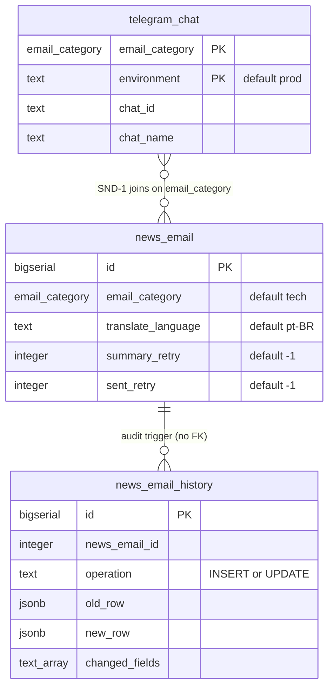

# Baseline data model

This is the **production schema**, provided by the owner on 2026-11-14 as psql `\d+` output and
kept verbatim in [prod-schema.md](prod-schema.md). It replaces the reconstruction that D-007 used
(see D-018).

`infra/db/init/001_schema.sql` reproduces it. `make schema-check` diffs app-db's `\d+` output
against the production output, ignoring whitespace. It matched on 2026-11-14.

Everything below comes from production unless it's tagged:

- **[inferred]**: not in the production output, implied by the n8n exports
- **[assumed]**: not in the production output; a guess so the experiment can run

The `Not-null constraints:` sections in the output only exist on PostgreSQL 18 and later, so
production runs 18 or newer. app-db runs 18.7.

## `public.email_category` (enum)

The labels are **[inferred]**: `news`, `finance` and `tech`, from the n8n Postgres node, which
shows the column as type `options`. n8n does that for enums. Production confirms that the type
exists and that `tech` is one of its labels, because it's the column default.

## `public.news_email`

| column | type | null / default | written by |
|---|---|---|---|
| `id` | `bigint` | `nextval('news_email_id_seq')` (bigserial), PK | DB |
| `email_inbox_label` | `text` | not null | ING-4 (sender slug) |
| `email_category` | `email_category` | not null, `'tech'` | ING-4 |
| `email_from` | `text` | not null | ING-4 |
| `email_subject` | `text` | not null | ING-4 |
| `email_date` | `text` | not null | ING-4 (GMT-3 display string) |
| `email_raw_content` | `text` | not null | ING-4 |
| `email_consumed_at` | `timestamptz` | not null, `CURRENT_TIMESTAMP` | DB (DUP-1 orders by it) |
| `to_translate` | `boolean` | not null, `false` | ING-4 |
| `translate_language` | `text` | not null, **`'pt-BR'`** | DB only, never written (Q-14) |
| `model_used` | `text` | nullable | SUM-6/7a |
| `summary_status` | `text` | nullable, **`'OK'`** | SUM-6/7a (`'OK'` or error text) |
| `is_summarized` | `boolean` | not null, `false` | SUM-6/7a, SND-5 |
| `summary_content` | `text` | nullable | SUM-6/7a |
| `summarized_at` | `timestamptz` | nullable | SUM-6/7a |
| `summary_retry` | `integer` | not null, **`-1`** | SUM-6/7a (`+ 1`) |
| `formatted_summary` | `text` | nullable | SND-4/5 |
| `formatted_length` | `integer` | nullable | SND-4/5 |
| `sent_status` | `text` | nullable, **`'OK'`** | SND-4/5 |
| `was_sent` | `boolean` | not null, `false` | SND-4/5 |
| `sent_at` | `timestamptz` | nullable | SND-4/5 |
| `sent_retry` | `integer` | not null, **`-1`** | SND-4/5 (`+ 1`) |

Trigger: `tr_news_email_audit AFTER INSERT OR UPDATE ... FOR EACH ROW EXECUTE FUNCTION log_news_email_changes()`.

### What the defaults mean for behavior

| Default | Effect | Where it shows |
|---|---|---|
| `translate_language = 'pt-BR'` | The prompt says `translated to pt-BR language` or `using pt-BR language`. The Telegram header says `translated to pt-BR` or `original on pt-BR`. | Q-14 (resolved), SUM-4, SND-2 vectors |
| `summary_retry = -1`, `sent_retry = -1` | The `< 5` guards in SUM-1 and SND-1 allow **6 attempts** (counter values -1 to 4), not 5. After the first successful summary, `summary_retry` is 0. | Q-17, F-7 |
| `summary_status = 'OK'`, `sent_status = 'OK'` | A row that has never been attempted already reads `'OK'`. To tell "not tried" from "succeeded", use `is_summarized`/`was_sent` and the retry counters, not the status text. | Parity assertions (Phase 5) |
| `email_category = 'tech'` | Never applies, because ING-3 always sets a category (falling back to `tech` itself). | none |

## `public.news_email_history` (audit)

The workflow never reads or writes this table. The trigger fills it on every insert and update of
`news_email`, whichever tool issues them.

| column | type | null / default |
|---|---|---|
| `id` | `bigint` | `nextval('news_email_history_id_seq')` (bigserial), PK |
| `news_email_id` | `integer` | not null (`news_email.id` is `bigint`; kept as in production) |
| `operation` | `text` | not null, `CHECK (operation IN ('INSERT', 'UPDATE'))` |
| `changed_at` | `timestamptz` | not null, `clock_timestamp()` |
| `changed_by` | `text` | `SESSION_USER` |
| `old_row`, `new_row` | `jsonb` | nullable |
| `changed_fields` | `text[]` | nullable |

Indexes: `(news_email_id, changed_at)` and `(operation)`.

- **The function body is [assumed].** Production shows only the trigger and the function name. The local version stores the whole row as jsonb (`old_row` only on UPDATE) and, on UPDATE, the sorted names of the columns whose values changed. The real source is requested in [next-steps.md](../next-steps.md).
- **Deletes aren't audited.** The trigger and the check constraint cover only INSERT and UPDATE, so DUP-1 deletes leave no trace, and there's no foreign key, so a deleted duplicate's history rows remain.
- **Use in this experiment:** the parity suite can count history rows per `news_email_id` to compare how many writes each tool makes per email, not just the final state. The jsonb content and `changed_fields` depend on the assumed function, so treat them as diagnostic only until the real body arrives.
- In production the table is about 4× the size of `news_email` (29 MB vs 7.5 MB).

## `public.telegram_chat`

| column | type | null / default |
|---|---|---|
| `email_category` | `email_category` | not null, PK part |
| `chat_id` | `text` | not null |
| `chat_name` | `text` | not null |
| `environment` | `text` | not null, `'prod'`, PK part |

- The primary key is `(email_category, environment)`, but **SND-1 joins on `email_category` only** (Q-18). With a second environment, every summarized email matches more than one chat, and `limit 1` (ordered by `ne.id` only) picks one of them arbitrarily.
- Locally, `infra/db/init/002_seed_telegram_chat.sh` inserts one row per category from `TELEGRAM_CHAT_ID_*`, with `environment` left at `'prod'` and placeholder `chat_name`s. The workflow doesn't read `chat_name`.
- Real chat IDs must not be committed.

## Not in the production output

| Item | Local stand-in | Matters for |
|---|---|---|
| Enum labels | `news`, `finance`, `tech` [inferred] | ING-3 categories |
| `log_news_email_changes()` body | jsonb snapshot + changed fields [assumed] | `news_email_history` content only |
| Database locale (`datctype`, provider) | `en_US.utf8`, libc (Postgres image default) | `initcap()` on non-ASCII text in SND-1 (G-9) |
