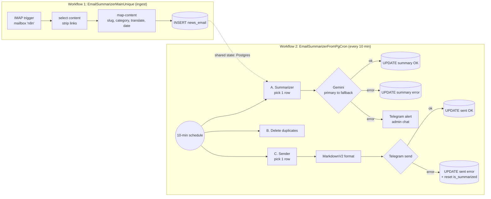
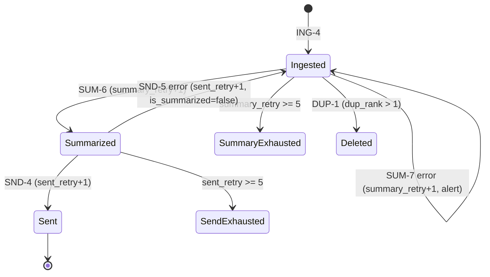

# Baseline behavior spec: n8n Email Summarizer

> **This document is the contract.** Kestra and Prefect must both meet it.
> It was derived from the n8n exports in [`baseline/`](../../baseline). If this spec and the JSON
> disagree, the JSON wins: fix this file and record the fix in [`../decisions.md`](../decisions.md).
>
> Requirement IDs (`ING-*`, `SUM-*`, `DUP-*`, `SND-*`, `Q-*`) are referenced by parity tests and
> by the comparison scorecard. Don't renumber them; add new IDs at the end.

## 1. What the system does

Newsletters arrive in a Gmail label called `n8n`. They are stored in Postgres. Every 10 minutes,
one stored email is summarized by Gemini (with a fallback model), and one already-summarized
email is formatted for Telegram and sent to a chat chosen by the email's category.



The two workflows share **only** the database. They don't call each other.

Data model: [`data-model.md`](data-model.md).

---

## 2. Workflow 1: Ingest (`EmailSummarizerMainUnique.json`)

### ING-1 Trigger

- n8n node `fetch-n8n-inbox` (`emailReadImap` v2), credential "GMAIL_IMAP", mailbox **`n8n`**.
- The node's defaults apply: it fetches **UNSEEN** messages, **marks them as read** after fetching,
  and uses the "simple" output format (`from`, `subject`, `date`, `textHtml`, `textPlain`, ...).
- **What the node hands to ING-2** (production n8n 2.40.3, `@n8n/imap@0.26.0`; referee
  `tests/golden/vectors/ing1-imap-simple.json`, D-015):
  - Header values (`from`, `subject`, `date`) are RFC 2047-decoded but otherwise **raw**. Quotes
    and spacing stay as sent, e.g. `"Morning Brew" <crew@…>`.
  - `textPlain` / `textHtml` are transfer-decoded and converted to UTF-8, with the original **CRLF**
    line endings kept. A missing part is `''`.
- n8n keeps a persistent IMAP connection (IDLE), so ingestion is close to real time.
  Implementations may poll on an interval instead. Both tools poll **every minute** (Q-8,
  [D-019](../decisions.md)).
- All messages read in one pass reach ING-4 together and are inserted in **one transaction**
  (n8n's Postgres node v2.6 defaults to `queryBatching: 'single'`), so they share one
  `email_consumed_at` (Q-19).

### ING-2 Content selection (`select-n8n-content-generic`)

For each message, keep:

| field | value |
|---|---|
| `from` | raw `From` header, e.g. `"Morning Brew" <crew@morningbrew.com>` |
| `subject` | subject |
| `date` | raw date |
| `htmlContent` | `textHtml` with every match of `/\(https?:\/\/[^\s)]+\)/g` removed |
| `plainContent` | `textPlain` with the same regex removed |

The regex strips URLs in parentheses, like `(https://...)`. Bare URLs stay.

### ING-3 Mapping (`map-content`, JavaScript)

1. **Sender parsing.** Match `from` against `/^"?([^"<]+)"?\s*<([^>]+)>$/`.
   - On a match: `from_name` = group 1, trimmed, with every char outside `[\x20-\x7E]` removed, trimmed again. `from_email` = group 2, trimmed.
   - With no match: `from_name = ''` and `from_email = from.trim()`.
2. **Slug.** `from_name_id` = `from_name` lowercased, chars outside `[a-z0-9\s]` removed, trimmed,
   and runs of whitespace replaced with `-`. Example: `Lenny's Newsletter` becomes `lennys-newsletter`.
3. **Translate flag.** `translate` is true when `from_name_id` is one of:
   `lennys-newsletter`, `the-pragmatic-engineer`, `tech-brew`, `the-neuron`, `morning-brew`, `refactoring`.
4. **Category.** `finance` for `rico-matinal`. `news` for `the-news` and `morning-brew`. `tech` for everything else.
5. **Body choice.** `raw_content` = `htmlContent` when `from_name_id` is `tech-brew` or `rico-matinal`, and `plainContent` otherwise.
6. **Date.** Parse `date` and subtract a **fixed 3 hours** (GMT-3, no DST). Format it as
   `${Ddd}, ${D} ${Mon} ${YYYY} at ${HH}h ${MM}min`, using English day and month abbreviations.
   The day of month is not zero-padded. Hours and minutes are zero-padded.
   Example: `Sat, 14 Nov 2026 at 09h 05min`.

### ING-4 Persist (`insert_raw_news`)

`INSERT INTO public.news_email` with:

| column | value |
|---|---|
| `email_from` | `from_name` (the display name, **not** the address) |
| `email_subject` | `subject` |
| `email_date` | `date_gmt3`: the **formatted string** from ING-3.6, not a timestamp |
| `email_raw_content` | `raw_content` |
| `email_inbox_label` | `from_name_id` |
| `to_translate` | `translate` |
| `email_category` | `category` |

All other columns take their database defaults ([data-model.md](data-model.md)). The ones that matter
are `translate_language = 'pt-BR'` (Q-14), `summary_retry = sent_retry = -1` (Q-17), and
`summary_status = sent_status = 'OK'`. One row is written per email. Ingest does no
dedup; workflow 2 handles that (DUP-1).

---

## 3. Workflow 2: Summarize & Send (`EmailSummarizerFromPgCron.json`)

### Trigger and execution order

- `10min-runner`: a schedule every **10 minutes**.
- The trigger fans out to **three independent branches**. n8n `executionOrder: "v1"` runs branches
  **one after another**, ordered by canvas position from top to bottom:
  1. **A. Summarizer** (`pg-get-dedup-raw-news`, y=560)
  2. **B. Duplicate cleanup** (`pg-drop-dups`, y=832)
  3. **C. Sender** (`pg-get-summary`, y=1184)
- Only two failures are handled: SUM-5 (to SUM-7) and SND-3 (to SND-5), the two nodes with
  `onError: continueErrorOutput`. **Any other node error ends the run**: n8n stops the execution,
  and the nodes after it, including the later branches, don't run until the next tick. For
  example, if the SUM-7b alert fails (Q-15), DUP-1 and branch C are skipped. ([D-019](../decisions.md)
  corrected this line, which said a failure in one branch doesn't stop the others.)
- Each branch handles **at most one row** per run. Throughput is therefore capped at 6 summaries
  and 6 sends per hour.
- Execution data is saved for every run (`saveDataSuccessExecution: all`, `saveExecutionProgress: true`).

### Branch A: Summarizer

#### SUM-1 Pick a row (`pg-get-dedup-raw-news`)

Run this SQL verbatim:

```sql
with email_dups as (
	select
		rank() over (partition by n.email_inbox_label, n.email_subject, n.email_date order by n.email_consumed_at) as dup_rank,
		n.*
	from public.news_email n
)
select
	d.id, d.email_inbox_label, d.email_date, d.email_from, d.email_subject,
	d.to_translate, d.translate_language, d.email_raw_content, d.summary_retry
from email_dups d
where dup_rank = 1
and not d.is_summarized
and d.summary_retry < 5
order by id
limit 1
```

#### SUM-2 Empty guard (`results-not-empty`)

If no row comes back, branch A ends quietly with no writes and no alerts.

#### SUM-3 Clean the content (`transform-content`)

- `news_id = id`.
- `from` = `email_from` up to the first `<`, trimmed. If there's no `<`, `from` is unchanged.
- `content` = `email_raw_content` with **every** occurrence of `View image: `, `Caption: ` and
  `Follow image link: ` removed. Then every char outside `[\x20-\x7E]` is removed. This also
  drops newlines, tabs, accents and emoji.
- Passed on: `news_id, from, subject, date, to_translate, translate_language, content`.

#### SUM-4 Build the prompt (`prompt-builder`)

- `model = "models/gemini-flash-lite-latest"` and `modelFallback = "models/gemini-2.5-flash"`.
  Make both configurable, with these values as defaults.
- `translatePrompt = (to_translate ? "translated to " : "using ") + translate_language + " language"`
- Use this prompt **verbatim**, including the `cntent` typo:
  ```
  Summarize this email cntent in main topics with content with 2500 chars limit ${translatePrompt} and remove any sponsored news (presented by) silently. Content >> ${content}
  ```

#### SUM-5 Call the LLM (`ai-summary` + `gemini-flash` + `gemini-flash-fallback`)

- n8n LangChain Agent with no tools, no memory and empty options. n8n's default system message
  ("You are a helpful assistant") therefore applies. Send it as the system instruction for parity.
- Call the primary model first. **If it throws, call the fallback model** with the same input.
  Any error counts, including 4xx responses.
- If both fail, take the error path (SUM-7). The node has `onError: continueErrorOutput`, so the
  failure is handled and the run doesn't fail.
- No sampling options are set (the model nodes have `options: {}`), so Gemini's defaults apply.
- Retries inside the model client are **not part of the contract** ([D-019](../decisions.md)).
  For the record, n8n 2.40.3 (`@langchain/core` 1.2.8) retries a model up to 6 times with
  exponential backoff (about 1 to 2 minutes), except for HTTP 400 to 409, before it gives up on
  that model.

#### SUM-6 Success path (`combine-results` then `pg-update-ai-summary`)

`UPDATE public.news_email SET ... WHERE id = news_id`:

| column | value |
|---|---|
| `summary_status` | `'OK'` |
| `summary_content` | LLM output text |
| `summarized_at` | now |
| `model_used` | the **primary** model name, even when the fallback answered (Q-2) |
| `is_summarized` | `true` |
| `summary_retry` | `summary_retry + 1` (successes count too, Q-11) |

#### SUM-7 Error path (`get-error`, then both of the following)

- **SUM-7a** (`pg-update-ai-error`): `UPDATE ... WHERE id = news_id`, setting
  `summarized_at = now`, `model_used = <primary model>` (n8n wrote the probably-empty model on the error item; changed by Q-3 / [D-008](../decisions.md)),
  `summary_status = <error message>`, `summary_content = NULL`,
  `summary_retry = summary_retry + 1` and `is_summarized = false`.
- SUM-7a runs **before** SUM-7b (canvas order), so the row is updated even when the alert fails.
- **SUM-7b** (`telegram-send-failed-exec`): send a Telegram alert to the **admin chat**. That chat
  ID is hard-coded in n8n; use `TELEGRAM_ALERT_CHAT_ID`. Send `parse_mode=HTML`,
  `disable_web_page_preview=true` and this template:
  ```html
  <b>Unable to summarize message</b>
  <i>Attempted at {now ISO-8601}</i>

  <b>Subject:</b> {subject}
  <b>From</b>: {from}
  <b>Date:</b> {date}
  <b>Model:</b> {model}
  <b>Model fallback:</b> {modelFallback}

  Execution error <b>{error}</b>

  <i>Retrying after 10 minutes</i>
  ```
  The values are **not** HTML-escaped in n8n (Q-15). `{now ISO-8601}` is `$now.toISO()`: local
  time with milliseconds and offset, e.g. `2026-11-14T12:00:00.000-03:00`, in America/Sao_Paulo
  ([D-019](../decisions.md)). `{error}` is the error message of the last failed model call; its
  wording depends on the tool's client library.
  n8n's Telegram node v1.2 also appends an "This message was sent automatically with n8n" footer
  with a link to the HTML alert. Both tools leave it out (deviation, [D-019](../decisions.md)).
  A failed alert isn't handled: the run fails (see execution order).

### Branch B: Duplicate cleanup

#### DUP-1 Delete duplicates (`pg-drop-dups`)

Run every tick, whatever A did. Use this SQL verbatim:

```sql
with email_dups as (
	select
		rank() over (
          partition by n.email_inbox_label, n.email_subject, n.email_date
          order by n.email_consumed_at
        ) as dup_rank,
		n.*
	from public.news_email n
)
delete from news_email
where id in (select id from email_dups where dup_rank > 1)
```

A duplicate means the same sender slug, subject and formatted `email_date`, which has minute
precision. The earliest-consumed row survives.

### Branch C: Sender

#### SND-1 Pick a row (`pg-get-summary`)

Run this SQL verbatim:

```sql
select
	ne.id,
	ne.email_inbox_label,
	tc.chat_id as telegram_chat_id,
	ne.email_category,
	initcap(ne.email_from) as email_from,
	initcap(ne.email_subject) as email_subject,
	ne.email_date,
	case when ne.to_translate then 'translated to ' else 'original on ' end || ne.translate_language as translated,
	ne.model_used,
	ne.summary_content,
	ne.sent_retry
from public.news_email ne
inner join public.telegram_chat tc on tc.email_category = ne.email_category
where ne.is_summarized
and not ne.was_sent
and ne.sent_retry < 5
order by ne.id
limit 1;
```

**SND-1a:** if no row comes back, branch C does nothing. n8n has no explicit guard here (Q-7).

The join ignores `telegram_chat.environment`, which is part of that table's primary key (Q-18).
Keep the SQL verbatim. The local DB has exactly one row per category.

#### SND-2 Format for Telegram MarkdownV2 (`format-as-markdown`, JavaScript)

Port the original code **exactly**. The golden vectors in `tests/golden/` are the referee. The steps:

1. Header: `**{email_from}**\n**{email_date}**\n**{email_subject}**\n*Summary {translated} with {model_used}*\n\n{summary_content}`.
2. Turn literal `\n` (backslash, n) into real newlines.
3. `^####\s*(.+)$`, `^###\s*...` and `^##\s*...` become `**$1**`. Lines that are only `---` become empty.
4. Bullets: `^(\s*)[*\-]\s{2,}` becomes `$1• `, then `^(\s*)[*\-]\s` becomes `$1• `.
5. Replace every `"` with `'`.
6. MarkdownV2 escaping that keeps formatting:
   - Mask each `**bold**` span (non-greedy) as `*inner*`, escaping every special char inside it.
   - Then mask each `*italic*` span (no inner `*` or newline, first char not a space) as `_inner_`, escaping inside it the same way.
   - Escape the remaining text with the set `` _ [ ] ( ) ~ ` > # + - = | { } . ! \ `` (not `*`). Then escape any leftover `*`.
   - Put the masked spans back.
7. Output `news_id`, `initialMessageLength`, `finalMessageLength` and `telegramMessage`.

#### SND-3 Send (`telegram-send-summary-markdown`)

Call Telegram `sendMessage` with `chat_id = telegram_chat_id`, `text = telegramMessage`,
`parse_mode = MarkdownV2` and `disable_web_page_preview = true` (set by the node, typeVersion 1.2).
n8n adds no attribution footer in MarkdownV2 mode. On any error, a Telegram rejection or a network
failure, go to SND-5 (`onError: continueErrorOutput`).

#### SND-4 Success path (`pg-update-summary-sent`)

`UPDATE ... WHERE id = news_id`:

| column | value |
|---|---|
| `sent_at` | now |
| `was_sent` | `true` |
| `formatted_length` | `finalMessageLength` |
| `formatted_summary` | `result.text` from **Telegram's response**: the rendered plain text, without markup |
| `sent_status` | `'OK'` |
| `sent_retry` | `sent_retry + 1` |

#### SND-5 Error path (`pg-update-sent-error`)

`UPDATE ... WHERE id = news_id`:

| column | value |
|---|---|
| `sent_retry` | `sent_retry + 1` |
| `sent_at` | now |
| `sent_status` | Telegram's `description` (e.g. `Bad Request: can't parse entities: …`). n8n stores `error.description ?? error.message` of its `NodeApiError`, and for a Telegram error response the description is that field. Without a response (network error), the tool's error message. |
| `was_sent` | `false` |
| `formatted_summary` | the escaped `telegramMessage` that was sent |
| `formatted_length` | `finalMessageLength` |
| `is_summarized` | **`false`**: the email is **summarized again** on a later tick (Q-12) |

No alert is sent for send failures.

---

## 4. Row lifecycle



- `summary_retry` counts **every** summarize attempt, successes included. `sent_retry` counts every send attempt.
- Both counters start at **-1** (the DB default), so the `< 5` guards allow **6** attempts each (Q-17). A row that was summarized on the first try has `summary_retry = 0`.
- A row whose send fails after `summary_retry` has reached 5 is stuck: it's no longer summarized
  and it can't be summarized again. This is inherited behavior. Document it; don't fix it silently.

---

## 5. Known quirks

Default policy: **keep the baseline behavior.** Any change is a deviation. Log it in
[`../decisions.md`](../decisions.md) and apply it **the same way in both tools**.

| ID | Quirk | Proposed handling |
|---|---|---|
| Q-1 | Prompt typo `cntent` | Keep (prompt parity) |
| Q-2 | `model_used` always holds the primary model, even when the fallback answered | Keep. Optionally log the model that actually answered in tool logs only. |
| Q-3 | On error, `model_used` = `$json.model` from the n8n error item, probably empty or undefined | Write the primary model name. **Deviation [D-008](../decisions.md)** (accepted) |
| Q-4 | ASCII stripping removes newlines and non-ASCII chars before the LLM call | Keep |
| Q-5 | Fixed GMT-3 offset; `email_date` stored as a display string; dedup uses it | Keep |
| Q-6 | Admin alert chat ID hard-coded | Parametrize as `TELEGRAM_ALERT_CHAT_ID`. Same behavior, so not a deviation. |
| Q-7 | Sender branch has no empty-result guard | Treat as a no-op (SND-1a) |
| Q-8 | IMAP push (IDLE) in n8n vs. polling in the targets | Polling allowed. Record the interval. |
| Q-9 | Two separate workflows that share only the DB | Keep the two-flow split in both tools |
| Q-10 | Timestamps: n8n mixes `$now.toISO()` (local offset) and `new Date().toISOString()` (UTC) | Columns are timestamps, so any timezone-aware "now" is fine |
| Q-11 | `summary_retry` is incremented on success too | Keep |
| Q-12 | A send failure resets `is_summarized`, so the email is summarized again and summary retries are used up | Keep |
| Q-13 | Agent default system message "You are a helpful assistant" | Send it explicitly |
| Q-14 | `translate_language` is never written; the DB default supplies it | Keep. The production default is `'pt-BR'` ([D-018](../decisions.md)), so prompts say `translated to pt-BR language` |
| Q-15 | Alert HTML isn't escaped. A subject containing `<` or `&` can make the alert itself fail. | Keep (parity). Note it in the comparison. |
| Q-16 | No protection against overlapping runs. n8n can start a tick while the last one is still running. | Note what each tool offers (concurrency limits). Single-flight is allowed as a documented improvement. |
| Q-17 | The retry counters default to -1, so `*_retry < 5` allows 6 attempts, not 5 | Keep. The schema supplies it ([D-018](../decisions.md)). F-7 expects 6. |
| Q-18 | SND-1 joins `telegram_chat` on `email_category` only, but that table's primary key is `(email_category, environment)`. A second environment makes the destination chat arbitrary. | Keep the SQL. Seed one row per category, as production presumably does (to be confirmed). |
| Q-19 | Duplicates that arrive in the **same ingest batch** get the same `email_consumed_at`, so `rank()` ties, DUP-1 deletes neither, and both are summarized and sent. | Keep (parity). F-5 must ingest the duplicate in a later run to exercise DUP-1. |

---

## 6. External dependencies

| Dependency | Used by | Local experiment substitute |
|---|---|---|
| Gmail IMAP (label `n8n`) | ING-1 | GreenMail (IMAP/SMTP) seeded with fixture emails |
| Postgres (`news_email`, `telegram_chat`; trigger-fed `news_email_history`) | all | `app-db` container with the production schema ([D-018](../decisions.md)) |
| Gemini API (2 models) | SUM-5 | Mock Gemini HTTP server by default; real API key optional |
| Telegram Bot API `sendMessage` | SUM-7b, SND-3 | Mock Telegram HTTP server that records calls; real bot optional |
