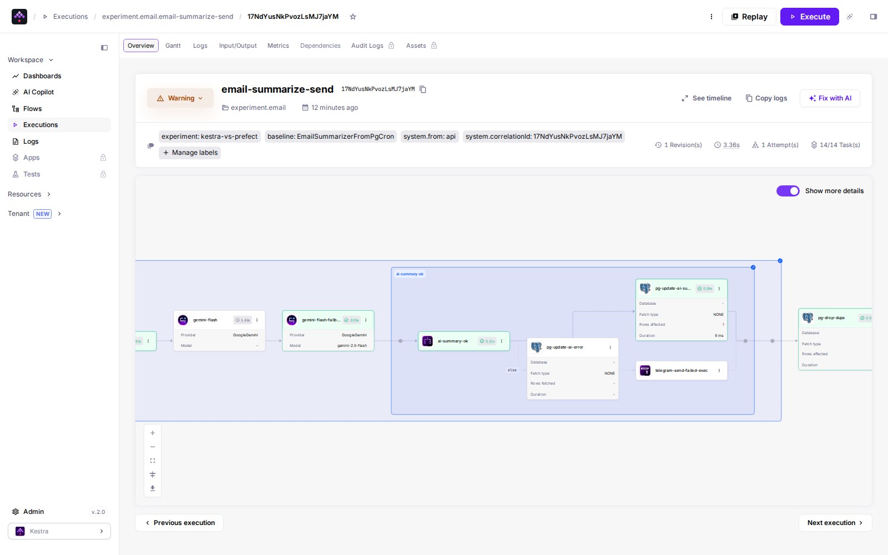
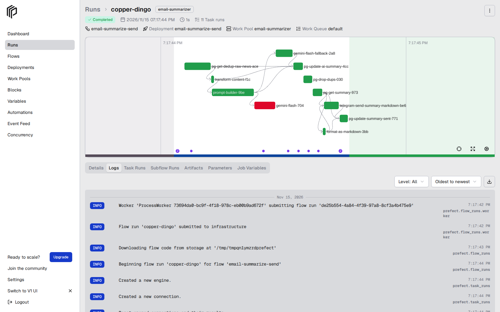

# Results: Kestra vs Prefect

The n8n Email Summarizer ([spec](../baseline/workflow-spec.md)) built twice, on **Kestra OSS 2.0.10**
and **Prefect OSS 3.9.3**, and judged on the [comparison framework](criteria.md). Everything ran
on 2026-11-15 on one Apple M1 Pro (16 GB) with Docker Desktop (VM: 10 CPUs, 7.65 GiB), one stack
at a time, against the mocks. [D-021](../decisions.md) describes how the numbers were measured.
The raw files are in [data/](data/).

## Verdict

**Both tools pass the parity gate.** Each reproduces the n8n workflow in all 13 parity scenarios,
with the same documented deviations ([parity.md](../parity.md)).

**On the weighted scorecard, Kestra comes out slightly ahead: 3.8 against 3.6 out of 5.**
That's a lean, not a clear win. With one implementation per tool and a 1-to-5 scale, doubling
the weights of footprint and secrets is enough to close the gap (see
[How sensitive the result is](#how-sensitive-the-result-is)).

**Recommendation: Kestra, if the people running the workflow will use it the way they use
n8n**, from the UI:

- Every run shows as a graph, with each task's logs and full output, including the model's
  answer and its token use.
- Backfill and Prometheus metrics come built in.
- 17 of the 23 n8n nodes map to a native task, with no code.
- It goes from edit to result in about 2 s.

The costs:

- About 700 MiB of memory for the JVM and its database.
- Secrets in the OSS edition are only base64-encoded environment variables.
- More surprises in the YAML and Pebble layer while building.

**Choose Prefect instead if the maintainers are Python developers** who want everything as
testable code, a smaller footprint (about 420 MiB) and encrypted secrets. Plan for what this
build had to add or go without on Prefect:

- An automation to catch runs whose worker died.
- An exporter for run metrics.
- No native backfill.
- Little visibility of task data in the UI.
- A worker that polls every 10 s, so each run starts 5 to 10 s late.

| Kestra is better at | Prefect is better at |
|---|---|
| Seeing what a run did: topology, Gantt, per-task logs and outputs, an expression debugger (C9) | Footprint: about 40% less memory at idle and at peak (C3) |
| Speed: first green run in 20 s, an edit live in 2 s, a tick in under 2 s (C2, C5) | Secrets in OSS: encrypted blocks, editable in the UI (C8) |
| Native tasks for SQL, HTTP and the LLM call (C4, C10) | Fewer authoring surprises; all logic is plain, unit-testable Python (C4, C5) |
| Scheduling: backfill, missed-run policy (C6) | No DSL to learn for a Python team (C13) |

## Scorecard

Scores are 1 (poor) to 5 (excellent) per tool, using the weights from
[criteria.md](criteria.md). C1 is a gate, not a score.

| # | Dimension | Weight | Kestra | Prefect | Why (details below) | Evidence |
|---|---|---|---|---|---|---|
| C1 | Behavioral parity | gate | **pass** | **pass** | 13 of 13 scenarios each, same deviations (D-019) | [parity.md](../parity.md), [Kestra run](data/parity-kestra-2026-11-15.json), [Prefect run](data/parity-prefect-2026-11-15.json) |
| C2 | Local setup | 1 | 4 | 4 | Both start with one command. Kestra: fewer services, green in 20 s, but needs the Docker socket as root and a custom image. Prefect: official images, green in 39 s. | [measurements](#measurements), [Kestra data](data/measure-kestra-2026-11-15.json), [Prefect data](data/measure-prefect-2026-11-15.json) |
| C3 | Resource footprint | 1 | 3 | 4 | Tool memory: Kestra 699 MiB idle and 825 MiB peak; Prefect 416 MiB idle and 530 MiB peak. Idle CPU is the same (about 20% of a core). | [measurements](#measurements) |
| C4 | Authoring effort | 2 | 3 | 4 | Similar code size. Kestra had more native nodes (17 vs 13), but four plugins didn't fit and its YAML/Pebble layer gave 11 surprises; Prefect gave 8, mostly library gotchas. | [LOC](data/loc-2026-11-15.json), node mappings ([K](../kestra/node-mapping.md), [P](../prefect/node-mapping.md)), effort logs ([K](../kestra/effort-log.md), [P](../prefect/effort-log.md)) |
| C5 | Developer loop | 2 | 4 | 3 | Edit to result: 2.4 s on Kestra, 22.7 s on Prefect (image rebuild plus worker poll). Prefect unit-tests all of its logic; Kestra's Pebble template can only be checked end to end. | [measurements](#measurements), effort logs |
| C6 | Triggers & scheduling | 1 | 4 | 3 | Both: cron and a concurrency limit for overlapping runs. Only Kestra has native backfill and a missed-run policy. Neither has an IMAP trigger that meets ING-1. | [screenshot](data/screenshots/kestra-08-flow-triggers.png), docs (below) |
| C7 | Error handling | 2 | 4 | 4 | Both express n8n's error branches exactly. Kestra: declarative, but fixed LLM retries, a 73 s connect timeout and a 10 s DNS window after outages. Prefect: plain Python, but a run whose worker dies stays `Running`. | [parity.md](../parity.md#same-contract-different-behavior) |
| C8 | Secrets & config | 1 | 2 | 4 | Kestra OSS: base64 env vars only (a shim was needed), no encryption at rest, secret managers are Enterprise. Prefect OSS: encrypted `Secret` blocks and variables in the UI. | READMEs ([K](../kestra/README.md#configuration-and-secrets-c8), [P](../prefect/README.md#configuration-and-secrets-c8)), [screenshot](data/screenshots/prefect-08-blocks.png) |
| C9 | Observability | 2 | 5 | 3 | Kestra: topology, Gantt, per-task logs and outputs, Prometheus on by default. Prefect: a clear run graph and tracebacks, but task inputs are references, outputs aren't kept, and metrics are off and hold no run data. | [screenshots](#c9-observability) |
| C10 | LLM integration | 1 | 4 | 3 | Kestra: a native Gemini task with a base-URL override and many providers, but no 4xx fallback and fixed retries. Prefect: no integration; Google's SDK in a task. | node mappings |
| C11 | Version control / GitOps | 1 | 4 | 4 | Both deploy from the repo with one command. Kestra: a 35-line REST script that also deletes removed flows; UI edits drift until the next deploy. Prefect: the stock CLI, code baked into the image, but removed deployments aren't deleted. | READMEs ([K](../kestra/README.md#deploying-from-the-repo-c11), [P](../prefect/README.md#deploying-from-the-repo-c11)) |
| C12 | Operations & scaling | 1 | 3 | 3 | Kestra: LTS releases with a year of support and a single process, but a 700 MiB JVM, the Docker socket, and many Enterprise-only features. Prefect: lighter, with a documented OSS scale-out, but no LTS and do-it-yourself zombie detection. | docs (below), effort logs |
| C13 | Learning curve & team fit | 2 | 4 | 4 | Kestra: a UI and topology close to n8n, but YAML plus Pebble. Prefect: plain Python with current docs, but more concepts (deployments, work pools, workers, blocks) and little data in the UI. | effort logs |
| | **Weighted score** (sum of score × weight ÷ 17) | | **3.76** | **3.59** | | |

## Measurements

From `make measure-kestra MEASURE_ARGS="--cold"` and `make measure-prefect MEASURE_ARGS="--cold"`
([D-021](../decisions.md)). "Tool" is the tool's own containers. The shared infra (app-db,
GreenMail and the two mocks) adds about 210 MiB to either stack.

| | Kestra 2.0.10 | Prefect 3.9.3 |
|---|---|---|
| Services the tool adds to the 4 shared ones | 2: `kestra` (one JVM: API, UI, scheduler, executor, worker) and `kestra-db` | 3: `prefect-server`, `prefect-worker` and `prefect-db`, plus the one-shot `prefect-deploy` |
| Compose file | 110 lines | 107 lines |
| Tool images on disk | `wfx-kestra:local` 830 MB, plus the 145 MB `python` image for script tasks | `wfx-prefect:local` 917 MB, which contains the 787 MB server image |
| All of the stack's images, shared layers counted once | 1,605 MB | 1,692 MB |
| Clean clone to first green run: pull + build + start and first tick | **69 s** (11 + 34 + 24) | **85 s** (15 + 29 + 41) |
| `make <tool>-up`: healthy and deployed (median of 3) | 14.2 s (tool healthy at 13 s) | 20.5 s (server healthy at 12.5 s, worker at 16 s) |
| `make <tool>-up` to the first green run (median of 3) | **20.4 s** | **38.6 s** |
| Idle memory, tool (after 5 min, schedules on, no mail) | 699 MiB (JVM 601) | 416 MiB on average; 594 MiB while a run's process exists |
| Idle CPU, tool (% of one core) | 20% | 21% |
| Peak memory during the parity happy path: tool / whole stack | **825 / 1,058 MiB** | **530 / 755 MiB** |
| Happy path: ingest 9 emails, then 10 ticks | 21.5 s | 114 s |
| One tick, from the API call to the end state | 1.6 to 1.9 s | 7 to 12 s, mostly the worker's 10 s poll |
| Unit tests with the stack down (`make test-<tool>`) | 141 passed, 0.3 s | 127 passed, 1.2 s |
| Edit a module, redeploy, an email is sent (median of 3) | **2.4 s** (`make kestra-deploy` 0.3 s + tick) | **22.7 s** (`make prefect-up` 10 to 20 s + tick) |

Code size, in code lines (no blanks, comments or docstrings), from `make loc`
([data](data/loc-2026-11-15.json)):

| Role | Kestra | Prefect |
|---|---|---|
| Orchestration: flows, their SQL and service calls | 336 (YAML) | 292 (`flows.py`, `sql.py`, `clients.py`) |
| Ported n8n logic (IMAP, Code nodes) | 569 | 451 |
| Glue between the tool and the logic | 81 | 86 |
| Stack and deployment | 140 | 130 |
| **Implementation total** | **1,126** | **959** |
| Unit tests | 83 | 112 |

Most of the gap is in the IMAP port. Kestra's reproduces n8n's per-part fetch, while Prefect's
parses the whole message with Python's `email` package. That's a porting choice, not a tool
property. The orchestration layers are about the same size.

## Per dimension

### C1: Behavioral parity

Both stacks pass all 13 scenarios of the [parity suite](../parity.md), from a stopped stack:
Kestra in 3 min 42 s, Prefect in 7 min 54 s. Both passed again on 2026-11-15, when the suite
was run to create the run history for the screenshots. The suite takes its expected values from
the golden vectors. It failed when deviations were planted on purpose, so it isn't lenient. Both
tools apply the deviations in [D-019](../decisions.md) the same way. Where the spec leaves room
(retries, error texts, run states), the tools differ as listed in
[parity.md](../parity.md#same-contract-different-behavior).

### C2: Local setup

Both stacks start from a clean clone with one command, and every service has a healthcheck.

**Kestra**

- Fewer containers: the whole engine is one JVM.
- Faster to green: 20 s from `up` to a sent message.
- The stock image bundles every plugin and is about 5 GB compressed. A three-plugin image was
  built from the 243 MB `-no-plugins` base instead.
- Script tasks start sibling containers through the Docker socket, which Kestra runs as root.

**Prefect**

- Uses the official image as-is for the server.
- Adds a worker image with the package installed.
- Reaches green 18 s later, mostly the worker's first polls.

### C3: Resource footprint

Prefect uses about 40% less memory: 416 against 699 MiB at idle, and 530 against 825 MiB at
peak. Kestra's JVM alone holds about 600 MiB at idle. Idle CPU is the same, about 20% of a core
for either tool:

- Kestra: the JVM and its queue polling Postgres.
- Prefect: mostly the worker, plus the ingest run's Python process once a minute.

Kestra finished the same workload more than 5 times faster (21.5 s against 114 s). So its peak
CPU is higher (216% against 130% of a core), but it is busy for less time.

### C4: Authoring effort

The implementations are about the same size (above). Both needed the same six custom ports of
n8n logic: the IMAP read and five Code or Set nodes
([K](../kestra/node-mapping.md#count), [P](../prefect/node-mapping.md#count)).

**Kestra** covered more nodes natively: 17 of 23, against 13 for Prefect plus 4 calls through
client libraries. Getting there took more workarounds:

- Four candidate plugins didn't fit the spec: the IMAP trigger, `plugin-gemini`, the AI
  `Fallback` provider and `TelegramSend`.
- 7 of the 11 surprises in the effort log were YAML and Pebble semantics:
  - `pluginDefaults` is rejected, though the release notes mention it.
  - Rendered parameters bind as `varchar`.
  - NULL columns are dropped from rows.
  - Pebble strings don't interpret `\n`.
  - `is defined` is true for a failed task.
  - Concurrency has no `SKIP` behavior.
  - A plain YAML scalar containing `: ` breaks parsing.

**Prefect's** 8 surprises were mostly library behavior:

- `Secret.get()` JSON-decodes the value.
- `fetch_one` keeps the cursor open.
- A redeploy re-activates paused schedules.

Build time: about 1 h for Kestra and 35 min for Prefect. The Prefect number isn't comparable:
it was built second, with the n8n research already done
([Prefect effort log](../prefect/effort-log.md)).

### C5: Developer loop

Both run their unit tests without the orchestrator, in about 0.1 s of test time.

**Prefect** can test all of its logic that way, including the alert text. Kestra's alert is a
Pebble template inside the flow, checked only end to end by the parity suite.

**Kestra** puts a change into the running stack about 10 times faster: a REST deploy in 0.3 s,
then a 2 s tick. Prefect's worker runs code installed in its image, so a change means a rebuild,
a new worker container and a redeploy (10 to 20 s), then a run that waits for the worker's poll.

A volume-mounted dev setup, or running flows from the laptop, would shorten Prefect's loop.
Neither was built or measured here.

### C6: Triggers & scheduling

Both use cron schedules declared in the repo, and both have a concurrency limit that drops an
ingest run overlapping the previous one: `CANCEL` on Kestra, `CANCEL_NEW` on Prefect.

**Kestra** adds two things:

- Backfill, in the UI ([screenshot](data/screenshots/kestra-08-flow-triggers.png)) and the API.
- `recoverMissedSchedules` (`ALL`, `NONE` or `LAST`) for ticks missed while it was down
  ([docs](https://kestra.io/docs/workflow-components/triggers/schedule-trigger)).

**Prefect** has no native backfill. The documented route is `prefect deployment run --start-at`
in a loop ([docs](https://www.prefect.io/docs/v3/api-ref/cli/deployment.md)). Runs scheduled
before an outage are marked `Late` and all run when the worker returns.

Neither tool has an email trigger that meets ING-1:

- Kestra's `MailReceivedTrigger` loses the sender's display name, merges the text parts and
  never marks mail read.
- Prefect has none.

Both poll IMAP from a schedule (Q-8).

### C7: Error handling

Both reproduce n8n's error branches exactly, including "an unhandled error stops the run" (F-1
to F-7, Q-15).

**Kestra** expresses them declaratively (`allowFailure`, `runIf`, `If`, `errorLogs()`), so the
branches show in the topology. Its run states also mark handled failures as `WARNING`. Its
defaults bite in the failure cases:

- The Gemini provider makes 3 attempts per model, and that can't be configured.
- The `Fallback` provider skips 4xx errors.
- An unreachable Telegram takes 73 s to fail.
- After a database outage, runs keep failing for 10 s. The JVM caches the failed DNS lookup.

**Prefect** uses plain control flow (`return_state=True`), so retries are the client's to set,
and failures are quick. Its gap is a run whose worker process dies: it stays `Running`. Catching
it on a self-hosted server needs an automation on missing heartbeats; Prefect Cloud has it as a
one-click policy ([docs](https://www.prefect.io/docs/v3/advanced/detect-zombie-flows.md)).

### C8: Secrets & config

**Kestra OSS** reads secrets only from base64-encoded `SECRET_*` environment variables. The docs
say there is "no encryption at rest, no audit trail"
([docs](https://kestra.io/docs/concepts/secret)). Compose can't encode, so a small entrypoint
script does it. Vault, the cloud secret managers and Kestra's own secret store are Enterprise.
Values are masked in logs.

**Prefect OSS** has three mechanisms:

- `Secret` blocks and the DB connector's password, encrypted at rest. The key is stored in the
  same database unless `PREFECT_SERVER_ENCRYPTION_KEY` is set.
- Plain variables for the rest of the config.
- `AwsSecret` and `GcpSecret` blocks for external managers.

All of it is visible and editable in the UI ([blocks](data/screenshots/prefect-08-blocks.png),
[variables](data/screenshots/prefect-09-variables.png)). One gotcha: `Secret.get()` JSON-decodes
the value.

### C9: Observability

The same parity runs in both UIs. F-1 is the primary model failing and the fallback answering;
Q-15 is the alert being rejected and the tick failing.

| What | Kestra | Prefect |
|---|---|---|
| Run history | [executions](data/screenshots/kestra-01-executions.png): list, counts and duration chart | [runs](data/screenshots/prefect-01-runs.png): list and duration scatter |
| One run's structure | [topology](data/screenshots/kestra-02-f1-overview.png): the flow's graph with each task's state and duration, including untaken branches; [Gantt](data/screenshots/kestra-03-f1-gantt.png) | [run graph](data/screenshots/prefect-02-f1-run.png): task runs on a timeline, with data dependencies (only the tasks that ran) |
| Logs | [per task and attempt](data/screenshots/kestra-04-f1-logs.png); [Q-15](data/screenshots/kestra-06-q15-logs.png) shows Telegram's 400 response | per run and per task, with tracebacks ([F-1](data/screenshots/prefect-03-f1-failed-task.png), [Q-15](data/screenshots/prefect-06-q15-failed-task.png)) |
| Task inputs and outputs | [every output](data/screenshots/kestra-05-f1-outputs.png) (the model's answer, token use) with an expression debugger | [inputs](data/screenshots/prefect-04-f1-task-inputs.png) are references to upstream runs. Outputs aren't kept unless result storage is configured ("Not configured" on the [blocks page](data/screenshots/prefect-08-blocks.png)). |
| Client retries | Not visible as attempts: the plugin retries inside one attempt | One attempt, so nothing to see; task-level retries show in the task's configuration |
| Metrics | Prometheus at `:8081/prometheus`, on by default, with per-flow execution and task-run metrics ([sample](data/screenshots/kestra-metrics.txt)) | `/api/metrics` is off by default ([404](data/screenshots/prefect-metrics.txt)) and holds no run metrics when on. Run metrics need the separate [prometheus-prefect-exporter](https://github.com/PrefectHQ/prometheus-prefect-exporter). |

| Kestra: F-1 execution | Prefect: F-1 flow run |
|---|---|
|  |  |

The screenshots come from `make screenshots-kestra` and `make screenshots-prefect`. The browser
blocked every request outside the stack, so Prefect's block icons, which load from a CDN, show
as broken images.

### C10: LLM integration

**Kestra**'s `plugin-ai` has a `GoogleGemini` provider with a `baseUrl` override, among about 20
providers ([plugin](https://kestra.io/plugins/plugin-ai)). Swapping providers is a change in
YAML. Two limits:

- Its `Fallback` provider doesn't fall back on 4xx errors, so the fallback is two tasks.
- Its retries can't be configured.

`plugin-gemini` has no base-URL override, so it couldn't target the mock. The OSS UI also has
an AI Copilot (Gemini) and a "Fix with AI" button.

**Prefect** has no Gemini integration. Its documented AI path is Pydantic AI's `PrefectDurability`,
which is more machinery than one prompt with a fallback. So Google's SDK runs in a plain task,
which gives full control in a few lines.

### C11: Version control / GitOps

**Kestra**: flows and namespace files are in the repo. A 35-line script
([deploy.sh](../../kestra/deploy.sh)) pushes them through the REST API with `delete=true`, so
flows removed from the repo are removed from Kestra. Edits in the UI editor are possible but
drift until the next deploy, and Kestra keeps revisions.

**Prefect**: deployments are declared in [prefect.yaml](../../prefect/prefect.yaml) and applied
with the stock `prefect deploy --all`. The code is baked into the worker image, so it can't
drift. Blocks and variables can be edited in the UI until the next deploy. Removed deployments
aren't deleted, and a redeploy re-activates paused schedules.

### C12: Operations & scaling

**Kestra**:

- Runs as one process (`server standalone`).
- On the Postgres backend, the OSS edition can split into webserver, scheduler, executor and
  worker, and scale each ([architecture](https://kestra.io/docs/architecture/deployment-architecture)).
- The HA guide labels HA as available in OSS, but the Enterprise page lists it as an Enterprise
  feature.
- Releases: an LTS every 6 months, supported for a year, with weekly patches
  ([releases](https://kestra.io/docs/releases)).
- Enterprise-only ([pricing](https://kestra.io/pricing)): secret managers, RBAC, SSO, audit
  logs, worker groups, Kafka/Elasticsearch backends, Kubernetes task runners.
- Costs here: the JVM's memory, its DNS caching, and root access to the Docker socket for script
  tasks.

**Prefect**:

- The self-hosted server scales out in OSS: several API servers, background services and Redis
  ([self-hosted](https://www.prefect.io/docs/v3/advanced/self-hosted.md)).
- Releases: minor versions every 2 to 3 months, which may break things, with weekly patches and
  no LTS ([versioning](https://www.prefect.io/docs/v3/release-notes/versioning.md)).
- Cloud-only: RBAC, SSO, audit logs, push work pools, and one-click unresponsive-run detection
  ([server](https://www.prefect.io/docs/v3/concepts/server.md)).

**Both**:

- Apache-2.0.
- Migrate their database automatically at startup.
- Their UIs contact outside hosts from the viewer's browser, even with the server's usage
  reporting off. Kestra contacts `api.kestra.io`; Prefect contacts an Amplitude config host, a
  CMS CDN and GitHub (seen while taking the screenshots; not investigated further).

### C13: Learning curve & team fit

**Kestra** gives an n8n user a familiar shape: a UI-first tool with a topology view, per-task
data, a no-code editor and plugin docs inside the editor. The cost is learning YAML plus Pebble.
That layer caused most of the friction here, and the 2.0 docs lagged behind 2.0's behavior.

**Prefect** asks for Python, plus its own concepts: flows, tasks, deployments, work pools,
workers, blocks and variables. The docs were current (each page has a Markdown version) and
answered every question. Debugging happens in code and tracebacks, not in the UI.

This workflow needs code on both tools: 6 of its 23 nodes are custom logic either way. The tie
reflects that either team profile can succeed here.

## How sensitive the result is

| Weights | Kestra | Prefect |
|---|---|---|
| As in [criteria.md](criteria.md) | 3.76 | 3.59 |
| All equal | 3.67 | 3.58 |
| C9 (observability) at 1 instead of 2 | 3.69 | 3.63 |
| C3 and C8 (footprint, secrets) at 2 instead of 1 | 3.63 | 3.63 |
| C3 and C8 at 2, and C9 at 1 | 3.56 | 3.67 |

The tools tie if footprint and secrets weigh as much as authoring. Prefect leads if, in
addition, the UI matters less, as it does for a team that debugs in code. The owner can change
the weights. A change should be recorded in [decisions.md](../decisions.md) and the table
recomputed.

## Limits

- **One author, one implementation per tool, built in sequence.** Kestra was built first. The
  Prefect build benefited from the n8n research, so build times aren't comparable (C4). Neither
  implementation was copied from the other (CLAUDE.md rule 3).
- **Mocks, not real services.** Gemini, Telegram and Gmail are local mocks
  ([D-004](../decisions.md)). Latency and rate limits of the real APIs aren't measured
  (Phase 7 is the optional smoke test).
- **One host, one run of each measurement** (three for starts and the edit loop). Differences
  of a second or a few tens of MiB aren't meaningful.
- **The setup shapes some numbers.** Prefect's code-in-the-image worker sets its edit loop.
  Kestra's Docker task runner sets the Docker-socket requirement. Other documented setups would
  change those rows: Prefect with a mounted volume, Kestra with the process runner.
- **Not evaluated:** high-availability setups, large volumes, and the paid editions
  ([D-006](../decisions.md)).

## Evidence files

| File | What it holds | Produced by |
|---|---|---|
| [data/measure-kestra-2026-11-15.json](data/measure-kestra-2026-11-15.json), [data/measure-prefect-2026-11-15.json](data/measure-prefect-2026-11-15.json) | C2, C3 and C5: images, cold and warm starts, per-service healthy times, idle and peak `docker stats` (with a time series), edit loops, unit tests; host, versions, commands | `make measure-<tool> MEASURE_ARGS="--cold"`, with later `--update` runs listed in the file |
| [data/loc-2026-11-15.json](data/loc-2026-11-15.json) | C4: lines per file and role | `make loc` |
| [data/parity-kestra-2026-11-15.json](data/parity-kestra-2026-11-15.json), [data/parity-prefect-2026-11-15.json](data/parity-prefect-2026-11-15.json) | C1, C7: every parity scenario's runs, states and durations | `make parity-<tool>` (Phase 5) |
| [data/screenshots/](data/screenshots/) | C9: the UI walkthrough, plus a metrics sample per tool | `make screenshots-<tool>` after `make parity-<tool>` |
