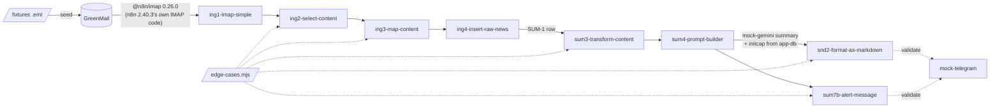

# Golden vectors (Phase 2)

Golden vectors are the referee for every piece of logic that Kestra and Prefect port from n8n
(CLAUDE.md rule 4). Each vector pairs an input with the output that **the original n8n code
produced**. The code and expressions are taken from `baseline/*.json` and run unmodified. An
implementation passes when it reproduces every `output` **byte for byte**.



## Regenerating

```bash
make golden         # start the infra, reseed the mail, run the generator in Docker, reseed again
make golden-check   # make golden, then fail if tests/golden/vectors differs from what's committed
```

The generator runs in `node:26.7.0-alpine3.24`, the Node version of the production n8n 2.40.3 image, with
locked dependencies (`tests/golden/package-lock.json`). It joins the infra network, so the host
needs no Node install. Output is deterministic: `$now` is frozen at
`2026-11-14T12:00:00.000-03:00`, nothing records a timestamp, and the case order is stable.
Three runs on 2026-11-14, one of them against freshly recreated infra, gave identical files. After
the switch to the production schema (D-018), two more consecutive runs also matched each other.

## Provenance

| Piece | What is run | Reference |
|---|---|---|
| ING-1 IMAP read | `ImapSimple.connect`, `search(['UNSEEN'], {bodies: ['TEXT','HEADER'], markSeen: false, struct: true})`, `downloadText`, and the node-imap-parsed `HEADER` part, from **`@n8n/imap@0.26.0`** (imap 0.8.19, quoted-printable 1.0.1, utf8 3.0.0, iconv-lite 0.6.3) | Glue mirrors `EmailReadImap/v2/utils.ts` at tag **`n8n@2.40.3`**, the owner-confirmed production version (D-017) |
| Code nodes | `jsCode` from the baseline JSON via `new Function('$input', code)`, with `$input.all/first/last` | Each file records `code_sha256` |
| Set node, Postgres column maps, Telegram template | The `={{ … }}` expressions from the baseline JSON, evaluated with `$json`, `$now` and `$()` shims | Each file records the sha256 of what it evaluated |
| `initcap()` (SND-1) | The real app-db: PostgreSQL 18.7, ctype `en_US.utf8`, locale provider `c` | Recorded in `snd2…notes` |
| Fresh-row defaults (SUM-1, SND-1 rows) | Read from app-db with a rolled-back insert: `translate_language = 'pt-BR'`, `summary_retry = sent_retry = -1` | The production schema (D-018). Recorded in `sum3…notes` |
| LLM summary | mock-gemini (deterministic per prompt and model), primary model, system message "You are a helpful assistant" (Q-13) | [infra.md](infra.md#mock-gemini) |
| Telegram verdict | mock-telegram parses the message as MarkdownV2 or HTML | D-012 |

The shim only implements what the baseline uses. Anything else throws, so a missing piece can't
quietly change an output. Production runs **n8n 2.40.3** (D-017). As a cross-check, the vectors were
also generated with the n8n 2.47.7 stack (`@n8n/imap@0.33.0` on imapflow and libmime, Node 26.13.0):
all 115 case outputs were identical.

## Files (`tests/golden/vectors/`)

| File | Spec | Cases (fixture + edge) | Input to output |
|---|---|---|---|
| `ing1-imap-simple.json` | ING-1 | 9 + 0 | fixture path to `{from, to, subject, date, textHtml, textPlain}` exactly as n8n delivers them |
| `ing2-select-content.json` | ING-2 | 9 + 2 | IMAP item to `{from, subject, date, htmlContent, plainContent}` |
| `ing3-map-content.json` | ING-3 | 9 + 15 | ING-2 output to `{from_name_id, from_name, from_email, translate, category, date, date_gmt3, subject, raw_content}` |
| `ing4-insert-raw-news.json` | ING-4 | 9 + 15 | ING-3 output to the column values inserted into `news_email` |
| `sum3-transform-content.json` | SUM-3 | 8 + 3 | SUM-1 row to `{news_id, from, subject, date, to_translate, translate_language, content}` |
| `sum4-prompt-builder.json` | SUM-4 | 8 + 3 | SUM-3 output to `{model, modelFallback, prompt}` |
| `sum7b-alert-message.json` | SUM-7b | 2 + 1 | `{now, error, transform-content, prompt-builder}` to `{text, parse_mode}` plus a Telegram verdict |
| `snd2-format-as-markdown.json` | SND-2 | 8 + 14 | SND-1 row to `{news_id, initialMessageLength, finalMessageLength, telegramMessage}` plus a Telegram verdict |

Fixture `03-the-news-duplicate` stops after ING-4, because DUP-1 deletes it before it can be summarized.

### Format

```json
{
  "spec": "SND-2",
  "source": { "workflow": "...", "node": "format-as-markdown", "code_sha256": "..." },
  "generator": { "script": "tests/golden/src/generate.mjs", "node": "v26.7.0", "now": "..." },
  "notes": "...",
  "cases": [
    {
      "id": "fixture:01-morning-brew",
      "tags": ["fixture"],
      "input": { },
      "output": { },
      "mock_telegram": { "status": 200, "ok": true, "result_text": "..." }
    }
  ]
}
```

- `id` is stable and unique within a file. The prefix is `fixture:` or `edge:`. **IDs are append-only.** Never renumber them or reuse one.
- `tags`: `fixture`, `edge`, and `quirk:Q-n` where a case shows a quirk.
- `mock_telegram` appears only on the files that send to Telegram. When `ok` is true, `result_text` is what SND-4 stores as `formatted_summary`. When `ok` is false, the send fails and SND-5 applies (the `description` becomes `sent_status`, which n8n's Telegram node confirms: D-019).

### How implementations use them

1. Load each file and, for every case, call the tool's port of that step with `input`. Assert
   that the result equals `output`: same keys, same types, same strings byte for byte. Unit tests
   do this without the orchestrator running.
2. ING-1 is checked one level up. The tool's IMAP step, run against the seeded GreenMail, must
   produce the five fields in `ing1-imap-simple.json` for each fixture.
3. The `mock_telegram` verdicts and the ING-4 rows feed the end-to-end parity suite (Phase 5).

## What the vectors pin down

These are facts from the vectors that a port can easily get wrong:

| # | Behavior | Where | Consequence for ports |
|---|---|---|---|
| G-1 | **Bodies keep CRLF line endings.** `textPlain`/`textHtml` come back transfer-decoded and converted to UTF-8, with the raw `\r\n` intact. | ING-1, then `email_raw_content` (ING-4) | Python's `email` `get_content()` turns CRLF into LF. Ports must keep CRLF to match ING-4. SUM-3 removes `\r` and `\n` anyway, so prompts aren't affected. |
| G-2 | **Header values are MIME-decoded but otherwise raw.** Quotes stay (`"Morning Brew" <…>`), and RFC 2047 words are decoded (`🧠 The Neuron <…>`). | ING-1 `from` | Don't run `From` through an address parser that drops quotes or re-serializes it. |
| G-3 | **JavaScript string coercion.** A `null` language gives `"... using null language ..."`, and `content` null becomes `''`. | SUM-4 `edge:nulls` | Python ports must print `null`, not `None`. |
| G-4 | **Dates go through V8 parsing, then a fixed −3 h.** `(UTC)` comments, `GMT`, `EST`, a missing weekday and single-digit hours all parse. The day of month isn't padded. | ING-3 `edge:date-*` | Checked on 2026-11-14: `email.utils.parsedate_to_datetime` resolves every fixture and edge date to the same instant as V8. The formatting (`%-d`, English names) is the part to get right. |
| G-5 | **Regex corner cases in sender parsing.** `<only@addr>` and `Name With "Quote" <…>` don't match, so the slug is `''` and the category falls back to `tech`. | ING-3 `edge:from-*` | Port the regex literally, without "improving" it. |
| G-6 | **The ASCII filter drops accents and emoji outright**, without transliterating. `Café Brasil` becomes the slug `caf-brasil`, and `ação` becomes `ao` in prompts. | ING-3, SUM-3 | Use a `[^\x20-\x7E]` filter, not `unicodedata` normalization. |
| G-7 | **A message can be valid MarkdownV2 and still be rejected for length.** 1,400 sentences grow to 5,750 chars after escaping and are rejected with `message is too long`. | SND-2 `edge:too-long-after-escaping` | That's a real path to SND-5 (send error, then summarize again). |
| G-8 | **Unescaped alert values break the HTML parse** (Q-15). The alert itself fails with `Unsupported start tag "today"`. | SUM-7b `edge:q15-html-in-subject` | Keep this for parity. Don't HTML-escape the alert. |
| G-9 | `initcap()` in SND-1 capitalizes after any non-alphanumeric character (`Lenny'S Newsletter`, `☕ Markets Rally …`). | SND-2 fixture inputs | Comes from the database. Ports run SND-1 verbatim and don't reimplement it. |

## Adding cases

1. Add the input to `tests/golden/src/edge-cases.mjs` with a new, unique `edge:` ID.
2. Run `make golden`, review the diff in `tests/golden/vectors/`, and commit the source and vectors together.
3. New fixture emails go in `fixtures/generate.py` and then `make fixtures`. The generator expects exactly 9 for now. Raise that count when adding fixtures.
