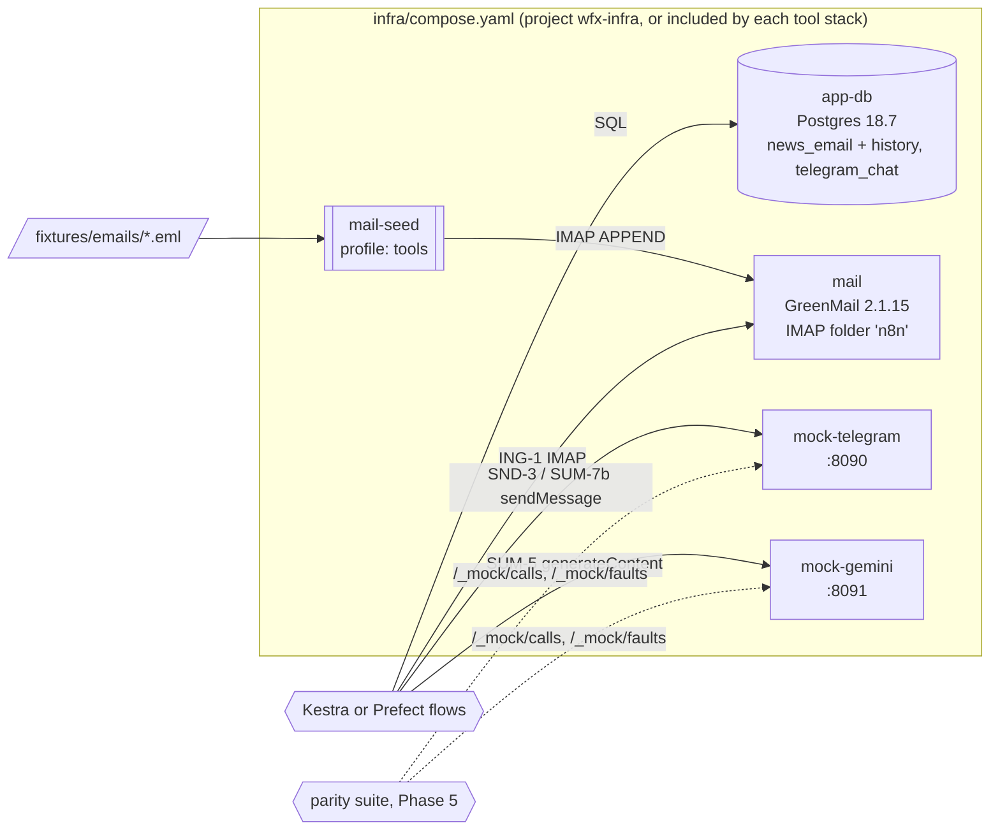

# Shared local infrastructure (Phase 1)

Both orchestrators run against the same local stand-ins for the baseline's external services
(decision D-004). This page covers what runs, how to drive it, and where the mocks differ from the
real services.



## Quick start

```bash
make infra-up      # build the mocks image, start everything, wait until all four services are healthy
make seed          # empty the 'n8n' mailbox and load the 9 fixture emails as UNSEEN
make infra-check   # DB tables, enum, telegram_chat rows; mock health; mailbox counts
make schema-check  # diff app-db's \d+ output against the production schema (docs/baseline/prod-schema.md)
make reset         # infra-down + infra-up + seed (about 11 s on the dev host)
make infra-down    # stop and delete volumes
```

Each tool stack (`make kestra-up`, `make prefect-up`) pulls these services in with `include:`
under its own project name, so it gets its own copy with fresh volumes. Run one stack at a time:
they use the same host ports.

Configuration comes from `.env` when it exists, otherwise from the committed `.env.example`
(local-only placeholders). Every compose variable is required (`${VAR:?}`), so a missing value
fails loudly instead of silently falling back to a default.

## Services

| Service | Image (pinned) | Host port to container | Health check |
|---|---|---|---|
| `app-db` | `postgres:18.7-alpine3.24` | 5433 to 5432 | `pg_isready` over TCP. Only turns healthy after the init scripts have run. |
| `mail` | `greenmail/standalone:2.1.15` | SMTP 3025, IMAP 3143, IMAPS 3993, API 8083 to 8080 | IMAP greeting read through bash `/dev/tcp`. The image has no curl or wget. |
| `mock-telegram` | `wfx-mocks:local` (built from `python:3.12.16-slim-trixie`) | 8090 | `GET /_mock/health` |
| `mock-gemini` | `wfx-mocks:local` | 8091 | `GET /_mock/health` |
| `mail-seed` | `wfx-mocks:local` (profile `tools`, run on demand) | none | none |
| `golden` | `wfx-golden:local` (built from `node:26.7.0-alpine3.24`; profile `tools`, run by `make golden`) | none | none. See [golden.md](golden.md). |

All images have arm64 builds, checked on Docker Hub on 2026-11-14. Observed on the dev host
(Apple Silicon, Docker Desktop with 7.65 GiB) with the stack idle: about 126 MiB for `mail`
(JVM), 32 MiB for `app-db`, and 18 to 19 MiB for each mock. That's a single `docker stats`
sample. The Phase 6 measurements will supersede it.

### app-db

- Schema: `infra/db/init/001_schema.sql` reproduces the **production schema** (D-018; see [baseline/data-model.md](baseline/data-model.md)). That includes the `translate_language` default `'pt-BR'`, retry counters starting at -1, and the `news_email_history` audit table with its trigger. Two parts aren't in the production output: the enum labels are [inferred] and the trigger function's body is [assumed]. `make schema-check` diffs the `\d+` output against production.
- `infra/db/init/002_seed_telegram_chat.sh` fills `telegram_chat` with one row per category from `TELEGRAM_CHAT_ID_{NEWS,FINANCE,TECH}`. `environment` stays at its default `'prod'`, and `chat_name` gets a placeholder. The values pass through as psql variables, never concatenated into SQL.
- The audit trigger writes a `news_email_history` row for every insert and update, so the parity suite can count each tool's writes per email.
- Init scripts run only on an **empty** volume. Run `make reset` after changing them.
- Postgres 18 images keep their data under `/var/lib/postgresql`, not `.../data`. The volume is mounted at that path.

### mail (GreenMail)

- There is one real user: `IMAP_USER` / `IMAP_PASSWORD` (`newsletters` / `local-only`). The image's default `auth.disabled` is turned off, so a wrong password is rejected, as with Gmail.
- The mailbox `IMAP_MAILBOX` (`n8n`) is a top-level IMAP folder, the same way a Gmail label appears over IMAP.
- IMAPS on 3993 uses GreenMail's self-signed certificate. Clients must skip verification. Plain IMAP on 3143 is the default (`IMAP_SECURE=false`).
- Mail is kept **in memory**: restarting the container empties the mailbox, so run `make seed` again.

### Seeding (`scripts/seed_mail.py`)

Fixtures are loaded with **IMAP APPEND**, not SMTP. Each message lands directly in the `n8n`
folder, has no flags (so it's UNSEEN, as ING-1 needs), and keeps its original `Date` as INTERNALDATE.
`--purge` empties the folder first. `--only '0[12]-*'` loads a subset. `--check` prints the counts.

## Mock control API (both mocks)

| Call | Effect |
|---|---|
| `GET /_mock/health` | `{"ok": true, "service": ...}` |
| `GET /_mock/calls` / `DELETE /_mock/calls` | Recorded upstream calls (request, status, response), oldest first, or clear them |
| `POST /_mock/faults` | Queue a fault: `{"when": {...}, "status": 500, "count": 1, "description": "...", "delay_ms": 0}` |
| `GET /_mock/faults` / `DELETE /_mock/faults` | List or clear queued faults |
| `POST /_mock/reset` | Clear both calls and faults |

`when` is matched against request attributes. An empty `when` matches everything, and
`count: -1` makes the fault permanent. Telegram matches on `method` and `chat_id`. Gemini matches
on `model` (no `models/` prefix), `action` and `api_version`.

Examples for the fault scenarios in [comparison/criteria.md](comparison/criteria.md):

```bash
# F-1: primary model down, fallback fine
curl -s localhost:8091/_mock/faults -d '{"when":{"model":"gemini-flash-lite-latest"},"status":503,"count":-1}'
# F-2: both models down
curl -s localhost:8091/_mock/faults -d '{"status":500,"count":-1}'
# F-3 happens naturally whenever a message isn't valid MarkdownV2. To force it:
curl -s localhost:8090/_mock/faults -d '{"when":{"method":"sendMessage"},"status":400,"description":"Bad Request: can'"'"'t parse entities: forced"}'
```

## mock-telegram

`POST /bot<token>/<method>` takes JSON, form-encoded, multipart or query-string parameters, as
the real API does.

| Method | Behavior |
|---|---|
| `getMe` | Returns the mock bot. The bot id comes from the token. |
| `sendMessage` | Checks in this order: the token format (`<digits>:<secret>`, else 401); fault queue; `chat_id` present and in `MOCK_TELEGRAM_KNOWN_CHATS`, else `Bad Request: chat not found`; text not empty; parse the text for `parse_mode` `MarkdownV2` or `HTML`; rendered text no longer than 4096 UTF-16 units. On success it returns a Message whose `text` is the **rendered plain text** and whose `entities` use UTF-16 offsets. SND-4 stores that rendered text. |

**Fidelity notes** (`infra/mocks/src/mocks/telegram_text.py`):

- MarkdownV2: these characters must be escaped: `` _ * [ ] ( ) ~ ` > # + - = | { } . ! ``. Bold, italic, underline, strikethrough, spoiler, inline code, pre and text links are supported, as is `>` for a blockquote at the start of a line. Entities must nest properly.
- HTML: the tags in the Bot API docs are accepted. An unknown tag, or a `<` that doesn't start a tag, gives `Unsupported start tag "..."`. That's how quirk Q-15 shows up.
- Leading and trailing whitespace is trimmed from the rendered text, as Telegram does.
- **Approximations:** the error wording follows Telegram's style but isn't byte-identical for every case. Custom emoji, expandable blockquotes and odd nesting cases aren't modelled. In HTML mode, a bare `&` or `>` is accepted literally.

## mock-gemini

Generative Language API routes, served under both `v1` and `v1beta`:
`GET /models`, `GET /models/{m}`, `POST /models/{m}:generateContent`, and
`POST /models/{m}:streamGenerateContent` (a JSON array, or SSE with `?alt=sse`).

- An API key is required (`x-goog-api-key` header or `?key=`), else 403 `PERMISSION_DENIED`.
- Models not in `MOCK_GEMINI_MODELS` (which is set from `GEMINI_MODEL` and `GEMINI_MODEL_FALLBACK`, with the `models/` prefix stripped) get 404 `NOT_FOUND`.
- The reply is a **deterministic function of (prompt, model)**. It summarizes the first three sentences after `Content >> ` (SUM-4), and its first line names the model, so a test can tell whether the fallback answered. The output includes a `##` heading, `*   ` bullets, `**bold**` and `---`, which exercise every branch of the SND-2 formatter.
- Errors use Google's shape: `{"error": {"code", "message", "status"}}`.
- Each recorded call keeps the whole request body, including `systemInstruction`, so a parity test can check SUM-5's system message ("You are a helpful assistant").

## Fixtures (`fixtures/emails/`, from `fixtures/generate.py`)

These are synthetic newsletters. The sender display names are the ones the ING-3 rules key on.
All domains are `.example` and all body text is made up. Running `make fixtures` again produces
byte-identical files.

| File | From to expected slug | Category / translate / body (ING-3) | What it exercises |
|---|---|---|---|
| `01-morning-brew` | `"Morning Brew"` to `morning-brew` | news / yes / plain | Emoji subject (RFC 2047), stripping of `(https://…)` links, `View image:` and `Caption:` |
| `02-the-news` | `The News` (no quotes) to `the-news` | news / no / plain | Non-ASCII subject and body, `-0300` date |
| `03-the-news-duplicate` | same as 02 | same as 02 | DUP-1: same slug, subject and date, so it gets deleted |
| `04-rico-matinal` | `"Rico Matinal"` to `rico-matinal` | finance / no / **HTML** (base64) | `01:30 +0000` becomes the previous day in GMT-3 |
| `05-tech-brew` | `"Tech Brew"` to `tech-brew` | tech / yes / **HTML** (quoted-printable) | HTML body with a `(https://…)` link |
| `06-lennys-newsletter` | `"Lenny's Newsletter"` to `lennys-newsletter` | tech / yes / plain | Apostrophe in the slug; every MarkdownV2 special character; `"` replaced by `'` |
| `07-the-neuron` | `=?UTF-8?B?…?=` (🧠 The Neuron) to `the-neuron` | tech / yes / plain | Encoded display name with an emoji that gets stripped; `-0500` date crossing midnight |
| `08-no-display-name` | bare `digest@weekly.example` to `''` | tech / no / plain | Regex doesn't match, so the slug is empty (still allowed by NOT NULL) |
| `09-pragmatic-engineer` | `"The Pragmatic Engineer"` to `the-pragmatic-engineer` | tech / yes / plain | Longer body |

The *expected values* above come from reading the spec. In Phase 2, the golden vectors become the
reference: they're produced by running the original n8n JavaScript on these inputs.

## Tests and lint

```bash
make test-mocks    # 45 pytest cases: MarkdownV2/HTML parsing, both servers over real HTTP
make lint          # ruff format --check + ruff check for infra/mocks, scripts, fixtures (repo ruff.toml)
```
