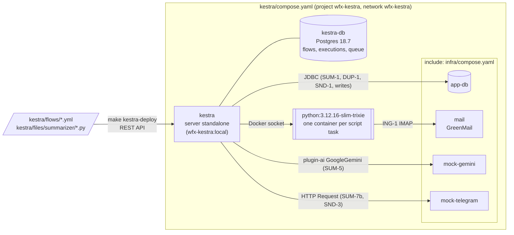

# Kestra implementation (Phase 3)

The n8n Email Summarizer ([spec](../baseline/workflow-spec.md)) on **Kestra OSS 2.0.10**, run
locally with docker compose. The two n8n workflows map to two Kestra flows in namespace
`experiment.email`. Kestra plugins do the database, LLM and HTTP work. The n8n Code-node logic
and the IMAP read are Python, deployed as namespace files.

- [node-mapping.md](node-mapping.md): which Kestra construct implements each n8n node, native or custom
- [effort-log.md](effort-log.md): friction, doc gaps and workarounds, as they happened

## Quick start

```bash
make kestra-up       # build the image, start Kestra + its DB + the shared infra, wait for healthy, deploy
make kestra-seed     # load the 9 fixture emails into the IMAP folder as UNSEEN
make kestra-run FLOW=email-ingest   # or wait: ingest polls every minute
make kestra-run      # one tick of email-summarize-send (it also runs every 10 minutes)
make test-kestra     # golden-vector tests of the Python port (no Kestra needed, except ING-1)
make kestra-down     # stop and delete the stack's volumes
```

UI and API: <http://localhost:8080>. Log in with `KESTRA_ADMIN_USER` / `KESTRA_ADMIN_PASSWORD`
from `.env` (`.env.example` has local-only placeholders). Run one stack at a time: this one
brings its own copy of `infra/`, on the same host ports.

## Architecture



- **One container**, `kestra server standalone`: webserver, scheduler, executor and worker in one
  JVM. Kestra keeps its state (flows, executions, queue) in its own Postgres, `kestra-db`.
- **Script tasks** run in a fresh `python:3.12.16-slim-trixie` container each, started through the
  Docker socket (Kestra's default Docker task runner). Task files are copied in with the runner's
  default `fileHandlingStrategy: VOLUME`, so no host directory is mounted. The ingest task joins
  the stack network to reach GreenMail. The other script tasks need no network.
- **The Python code is stdlib only**, so the task image is a stock Python image with nothing
  installed.

### Flows

| Flow | Trigger | What it does |
|---|---|---|
| [`email-ingest`](../../kestra/flows/email-ingest.yml) | Schedule `* * * * *` (polling, Q-8); concurrency limit 1, `CANCEL` | `fetch-n8n-inbox` (Python: ING-1 to ING-3, marks mail read) writes `rows.ion`; `insert_raw_news` (JDBC `Batch`) inserts them (ING-4) |
| [`email-summarize-send`](../../kestra/flows/email-summarize-send.yml) | Schedule `*/10 * * * *` (`10min-runner`) | Branch A (SUM-1 to SUM-7), then B (DUP-1), then C (SND-1 to SND-5), in n8n's canvas order |

Error handling follows n8n exactly ([D-019](../decisions.md)): the primary model's failure leads
to the fallback (`allowFailure` + `runIf`), both failing leads to SUM-7, and a Telegram rejection
or network error leads to SND-5 (`options.allowFailed` + `allowFailure`). Any other task failure
fails the run, and the tasks after it don't run until the next tick, as in n8n. A handled LLM
failure leaves the execution in `WARNING` state, where n8n would show success.

### Configuration and secrets (C8)

| Kind | Mechanism | Used as |
|---|---|---|
| Non-secret config | Compose sets `ENV_<NAME>` on the Kestra container | `{{ envs.<name> }}`, e.g. `envs.gemini_base_url` |
| Secrets (`IMAP_PASSWORD`, `APP_DB_PASSWORD`, `GEMINI_API_KEY`, `TELEGRAM_BOT_TOKEN`, `TELEGRAM_ALERT_CHAT_ID`) | Kestra OSS reads `SECRET_<NAME>` env vars, **base64-encoded**. Compose can't encode, so [`secrets-entrypoint.sh`](../../kestra/secrets-entrypoint.sh) encodes the names in `KESTRA_SECRET_NAMES` at container start. | `{{ secret('NAME') }}`, masked in logs |
| UI/API login | `kestra.server.basic-auth` in `KESTRA_CONFIGURATION` | basic auth on every API call |

Base URLs (`GEMINI_BASE_URL`, `TELEGRAM_BASE_URL`) and the IMAP host come from `.env`, so
pointing at real services is a config change (D-004).

### Deploying from the repo (C11)

[`kestra/deploy.sh`](../../kestra/deploy.sh) (`make kestra-deploy`) uses the REST API:

1. Replace the namespace files under `/summarizer` (`DELETE` then multipart `POST` per file).
2. `POST /api/v1/main/flows/experiment.email?delete=true` with all flow files as one multi-document
   YAML. Flows that aren't in the repo are deleted, so the repo stays the source of truth.

Edits made in the UI are overwritten by the next deploy. Kestra also offers a two-way file watcher
(`micronaut.io.watch`) and `server standalone --flow-path` for loading flows at startup; neither
covers namespace files, so the API is used for both.

## Versions (pinned)

| Component | Version | Notes |
|---|---|---|
| Kestra | `kestra/kestra:v2.0.10-no-plugins` (`sha256:eb1ff43d…`) | Current LTS on 2026-11-14 (`latest` and `latest-lts` point to it). Java 25. |
| `plugin-jdbc-postgres` | 3.1.1 | `Query` (named `parameters`), `Batch` |
| `plugin-script-python` | 1.18.8 | `Commands` with the Docker task runner |
| `plugin-ai` | 2.9.0 | `ChatCompletion` with the `GoogleGemini` provider (`baseUrl` override) |
| Task image | `python:3.12.16-slim-trixie` | Same base as the mocks |
| Kestra's DB | `postgres:18.7-alpine3.24` | Same image as app-db |
| Python tooling | uv, Python 3.12, pytest, ruff | `kestra/pyproject.toml`, `kestra/uv.lock` (dev only) |

Plugin versions are the newest that core 2.0.10 accepts, resolved with
`kestra plugins install <plugin>:LATEST` on 2026-11-14 and then pinned in
[`kestra/Dockerfile`](../../kestra/Dockerfile). The built image is 830 MB; the full
`kestra/kestra:v2.0.10` image, with every plugin, is about 5 GB compressed. `plugin-ai` alone is
291 MB.

## Python namespace files (C4, C5)

[`kestra/files/summarizer/`](../../kestra/files/summarizer) is uploaded to namespace
`experiment.email` and mounted into script tasks with `namespaceFiles`. Each task calls
`python -m summarizer.task <step>`, reads its input from a JSON file rendered by the flow, and
returns values with Kestra's `::{"outputs": …}::` stdout protocol.

| Module | Spec | Notes |
|---|---|---|
| `imap_simple.py` | ING-1 | Ports what n8n's IMAP trigger does with @n8n/imap 0.26.0 / node-imap 0.8.19: UNSEEN search, BODYSTRUCTURE part choice, PartData decoding, node-imap header unfolding and RFC 2047 decoding, then `\Seen`. |
| `ported.py` | ING-2, ING-3, SUM-3, SUM-4, SND-2 | The n8n Set/Code node logic. |
| `jscompat.py` | | JavaScript semantics the vectors depend on: `\s`, `trim()`, `m`-flag anchors, `String(null)`, UTF-16 `.length`, V8 date parsing. |
| `task.py` | | Entry points; puts back the NULL columns that Kestra's JDBC rows leave out (G-3). |

`make test-kestra` runs [`kestra/tests/`](../../kestra/tests) with pytest, without Kestra: every
golden vector for ING-2, ING-3, ING-4, SUM-3, SUM-4 and SND-2, plus the NULL-column variants (136
cases), unit tests of the decoders, and ING-1 against the seeded GreenMail (skipped when it isn't
running). SUM-7b's alert is a Pebble template in the flow, so it's checked end to end (below).

## Verification (2026-11-14)

Run against the mocks with `.env.example`, on the dev host (Apple Silicon, Docker Desktop).

| Check | Result |
|---|---|
| `make test-kestra` | 142 passed (136 golden cases, ING-1 against GreenMail matching all 9 fixtures, 5 decoder tests) |
| `make lint` | clean |
| `make kestra-up` from a clean state (image cached) | all 6 services healthy and flows deployed in 12 to 13 s (two runs); building the image took 2 min 12 s |
| Ingest of the 9 fixtures (`make kestra-run FLOW=email-ingest`) | SUCCESS in 3.3 s; all 9 `news_email` rows equal `ing4-insert-raw-news.json` byte for byte, CRLF kept |
| Happy tick | SUCCESS in 2.3 s. Gemini got the SUM-4 vector's prompt, the system message and the primary model on `v1beta`. Telegram got the SND-2 vector's message with `MarkdownV2` and `disable_web_page_preview`. Row 1 ended with the expected SUM-6/SND-4 values, including `formatted_summary` = the vector's rendered text. |
| F-1, primary model returns 503 | Fallback answered; `model_used` stays the primary (Q-2); row sent in the same tick. Execution `WARNING`. |
| F-2, both models return 500 | SUM-7a row update (`is_summarized` false, retry -1 to 0, primary model, error text); the alert matches `sum7b-alert-message.json` (`fixture:02-the-news`) byte for byte once the timestamp and error text are substituted. |
| F-3, Telegram returns 400 | SND-5: `sent_status` = Telegram's description, `is_summarized` false, `sent_retry` -1 to 0; execution SUCCESS. |
| SND-3 network error (mock-telegram stopped) | SND-5 with `No route to host (connect failed)`, after the HTTP client's 71 s connect timeout. |
| Q-15, `<today>` in a subject with both models failing | Telegram rejects the alert (`Unsupported start tag "today" at byte offset 108`, as in the vector); the run FAILS; DUP-1 and branch C don't run, as in n8n. |
| Q-19, duplicate fixture 03 seeded in the same batch as 02 | Same `email_consumed_at`, so DUP-1 deletes neither, as n8n would. |
| Cleanup | Task containers and their volumes are removed after each run. |

The parity suite ([parity.md](../parity.md)) now runs these checks, and F-4, F-5, F-6 and F-7, automatically:
`make parity-kestra` passed 13 of 13 on 2026-11-15.

## Known differences from n8n

All are recorded in [decisions.md](../decisions.md) and apply to both tools unless noted.

- Ingest polls every minute instead of IMAP IDLE (Q-8, D-019). An empty poll still creates a
  successful execution, so the history shows one execution a minute.
- The alert has no "sent automatically with n8n" footer (D-019).
- The model client made 3 attempts per model within about 1.5 s (plugin-ai's default; the
  GoogleGemini provider has no retry setting). n8n makes up to 7 with exponential backoff (D-019).
- Executions with a handled LLM failure end in `WARNING`, not success.
