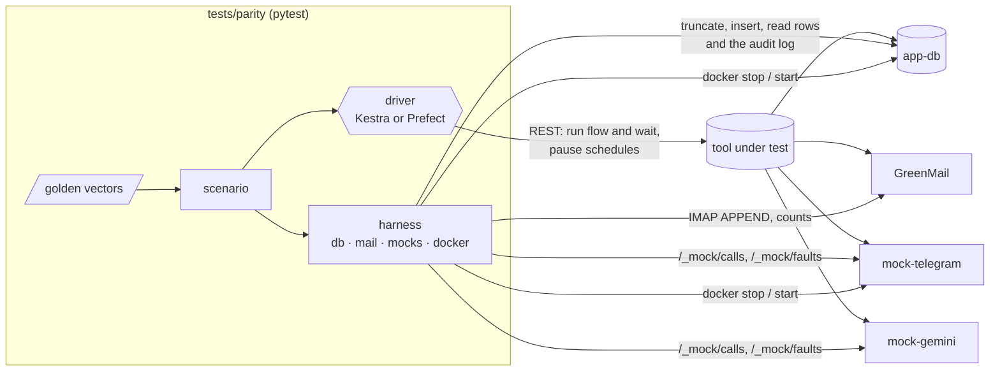

# Parity suite (Phase 5)

The parity suite decides **C1, behavioral parity**. It runs the same scenarios against the
running Kestra or Prefect stack and checks what each one does to the outside world: the rows in
app-db, the calls Gemini and Telegram receive, the mailbox, and whether the run ends as n8n's
execution would. The golden vectors ([golden.md](golden.md)) check the ported logic in
isolation. This suite checks the whole system: triggers through the tool's API, real IMAP, the
real database, and the mocks.

## Running it

```bash
make parity-kestra                        # starts the Kestra stack if needed, runs the suite, leaves the stack up
make parity-prefect                       # the same against Prefect (stop the other stack first: same host ports)
make parity-prefect PARITY_ARGS="-k f2"   # one scenario; PARITY_ARGS goes to pytest
```

- The suite needs the mock configuration of `.env.example` (D-004): mock base URLs, GreenMail,
  and the default model names that the golden vectors were generated with. It checks this at
  the start and stops with a message otherwise.
- It **pauses the tool's schedules** for the session and resumes them at the end, so only the
  suite starts runs. Runs left over from before the session get two minutes to finish and are
  then cancelled. The results file lists any it cancelled.
- It writes a results file: each test's outcome, every run's tool state and duration, and
  observations such as retry counts and client error texts. The default is
  `tests/parity/results/<tool>.json` (gitignored); `PARITY_ARGS="--results PATH"` writes it elsewhere.
  The recorded runs below are in [comparison/data/](comparison/data/).

## How it works



Before each test the harness empties `news_email` and its audit log (ids restart at 1), empties
the mailbox, and resets both mocks. A scenario then delivers fixture emails with IMAP APPEND
(or writes rows straight to app-db), injects faults, runs `email-ingest` and
`email-summarize-send` through the tool's API, waits for each run to finish, and asserts on:

| What | How |
|---|---|
| The run's outcome | The tool's terminal state, read as n8n's success or error (table below) |
| Rows | Column by column against the golden vectors: ING-4 values, SUM-4 prompts, mock-gemini's summary, the SND-2 message and its rendered text |
| Writes | The audit trigger's `news_email_history`: **one UPDATE per step**, changing exactly the columns the baseline's Postgres node changes |
| Calls | The mocks' recordings during the run: Gemini model, prompt and system message; Telegram chat, text, `parse_mode`, `disable_web_page_preview`, and the response |
| Timestamps | `summarized_at`, `sent_at`, `email_consumed_at` and the alert's `$now` fall inside the run (database clock, 2 s slack) |
| Mailbox | Message and unseen counts (ING-1 marks mail read) |

Only two things are hand-written: a fresh row's defaults (from the production schema, D-018)
and the columns each step changes (from the baseline's Postgres nodes). Everything else comes
from the golden vectors, which ran the original n8n code.

| Tool state | Kestra 2.0.10 | Prefect 3.9.3 | n8n |
|---|---|---|---|
| Counted as **completed** | `SUCCESS`, `WARNING` | `Completed` | execution succeeded |
| Counted as **failed** | `FAILED`, `KILLED` | `Failed`, `Crashed` | execution failed |

Kestra ends an execution in `WARNING` when a task failed and the flow carried on. In these
runs that happened when a Gemini call failed (F-1, F-2, F-7) or the Telegram connection failed
(SND-5), but not when Telegram answered 400 (F-3). n8n reports all of these executions as
successful, so `WARNING` counts as completed ([D-020](decisions.md)).

The only tool-specific code is the two drivers in `tests/parity/harness/drivers.py`, about 75
lines each, using plain HTTP: run a flow and wait, read and pause the schedules, list and
cancel unfinished runs.

## Scenarios

| Test | Spec | Checks |
|---|---|---|
| `test_ingest_inserts_every_fixture_as_n8n_would` | ING-1 to ING-4, Q-19 | 9 rows equal to the ING-4 vector, byte for byte; DB defaults; one `email_consumed_at` (one transaction); all mail read; 9 INSERTs; no calls |
| `test_ingest_without_new_mail_changes_nothing` | ING-1, Q-8 | An empty poll and a repeated poll insert nothing |
| `test_each_tick_summarizes_and_sends_one_email` | SUM-1 to SUM-6, DUP-1, SND-1 to SND-4, Q-11, Q-13, Q-19, F-6 | Nine ticks, one email each, in id order: the Gemini call (primary model, SUM-4 prompt, system message), the Telegram call (SND-2 message to the category chat), the SUM-6 and SND-4 values, one UPDATE each; the later rows untouched. 02 and its same-batch duplicate 03 are both kept and sent (Q-19). A tenth tick calls and writes nothing. |
| `test_f1_primary_model_fails_and_the_fallback_answers` | F-1, SUM-5, Q-2 | Primary calls all fail, then one fallback call; its answer is stored with the primary's name; sent in the same tick; no alert |
| `test_f2_both_models_fail_so_the_error_is_stored_and_alerted` | F-2, SUM-7a, SUM-7b, D-008 | Primary calls, then fallback calls, all failed; SUM-7a values and changed columns; the alert equals the SUM-7b vector apart from `$now` and the error; `$now` is America/Sao_Paulo time inside the run; the alert's error equals `summary_status`; the run completes |
| `test_f3_telegram_rejects_the_message_so_it_is_summarized_again` | F-3, SND-5, Q-11, Q-12 | `sent_status` = Telegram's description; the escaped message stored; `is_summarized` reset; the next tick summarizes it again and sends it (`summary_retry` 1, `sent_retry` 1) |
| `test_snd5_telegram_unreachable_is_handled_like_a_rejection` | SND-5 | mock-telegram stopped: the same SND-5 writes, with the client's error text; the run completes |
| `test_f4_database_down_fails_the_tick_and_the_next_tick_recovers` | F-4, D-019 | app-db stopped: the run fails, no calls, no writes; app-db back: the next tick summarizes and sends |
| `test_f5_a_duplicate_from_a_later_ingest_is_deleted` | F-5, DUP-1 | 03 ingested a run after 02: the tick deletes the later copy and sends one message |
| `test_f6_an_empty_queue_calls_nothing_and_writes_nothing` | F-6, SUM-2, SND-1a | No calls, no rows, no writes |
| `test_f7_a_row_is_left_alone_after_six_failed_attempts` | F-7, Q-17 | Six failing ticks take `summary_retry` from -1 to 5 with one alert each; the seventh calls nothing |
| `test_q15_an_alert_telegram_rejects_fails_the_tick_and_skips_the_rest` | Q-15, SUM-7a, D-019 | The `edge:q15-html-in-subject` alert is rejected exactly as in the vector; the run fails; SUM-7a was written first; DUP-1 and branch C didn't run; the next tick runs both |
| `test_schedules_match_the_baseline` | `10min-runner`, Q-8 | The declared crons: `* * * * *` for ingest, `*/10 * * * *` for the tick |

## Results

Recorded on 2026-11-15 on the dev host (Apple Silicon, macOS 26.6.2, Docker Desktop with 7.65 GiB),
with `.env.example`, each starting from a stopped stack, one stack at a time.

| | Kestra 2.0.10 | Prefect 3.9.3 |
|---|---|---|
| Scenarios passed | **13 of 13** | **13 of 13** |
| `make parity-<tool>` from a stopped stack | 3 min 42 s (the suite itself 3 min 28 s) | 7 min 54 s (the suite itself 7 min 34 s) |
| Runs the suite started | 42 | 42 |
| Median run, API call to end state | tick 1.7 s, ingest 1.0 s | tick 8.9 s, ingest 9.4 s, mostly waiting for the worker's 10 s poll |
| Leftover runs cancelled at the start | none | none |
| Recorded run | [parity-kestra-2026-11-15.json](comparison/data/parity-kestra-2026-11-15.json) | [parity-prefect-2026-11-15.json](comparison/data/parity-prefect-2026-11-15.json) |

Each file has the date, host, tool version, the exact command, every test's outcome, every
run's tool state and duration, and the notes below. Each suite had also passed one full development run earlier the
same day. Kestra's first development run failed F-4's recovery tick and the four scenarios after it, all
inside the 10 s DNS window described below, which led to the 15 s settle time.

## Same contract, different behavior

These all pass, because the spec leaves them to the tool ([D-019](decisions.md): client
retries and client error texts aren't part of the contract). They're evidence for C7 and C12.

| Observation | Kestra | Prefect | Contract |
|---|---|---|---|
| Run state after a handled failure | `WARNING` for F-1, F-2, F-7 and SND-5; `SUCCESS` for F-3 | `Completed` | n8n reports success; both count as completed (D-020) |
| Model attempts before the fallback or the error path (F-1, F-2) | 3 per model | 1 per model | Not compared (D-019). n8n makes up to 7 per model, with backoff. |
| `summary_status` and the alert's error (F-2) | The response's JSON body: `{"error": {"code": 500, "message": "Mock fault 500 for models/gemini-2.5-flash", "status": "INTERNAL"}}` | The message: `Mock fault 500 for models/gemini-2.5-flash` | Wording not compared (D-019). In both, the alert's error equals `summary_status`, as with n8n's `get-error`. |
| Telegram unreachable (SND-5) | 73 s, then `No route to host (connect failed)` | 7 s, almost all of it the worker poll, then `[Errno -2] Name or service not known` | Both store the client's message, as the spec allows |
| app-db down when the tick starts (F-4) | `FAILED` after 20 s | `Failed` after 10 s, including the poll | Both fail with no writes and no calls, and the next tick recovers |
| Right after an outage | A run can still fail for up to 10 s: the JVM keeps a failed DNS lookup that long | Not seen | The suite waits 15 s before the next run (D-020); real ticks are 10 minutes apart |
| A run whose worker process died | Not seen | Stays `Running` until cancelled. A self-hosted server needs an automation on missing heartbeats to mark it `Crashed`. | Not in the contract; evidence for C12 |

Details for each tool are in its effort log ([Kestra](kestra/effort-log.md), [Prefect](prefect/effort-log.md)).

## Does the suite catch deviations?

A suite that passes on both tools could just be lenient. On 2026-11-15, two deliberate
deviations were built into the Prefect worker image, then reverted:

| Deviation | Result |
|---|---|
| The system message with a trailing period (`"You are a helpful assistant."`) | The happy path and F-1 failed on the system-message assertion |
| The alert's subject HTML-escaped, which removes Q-15 | Q-15 failed: the run ended `Completed` instead of failed, because Telegram accepted the escaped alert |

## Limits

- **F-4 takes the database away before the tick starts.** A failure in the middle of a tick, for
  example between the summary and its UPDATE, isn't simulated. It wouldn't be deterministic,
  and n8n doesn't make a tick atomic either.
- **Outages settle for 15 s** before the next run, as a stand-in for the 10 minutes until the
  next real tick. Without it, a Kestra run right after the restart can fail (see above).
- n8n itself doesn't run ([D-009](decisions.md)). The expected values are the golden vectors and the spec.
- Overlapping runs (Q-16) aren't part of parity. Each tool's README describes its concurrency control.
- The schedule test checks the declared crons, not that runs fire on time. That was observed
  by hand in Phases 3 and 4 (each tool's README).
- End to end, ING-1 covers the 9 fixtures. Other encodings are unit-tested per tool against the
  same decoding rules.
- The mocks' fidelity limits apply ([infra.md](infra.md#mock-telegram), D-012). Real services are Phase 7.

## Adding a scenario

1. Put it in `tests/parity/test_*.py` with the `world` fixture. Take expected values from
   `harness.expected` (the golden vectors), not from either tool's code (CLAUDE.md rule 3).
2. Run it against both stacks. A scenario that only one tool passes is a parity finding:
   record it here with the requirement ID, and fix the implementation or log a deviation.
