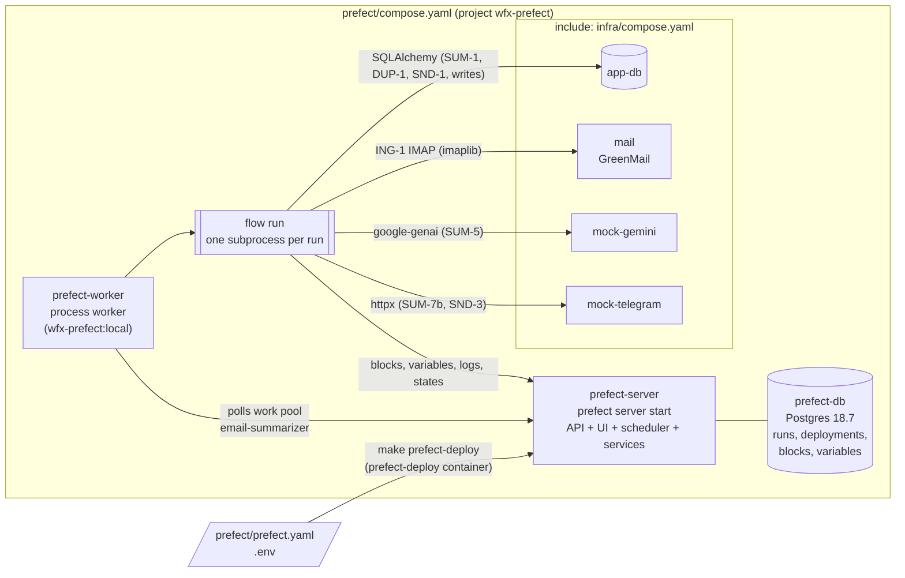

# Prefect implementation (Phase 4)

The n8n Email Summarizer ([spec](../baseline/workflow-spec.md)) on **Prefect OSS 3.9.3**,
self-hosted with docker compose. The two n8n workflows map to two Prefect flows with one
deployment each. Each n8n node is a Prefect task with the node's name. The ported n8n logic is
plain Python, tested against the golden vectors without Prefect running.

- [node-mapping.md](node-mapping.md): which Prefect construct implements each n8n node
- [effort-log.md](effort-log.md): friction, doc gaps and workarounds, as they happened

## Quick start

```bash
make prefect-up       # build the worker image, start server + worker + their DB + the shared infra, deploy
make prefect-seed     # load the 9 fixture emails into the IMAP folder as UNSEEN
make prefect-run FLOW=email-ingest   # or wait: the ingest deployment runs every minute
make prefect-run      # one tick of email-summarize-send (it also runs every 10 minutes)
make test-prefect     # golden vectors and unit tests (no Prefect needed, except the ING-1 GreenMail test)
make prefect-down     # stop and delete the stack's volumes
```

UI and API: <http://localhost:4200>. The UI asks for the basic-auth string
`PREFECT_ADMIN_USER:PREFECT_ADMIN_PASSWORD` from `.env` (`.env.example` has local-only
placeholders). Run one stack at a time: this one brings its own copy of `infra/`, on the same host ports.

`make prefect-run` runs on the host (`uv run --project prefect`, Prefect's Python client) and
prints each task's state and the warning and error logs; it exits 1 unless the run ends `Completed`.

## Architecture



- **`prefect-server`** is the official image running `prefect server start`: API, UI, scheduler and
  the background services in one process, backed by its own Postgres, `prefect-db`. Prefect's
  compose guide adds Redis and a separate services container for scaling out; one server
  process doesn't need either ([docs](https://www.prefect.io/docs/v3/how-to-guides/self-hosted/docker-compose)).
- **`prefect-worker`** runs `prefect worker start --type process` from `wfx-prefect:local`, the
  official image plus this package and its locked dependencies. It polls the `email-summarizer`
  work pool every 10 s (Prefect's default) and runs each flow run in a new Python subprocess, so
  the code it runs is whatever is installed in the image.
- **`prefect-deploy`** (profile `tools`) is a one-shot container from the same image:
  [`deploy.sh`](../../prefect/deploy.sh) creates the work pool, writes the configuration
  ([`bootstrap.py`](../../prefect/src/email_summarizer/bootstrap.py)) and runs `prefect deploy --all`.

### Flows and deployments

| Flow (deployment) | Schedule | What it does |
|---|---|---|
| [`email-ingest`](../../prefect/src/email_summarizer/flows.py) | cron `* * * * *` (polling, Q-8); deployment concurrency limit 1 with `CANCEL_NEW` | `fetch-n8n-inbox` (ING-1, marks mail read) → `select-n8n-content-generic` (ING-2) → `map-content` (ING-3) → `insert_raw_news` (ING-4, one transaction) |
| [`email-summarize-send`](../../prefect/src/email_summarizer/flows.py) | cron `*/10 * * * *` (`10min-runner`); no concurrency limit, as in n8n (Q-16) | Branch A (SUM-1 to SUM-7), then B (DUP-1), then C (SND-1 to SND-5), in n8n's canvas order |

Both are declared in [`prefect.yaml`](../../prefect/prefect.yaml) with module entrypoints
(`email_summarizer.flows.email_ingest`). There is nothing to build, push or pull at run time
(`pull: []`): the code is in the worker image.

**Error handling** follows n8n ([D-019](../decisions.md)). The two handled failures ask the task
for its final state (`return_state=True`) instead of letting it raise. A failed `gemini-flash`
leads to `gemini-flash-fallback`; both failing lead to SUM-7a then SUM-7b. A failed
`telegram-send-summary-markdown` (rejection or network error) leads to SND-5. Any other exception
propagates out of the flow: the run is `Failed` and the later branches don't run until the next
tick, as in n8n. A run with a handled failure ends `Completed`, as n8n reports success, and the
failed task run stays visible in the run's task list.

### Configuration and secrets (C8)

Everything the flows read at run time lives in the Prefect server, written from `.env` by
`make prefect-deploy`. The worker container gets only the API URL and the API credentials.

| Kind | Mechanism | Used as |
|---|---|---|
| App DB connection, password included | `SqlAlchemyConnector` block `app-db` ([`prefect-sqlalchemy`](https://pypi.org/project/prefect-sqlalchemy/)); the password is a `SecretStr` | `SqlAlchemyConnector.load("app-db")` |
| `IMAP_PASSWORD`, `GEMINI_API_KEY`, `TELEGRAM_BOT_TOKEN`, `TELEGRAM_ALERT_CHAT_ID` | `Secret` blocks (`imap-password`, …), encrypted at rest in the server DB and masked in the UI | `Secret.load(name).value.get_secret_value()`: not `.get()`, which runs `json.loads` on the value (a chat id came back as an int) |
| Base URLs, model names, IMAP host/port/user/mailbox | Prefect **variables** (`gemini_base_url`, …): plain JSON, visible and editable in the UI | `Variable.get(name)` |
| UI/API login | `PREFECT_SERVER_API_AUTH_STRING` on the server, `PREFECT_API_AUTH_STRING` on clients | basic auth on every API call except `/api/health` and `/ready` |

Pointing at real Gmail, Gemini or Telegram is a change to `.env` and `make prefect-deploy` (D-004).
A value edited in the UI is overwritten by the next deploy.

### Deploying from the repo (C11)

`make prefect-deploy` runs [`deploy.sh`](../../prefect/deploy.sh) in the `prefect-deploy` container:

1. `prefect work-pool create email-summarizer --type process --overwrite`
2. `python -m email_summarizer.bootstrap`: blocks and variables from the environment, all with `overwrite=True`
3. `prefect --no-prompt deploy --all`: creates or updates both deployments from `prefect.yaml`

A redeploy also re-activates paused schedules: the file says they're active. `prefect deploy`
doesn't delete deployments that were removed from `prefect.yaml`. Code changes need a new worker
image: `make prefect-up` rebuilds it, recreates the worker and redeploys (21 s, below).

## Versions (pinned)

| Component | Version | Notes |
|---|---|---|
| Prefect server and worker base | `prefecthq/prefect:3.9.3-python3.12` (`sha256:1f32e854…`), 787 MB | Released 2026-11-13, the latest on 2026-11-15. Python 3.12.16, Debian trixie, arm64 build. |
| Worker image | `wfx-prefect:local`, 917 MB | The base plus the locked dependencies below, installed with the image's `uv` from `uv.lock` (`--require-hashes`), bytecode precompiled |
| `prefect` | 3.9.3 | |
| `prefect-sqlalchemy` | 0.6.1 | `SqlAlchemyConnector` block; SQLAlchemy 2.1.8 with psycopg 3.3.9 (`postgresql+psycopg`) |
| `google-genai` | 3.3.0 | Google's Gen AI SDK; `HttpOptions(base_url=…, api_version="v1beta")` |
| `httpx` | 0.28.1 | Telegram calls (already a Prefect dependency) |
| Prefect's DB | `postgres:18.7-alpine3.24` | Same image as app-db |
| Python tooling | uv, Python 3.12, pytest, ruff | [`prefect/pyproject.toml`](../../prefect/pyproject.toml), [`prefect/uv.lock`](../../prefect/uv.lock) (123 packages) |

## The Python package (C4, C5)

[`prefect/src/email_summarizer/`](../../prefect/src/email_summarizer), ported from the spec, the
baseline JSON and the golden vectors (not from the Kestra port):

| Module | Spec | What it is |
|---|---|---|
| `flows.py` | all | The two flows and their 17 tasks, named after the n8n nodes |
| `imap.py` | ING-1 | UNSEEN search, one `BODY.PEEK[]` fetch per message, Python's `email` parser for the MIME structure, then n8n's own decoding rules ported from `@n8n/imap` 0.26.0 and `imap` 0.8.19: header unfolding and RFC 2047 words (`parseHeader`, `decodeWords`), `PartData` per transfer encoding, the `quoted-printable` package's decoder; then `\Seen` |
| `ingest.py` | ING-2, ING-3, ING-4 | The Set node, the `map-content` Code node and the insert column map |
| `summarize.py` | SUM-3, SUM-4, SUM-7b | `transform-content`, `prompt-builder` and the alert text (unit-tested against its vector, unlike a template inside a flow definition) |
| `markdown.py` | SND-2 | `format-as-markdown`, regex by regex |
| `js.py` | | The JavaScript semantics the vectors depend on: `\s`, `trim()`, `m`-flag anchors, `String(null)`, UTF-16 `.length`, mail dates |
| `sql.py` | SUM-1, DUP-1, SND-1, writes | The three baseline queries byte for byte (generated from the JSON, tested against it) and the parameterized writes |
| `clients.py` | SUM-5, SUM-7b, SND-3 | google-genai and Telegram `sendMessage` calls |
| `config.py`, `bootstrap.py` | | Reading and writing the blocks and variables |

`make test-prefect` runs [`prefect/tests/`](../../prefect/tests) in about 0.1 s: every case of
the 7 vector files for ING-2 to SND-2 including SUM-7b (106), ING-1 on each fixture file (9),
ING-1 against the running GreenMail (1, skipped when it isn't reachable, and failing with a hint
when the mailbox isn't freshly seeded), the verbatim SQL (3) and decoder and date unit tests.

## Verification (2026-11-15)

Run against the mocks with `.env.example`, on the dev host (Apple Silicon, Docker Desktop 29.9.3,
Compose 5.7.0), schedules paused for the scenario runs.

| Check | Result |
|---|---|
| `make test-prefect` | 128 passed, including ING-1 against GreenMail matching all 9 fixtures |
| `make lint` | clean |
| `make prefect-up` from a clean state | healthy and deployed in 21.0 s (image layers cached, `src` layer rebuilt); 47.2 s the first time, with the dependency layer built and the 787 MB base image already pulled (the pull took 70 s) |
| Ingest of the 9 fixtures (`make prefect-run FLOW=email-ingest`) | `Completed`; the 9 `news_email` rows equal `ing4-insert-raw-news.json` byte for byte, CRLF kept, all with one `email_consumed_at` (one transaction, Q-19) |
| Happy tick | `Completed`, 22/22 checks: Gemini got the SUM-4 vector's prompt, the system message and the primary model on `v1beta` with an empty `generationConfig`; Telegram got the SND-2 vector's message, the chat id as a string, `MarkdownV2` and `disable_web_page_preview`; row 1 ended with the SUM-6/SND-4 values, `formatted_summary` = the vector's rendered text |
| F-1, primary model returns 503 | One primary call (no client retries), fallback answered, `model_used` = primary (Q-2), sent in the same tick; run `Completed` with `gemini-flash` `Failed` |
| F-2, both models return 500 | SUM-7a (`is_summarized` false, retry -1 to 0, primary model, `summary_content` null, the API's error message); the alert went to the alert chat and equals `sum7b-alert-message.json` (`fixture:02-the-news`) byte for byte once the timestamp and error text are substituted; run `Completed` |
| F-3, Telegram returns 400 | SND-5: `sent_status` = Telegram's description, `is_summarized` false, `sent_retry` -1 to 0, `formatted_summary` = the escaped message sent; run `Completed` |
| SND-3 network error (mock-telegram stopped) | SND-5 with `[Errno -2] Name or service not known`, after 0.07 s |
| Q-15, `<today>` in a subject with both models failing | SUM-7a written, then Telegram rejects the alert (`Unsupported start tag "today" at byte offset 108`, as in the vector); the run is `Failed`; DUP-1 and branch C don't run (a later duplicate and a row ready to send were both left alone) |
| F-6, empty queue | Only `pg-get-dedup-raw-news`, `pg-drop-dups`, `pg-get-summary` run; no writes, no Gemini or Telegram calls |
| F-5, the 9 fixtures ingested again in a later run | 18 rows in 2 batches; after one tick, the 9 later copies are deleted, the first batch's 02/03 pair survives (Q-19), one Telegram message |
| Ingest concurrency | Two ingest runs started together: one `Completed`, the other `Cancelled` ("Deployment concurrency limit reached.") |
| Schedules, hands off | After a clean `make prefect-up` and `make prefect-seed`, the scheduled ingest and the scheduled 10-minute tick ran with no manual trigger: see the effort log for the run list |

End-to-end latency of a manually triggered run is 5 to 15 s, almost all of it the worker's 10 s
polling interval and the subprocess start; the tasks of a tick take about 0.5 s together.
The full parity suite (F-1 to F-7 against both tools) is Phase 5.

## Known differences from n8n

All are recorded in [decisions.md](../decisions.md) and apply to both tools.

- Ingest polls every minute instead of IMAP IDLE (Q-8, D-019). A poll with no mail is still a
  completed flow run, so the run history shows one ingest run a minute.
- The alert has no "sent automatically with n8n" footer (D-019).
- The model client makes one attempt per model (google-genai's default without `retry_options`).
  n8n makes up to 7 with exponential backoff (D-019).
- ING-1 takes the MIME structure from Python's `email` parser on the whole message, where n8n
  asks the server for BODYSTRUCTURE and fetches each part. The decoding rules are n8n's. The two
  could pick different parts only for malformed MIME, which no fixture has.
