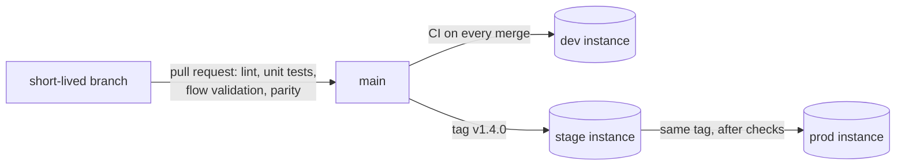
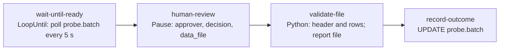

# Kestra as the Retool Workflows replacement

How to run the Kestra implementation yourself, how a change moves from your laptop to
production without merge conflicts, and what Kestra gives you for each capability the Retool
replacement needs ([D-022](../decisions.md)). Everything here is Kestra **OSS 2.0.10**, the
current LTS, self-hosted.

Each claim is marked with where it comes from: **[measured]** means run in this repo, with a
link to the data; **[docs]** means Kestra's documentation or source, checked 2026-11-15;
**[proposal]** means a recommendation that wasn't built or run here.

## In short

| Retool pain point or need | With Kestra |
|---|---|
| Merge conflicts from dev > stage > prod | **Solved by design, if you keep the UI read-only.** A flow is one plain YAML file in Git, and the same file deploys to every environment. Environment differences live outside the flow, in environment variables and secrets. Trunk-based development fits: one `main`, short branches, and promotion as a deploy, not a merge. |
| Retool's 600 s limit | **None.** A 660 s Postgres statement finished `SUCCESS` after 660.6 s, with no setting changed [measured]. Tasks and executions have no default timeout [docs]. |
| Gates on Postgres control tables | **Native.** `LoopUntil` polls a query until a condition holds; the Postgres `Trigger` starts a flow when a query returns rows; `If`, `Switch`, `Fail` and `Assert` branch or stop [docs]. The probe held a run until its control row turned READY [measured]. |
| People enter values and upload files | **Native, in OSS.** A `Pause` task asks for inputs when someone resumes it: text, a choice and a file in the probe. Kestra draws the form [measured, [screenshot](../comparison/data/screenshots/kestra-review-01-form.png)]. What OSS lacks: assigning a step to a person or group, and custom approval apps. Those are Enterprise. |
| Validating artifacts | **Native.** A task validated the uploaded CSV, kept the report as a file you can preview and download in the UI, and wrote the outcome to the control table [measured, [screenshot](../comparison/data/screenshots/kestra-review-02-outputs.png)]. |
| Webhook calls (native in Retool) | **Native, and stricter than Retool's.** A `Webhook` trigger gives each flow a URL. It can verify an HMAC signature and answer with the flow's outputs. Unsigned calls got 401; a signed one got the result in 0.35 s [measured]. |
| Lambda, S3, RDS, Secrets Manager | **Covered, with two OSS limits.** `plugin-aws` (Apache-2.0) has S3 tasks, an S3 trigger and SQS triggers, and uses the ECS task role or IRSA automatically. Its Lambda call is **synchronous only**. Secrets Manager reaches Kestra OSS only as environment variables set at container start; the native secret store is Enterprise [docs]. |
| Self-hosted on AWS | **EKS or EC2, not ECS Fargate.** Official guides cover EKS (Helm chart) and EC2 (Docker Compose), with RDS and S3. Kestra's docs say Fargate isn't supported for script tasks [docs]. Retool 4.0 also requires Kubernetes. |
| Spec-driven development | **Good for logic, weaker for the flow.** Ported logic is plain Python, tested against the golden vectors outside Kestra (141 tests in 0.3 s). The flow's wiring and its Pebble templates can only be tested end to end, by the parity suite. Kestra's own flow unit tests are Enterprise [docs]. |

Kestra's costs, covered below:

- About 700 MiB of memory for the JVM and its database.
- Secrets in OSS are base64-encoded environment variables only.
- No access control in OSS: one shared login.
- Root access to the Docker socket for script tasks.
- More surprises in the YAML and Pebble layer than in plain code.

## What's in the repo

| Path | What it is |
|---|---|
| [`kestra/flows/`](../../kestra/flows/) | The two n8n workflows as Kestra flows, one YAML file each (namespace `experiment.email`) |
| [`kestra/files/summarizer/`](../../kestra/files/summarizer/) | The ported n8n logic in Python, uploaded as namespace files and run by script tasks |
| [`kestra/tests/`](../../kestra/tests/) | pytest for that logic, against the golden vectors; no Kestra needed |
| [`kestra/compose.yaml`](../../kestra/compose.yaml), [`Dockerfile`](../../kestra/Dockerfile), [`secrets-entrypoint.sh`](../../kestra/secrets-entrypoint.sh) | The stack: Kestra plus its Postgres, the shared infra, an image with 3 pinned plugins |
| [`kestra/deploy.sh`](../../kestra/deploy.sh) | Deploys flows and namespace files from the repo through the REST API, and deletes flows that aren't in the repo |
| [`kestra/probes/`](../../kestra/probes/) | The capability probes (namespace `experiment.probes`): the long statement and the control-table gate with a human step |
| [README](../kestra/README.md), [node mapping](../kestra/node-mapping.md), [effort log](../kestra/effort-log.md) | Architecture, versions, the construct used per n8n node, and what was hard |

## Run it yourself

You need Docker Desktop (8 GB of memory for the VM), GNU Make and [uv](https://docs.astral.sh/uv/).
No `.env` is needed: the Makefile falls back to `.env.example`, which points everything at
local mocks.

```bash
make kestra-up                      # build, start, wait until healthy, deploy: about 15 s once the image exists
make kestra-seed                    # 9 fixture emails into the IMAP folder
make kestra-run FLOW=email-ingest   # ingest now (it also polls every minute)
make kestra-run                     # one summarize-and-send tick (it also runs every 10 minutes)
open http://localhost:8080          # UI: admin@kestra.local / Kestra-local-only1 (.env.example)
make test-kestra                    # unit tests of the ported logic: 0.3 s, no Kestra needed
make parity-kestra                  # the 13 parity scenarios: about 4 minutes
make probe-kestra                   # the capability probes: about 12 minutes (PROBE_ARGS="--probes webhook" for one)
make screenshots-review-kestra      # the probe's human step done through the UI form, captured
make kestra-down                    # stop and delete everything
```

Run one stack at a time: Kestra and Prefect use the same host ports for the shared infra.

## The development lifecycle

### Inner loop on your laptop [measured]

| You change | Then | Time |
|---|---|---|
| Ported logic (`kestra/files/summarizer/*.py`) | `make test-kestra`, then `make kestra-deploy` and `make kestra-run` | Tests 0.3 s; deploy 0.3 s; a tick 2 s. From edit to a sent email: 2.4 s ([data](../comparison/data/measure-kestra-2026-11-15.json)) |
| A flow (`kestra/flows/*.yml`) | `make kestra-deploy` (the server rejects invalid YAML), then `make kestra-run` | The same; `make kestra-run` prints each task's state and the error logs |
| Anything, before a pull request | `make lint`, `make test-kestra`, `make parity-kestra` | About 4 minutes for parity |

You can also edit a flow in the UI editor, which has docs, autocompletion and a live topology
view. Treat that as a scratchpad: copy the YAML back into the repo. The next deploy overwrites
the server's copy.

### Spec-driven: adding a requirement [measured]

This repo already works this way for the n8n workflow, and the same steps fit a new pipeline:

1. **Write the requirement** with an ID in the spec, like `SUM-5` in
   [workflow-spec.md](../baseline/workflow-spec.md). A quirk you choose to keep gets a `Q-` ID.
   A deliberate deviation gets a `D-` entry in [decisions.md](../decisions.md).
2. **Pin the expected behavior before the implementation.**
   - For logic, add golden cases. Here they're generated from the reference implementation:
     [golden.md](../golden.md).
   - For orchestration (gates, retries, human steps), add a parity scenario that drives the
     flow and checks the database and the outside calls: [parity.md](../parity.md).
3. **Watch them fail.** Then implement: Python for logic, YAML for wiring.
4. **Pass them.** `make test-kestra` for logic, `make parity-kestra` for the flow, then open a
   pull request.

The golden-vector and parity tooling is tool-agnostic. It is the same suite Prefect passes. It
doesn't depend on Kestra Enterprise's unit-test feature.

### Branching and promotion without merge conflicts [proposal]

Retool's own guidance points the same way ([comparison](retool-kestra-prefect.md#1-merge-conflicts-and-promotion)):
avoid one branch per environment. With Kestra:



- **One `main`, short branches.** No dev, stage or prod branches. A release is a Git tag.
  Promoting means deploying that tag to the next instance, so there is nothing to merge between
  environments.
- **The same files everywhere.**
  - Each environment is a separate Kestra instance, as Kestra recommends. It advises against
    tenants or namespaces as environments for critical work [docs].
  - What differs is configuration on each instance:
    - URLs and plain settings in `ENV_*` variables, read as `{{ envs.x }}`;
    - credentials in `SECRET_*` variables, read as `{{ secret('X') }}`;
    - values that change at runtime in the KV store, read as `{{ kv('X') }}`.

  The flow file never names an environment.
- **The repo is the only source of truth.**
  - [`deploy.sh`](../../kestra/deploy.sh) posts all flows with `delete=true`. A flow edited in
    the UI is overwritten, and a flow missing from the repo is deleted.
  - Add the `system.readOnly: true` label to flows on stage and prod to disable the UI editor.
    In OSS that only blocks the editor, not the API [docs].
  - OSS has one shared login and no roles, so keep the prod UI reachable only by the people who
    run it, and let CI hold the deploy credentials.
- **CI checks on a pull request:**
  - `make lint` and `make test-kestra`.
  - Deploy the flows to a throwaway Kestra in CI and run `make parity-kestra`. Deploying also
    validates the YAML: the server rejects invalid flows.
  - Optionally Kestra's `validate-flows` GitHub Action. If you use it or `kestractl`, pin
    `kestractlVersion`: the action defaults to `latest`. `kestractl` has no delete or prune
    option, so keep `deploy.sh`'s `delete=true` for the real deploy [docs].
- **Why this avoids conflicts:**
  - A flow is one small YAML file with no generated IDs or positions. Two people changing
    different flows touch different files.
  - Two people changing the same flow get an ordinary text conflict in a readable file.

A sketch of the deploy job, not built or run here:

```yaml
# .github/workflows/deploy.yml (sketch): main -> dev on merge; a tag -> stage, then prod with approval
on:
  push: { branches: [main], tags: ["v*"] }
jobs:
  deploy:
    runs-on: ubuntu-latest
    environment: ${{ startsWith(github.ref, 'refs/tags/') && 'stage' || 'dev' }}  # a second job targets prod
    steps:
      - uses: actions/checkout@v4
      - run: kestra/deploy.sh   # REST deploy with delete=true: the repo replaces what's on the server
        env:
          KESTRA_URL: ${{ vars.KESTRA_URL }}
          KESTRA_USER: ${{ secrets.KESTRA_USER }}
          KESTRA_PASSWORD: ${{ secrets.KESTRA_PASSWORD }}
```

### Configuration per environment

| What | Where it lives | In the flow |
|---|---|---|
| URLs, model names, IMAP host and mailbox | `ENV_*` variables on the Kestra container (compose sets them from `.env`) | `{{ envs.gemini_base_url }}` |
| Passwords, API keys, chat ids | `SECRET_*` variables, base64-encoded; [`secrets-entrypoint.sh`](../../kestra/secrets-entrypoint.sh) encodes them at start | `{{ secret('GEMINI_API_KEY') }}`, masked in logs |
| Values that operators change at runtime | The KV store (OSS) | `{{ kv('KEY') }}` |

OSS secrets have no encryption at rest and no audit trail, by Kestra's own docs. Vault and the
cloud secret managers are Enterprise. In production, inject the `SECRET_*` variables from your
platform's secret store, not from a file.

## The control-table gate with a human step [measured]

[`probe-gate.yml`](../../kestra/probes/probe-gate.yml) is the pattern the Retool replacement
needs, in about 100 lines of YAML:



```yaml
  - id: human-review
    type: io.kestra.plugin.core.flow.Pause  # no pauseDuration: waits until someone resumes it
    onResume:
      - id: approver
        type: STRING
      - id: decision
        type: SELECT
        values: [APPROVE, REJECT]
      - id: data_file
        type: FILE
```

What the probe showed ([data](../comparison/data/probes-kestra-2026-11-15.json)):

| Step | Result |
|---|---|
| Waiting on the control table | The run held until the row turned READY; the review step was reached about 4 s later. While `LoopUntil` waits between checks, Kestra shows the whole execution as `PAUSED`. A person who presses Resume then only triggers an early check. Scripts that look for "the run is paused" must check the `Pause` task itself, as [`probes.py`](../../scripts/probes.py) does. |
| The human step | Kestra drew the form from `onResume`: a text field, a dropdown and a file chooser ([form](../comparison/data/screenshots/kestra-review-01-form.png)). It was filled in and submitted through the UI, and through the API (`POST /api/v1/main/executions/{id}/actions/resume`, multipart, file included). |
| Validation | A good CSV wrote `APPROVED`, 3 of 3 rows valid. A bad one wrote `INVALID`, 1 of 3 valid. The report is a file on the run's Input/Output tab, with Preview and Download ([outputs](../comparison/data/screenshots/kestra-review-02-outputs.png)). |
| Long statement | `select pg_sleep(660)` through the JDBC task: `SUCCESS` after 660.6 s, and 11 min 0.6 s in an earlier run. |

Two notes for a team:

- **Who may approve is not enforced in OSS.** Anyone with the shared login can resume.
  Assigning a human task to a person or group (`HumanTask`) and building custom approval forms
  (Apps) are Enterprise [docs]. Record the approver's name, as the probe does. If you need real
  control, put the form in a tool with access control, such as a Retool app, and let it write
  to the control table.
- **The form's text fields are a code editor,** because inputs accept expressions. Fine for
  engineers. For other users, a dropdown or a file chooser reads more naturally.

## Webhooks [measured]

[`probe-webhook.yml`](../../kestra/probes/probe-webhook.yml) is an upstream system announcing
a batch, as Retool workflows are triggered today:

```yaml
triggers:
  - id: announce
    type: io.kestra.plugin.core.trigger.Webhook
    key: probe-webhook                       # part of the URL
    signature:                               # HMAC of the raw body; a bad or missing one gets 401
      header: X-Signature
      secret: "{{ secret('WEBHOOK_SIGNING_SECRET') }}"
      algorithm: HMAC_SHA256
    wait: true                               # answer when the flow has finished...
    returnOutputs: true                      # ...with the flow's outputs as the response body
```

| | Result ([data](../comparison/data/probes-kestra-2026-11-16.json)) |
|---|---|
| URL | `POST /api/v1/main/executions/webhook/experiment.probes/probe-webhook/probe-webhook` (GET and PUT also work) |
| No signature, or a wrong one | 401 "Invalid webhook signature", before any execution exists |
| Signed | 200 in 0.35 s, with `{"batch":{"id":7,"status":"PENDING"}}`: the row the flow wrote |

What to know [docs]:

- **The server's login doesn't apply to webhook paths.** The key in the URL is the only check
  unless you add `signature`. Use a long random key and a signing secret, and expose only the
  webhook path on the load balancer.
- **Request data:**
  - `trigger.body` (JSON is parsed), `trigger.headers` and `trigger.parameters` (the query).
  - Multipart file parts land in internal storage as `trigger.parts`.
  - Bodies over 1 MiB need `fetchType: STORE`, or the call gets 413.
- **Answering the caller:**
  - With `wait`, a failed run answers 500.
  - `responseCode` and `responseContentType` set the success answer.
  - A `when` expression filters calls (204 when false). `conditions` were removed in 2.0.
- **The signature protects integrity, not against replays,** in the property's own words.
- `signature` is in the running 2.0.10 server's plugin schema but missing from the published
  plugin page.

## AWS: services and deployment [docs, proposal]

Nothing here ran against AWS; it's from Kestra's docs and plugin sources.

| Service | In Kestra OSS |
|---|---|
| **AWS Lambda** | `io.kestra.plugin.aws.lambda.Invoke` (`plugin-aws` 4.0.0, the newest that 2.0.10 accepts): `functionArn`, `functionPayload`. **Synchronous only.** The response body is saved as a file (`outputs.<task>.uri`, read it with `read()`). The task fails on a function error and copies the function's CloudWatch logs into the task log. For a fire-and-forget call, send to SQS or EventBridge instead (both have tasks). |
| **Amazon S3** | `s3.Upload`, `Download`, `List`, `Delete`, `Copy` and more. **`s3.Trigger`** polls a bucket and starts a flow for new objects; it can move or delete them afterwards. A file a person uploads in a `Pause` form can be copied to S3 with `s3.Upload`. |
| **Postgres (RDS)** | `plugin-jdbc-postgres`, what this repo uses, with a JDBC URL to RDS. Kestra's own state also lives in RDS Postgres (14 or newer). |
| **Secrets Manager** | As Kestra's secret store: Enterprise only. **In OSS:** let ECS (`secrets` in the task definition) or Kubernetes (External Secrets) put the values into the container's environment. [`secrets-entrypoint.sh`](../../kestra/secrets-entrypoint.sh) turns plain variables into the base64 `SECRET_*` ones Kestra reads. Flows read them as `{{ secret('NAME') }}`. They're read once at start: a rotated secret needs a restart. |
| **Credentials** | With no keys set, `plugin-aws` uses AWS's default chain, which picks up **the ECS task role** or **IRSA** on EKS. `stsRoleArn` assumes a role; `endpointOverride` points at LocalStack or MinIO for local tests. |
| **Also** | SQS `RealtimeTrigger` (one run per message); SNS; EventBridge `PutEvents`; Athena; DynamoDB; Glue; Bedrock |

Deploying on AWS:

| | |
|---|---|
| **Official paths** | **EKS** with the Helm chart (now in `kestra-io/kestra` under `charts/kestra`; the old `helm-charts` repository is gone), RDS Postgres and S3 internal storage (`storage-s3`, Apache-2.0). Or **EC2** with Docker Compose: at least 4 GiB and 2 vCPU (a t3.medium), then RDS and S3. |
| **ECS** | **Fargate isn't supported for script tasks:** they need Docker-in-Docker, and the chart runs a privileged `dind` sidecar. Two undocumented ways onto ECS: ECS on EC2 with the host's Docker socket mounted (what this repo's compose does), or the Process task runner, with Python and its packages in the Kestra image. The AWS Batch runner, which can use Fargate, is Enterprise. |
| **Proposed layout** | Kestra on EKS behind an ALB that exposes only `/api/v1/*/executions/webhook/*` to callers outside your network; UI and API internal. RDS for Kestra's state; S3 for internal storage; an IRSA role for S3, Lambda and SQS; External Secrets from Secrets Manager into `SECRET_*`; one instance each for dev, stage and prod, deployed from the same tag. |
| **Sizing** | 699 MiB at idle and 825 MiB at peak for Kestra and its database here; each script task adds a short-lived container. |

## Price [docs]

| | OSS (Apache-2.0) | Enterprise |
|---|---|---|
| Price | Free | Annual subscription per instance, unlimited flows and executions, "contact sales". Support tiers: Standard (24 h P0, 8×5), Premium (6 h), Platinum (1 h, 24×7). Upgrade by adding a license key. |
| Included | Everything in this repo: forms with files, webhooks with signatures, `plugin-aws`, S3 storage, Prometheus | Adds RBAC, SSO and SCIM, audit logs, Secrets Manager as secret store, worker groups, AWS Batch, EC2 and Lambda task runners, Apps, `HumanTask`, Promote, flow unit tests, Kafka, Redis and AMQP queues |

Kestra Cloud also exists, usage-based and by request; it isn't self-hosted.

## Pros and cons by capability

| Capability | How Kestra does it | Pros | Cons |
|---|---|---|---|
| Version control, merge conflicts | One YAML file per flow; namespace files as plain files; deploy through the REST API | Small, readable diffs; no generated IDs; `delete=true` keeps the server equal to the repo | The UI editor invites a second source of truth; OSS can't block API edits; deploys need a script (`kestractl` has no prune) |
| Promotion dev > stage > prod | Separate instances, same files, config in `ENV_*`, `SECRET_*` and KV | Trunk-based fits; promotion is a deploy of a tag | Promote (the UI feature) and RBAC are Enterprise; you build the CI pipeline yourself |
| Spec-driven development and tests | Python logic tested outside Kestra; flows tested end to end | Logic tests run in 0.3 s; the parity suite drives flows through the API | Pebble templates and flow wiring can't be unit-tested in OSS; Kestra's flow tests are Enterprise |
| Long Postgres work | JDBC `Query` task; no default timeouts | 660 s statement passed [measured]; set `timeout` or an SLA `MAX_DURATION` only where you want a limit | No query-timeout property on the JDBC task; use Postgres `statement_timeout` if you need one |
| Gates on control tables | `LoopUntil`, Postgres `Trigger`, `If`, `Switch`, `Fail`, `Assert` | Declarative, and the gate is visible in the topology; a Postgres trigger starts a flow when rows appear | `LoopUntil` makes the execution look `PAUSED` while it waits; JDBC parameters bind as text, so SQL needs casts (`:id::bigint`) |
| Human input: fields, files, approvals | `Pause` with `onResume` inputs; flow inputs on the Execute form | A form with fields and file upload in OSS, no code [measured]; pauses can wait forever or time out with a chosen behavior | No assignment, roles or custom forms in OSS (Enterprise); text fields are a code editor |
| Artifacts and validation | Script tasks write output files; the UI previews and downloads them | The reviewer sees the report next to the run; any task's output is browsable | Validation code runs in a container per task (about 0.6 s each) |
| Error handling | `allowFailure`, `runIf`, `If`, `errorLogs()`, retries per task | Error branches are declarative and visible | Some plugin defaults bite: fixed LLM retries, a 73 s HTTP connect timeout, a 10 s DNS window after outages ([effort log](../kestra/effort-log.md)) |
| Scheduling and triggers | Cron with concurrency limits; backfill; webhooks; flow triggers; Postgres trigger | Backfill and a missed-run policy built in | Every poll is an execution in the history |
| Webhooks | Core `Webhook` trigger with key, HMAC signature, `wait` and `returnOutputs` | Matches Retool's triggers, plus signature checks and the flow's outputs as the answer [measured] | Open to anyone with the key unless signed; bodies over 1 MiB need `STORE` |
| AWS services | `plugin-aws` (OSS): S3, Lambda, SQS, SNS, EventBridge and more; ECS task role or IRSA | Ready-made S3 and SQS triggers; Lambda logs land in the task log | Lambda calls are synchronous only; Secrets Manager only through environment variables (rotation needs a restart) unless Enterprise |
| Deployment on AWS | Helm chart on EKS, or Docker Compose on EC2; RDS and S3 | Official guides for both; S3 internal storage in OSS | Not ECS Fargate for script tasks (needs Docker-in-Docker); remote task runners are Enterprise |
| Observability | Topology, Gantt, per-task logs and outputs, Prometheus | Best in this comparison ([results C9](../comparison/results.md#c9-observability)) | The topology needs zooming for large flows |
| Secrets and config | `SECRET_*` base64 environment variables; `ENV_*`; KV | Simple, and secrets are masked in logs | No encryption at rest; secret managers are Enterprise |
| Operations | One JVM (`server standalone`) and Postgres; LTS releases | LTS every 6 months with a year of support; Prometheus metrics on by default | About 700 MiB at idle; script tasks need the Docker socket as root (or the process runner); HA docs contradict each other |
| Learning curve | YAML, Pebble expressions, a plugin catalog, a UI editor | Close to n8n's and Retool's visual model; plugin docs inside the editor | Pebble and JDBC typing caused most of the build's surprises ([effort log](../kestra/effort-log.md)) |

## Costs and risks

| Risk | Mitigation |
|---|---|
| The UI becomes a second source of truth | Deploy with `delete=true` from CI only; `system.readOnly` on stage and prod; restrict who reaches the prod UI |
| No access control in OSS (one login, anyone can approve) | Record the approver in the control table; keep approvals in a tool with access control if that matters; Enterprise adds RBAC and `HumanTask` |
| Secrets as plain environment variables | Inject from a secret store at deploy time; or Enterprise secret backends |
| JVM memory and behavior (700 MiB idle; a cached failed DNS lookup for 10 s) | Size the host; the DNS cache only matters right after an outage |
| Docker socket as root for script tasks | Use the process task runner with Python in the image, or run workers on a dedicated host |
| Leaving ECS (Fargate isn't supported for script tasks) | Run on EKS, where Retool 4.0 is heading too; or ECS on EC2 with the Docker socket; or the Process runner |
| A public webhook URL | Sign calls (`signature`), use long keys, expose only the webhook path |
| Enterprise features that look free in the UI (Promote, Tests, Apps, Audit Logs show a lock) | Plan around them; this report assumes OSS only |

## Evidence

- Measurements: [results.md](../comparison/results.md) and [measure-kestra](../comparison/data/measure-kestra-2026-11-15.json)
- Parity: [parity.md](../parity.md) and [parity-kestra](../comparison/data/parity-kestra-2026-11-15.json)
- Probes: [probes.md](../probes.md), [probes-kestra (11-15)](../comparison/data/probes-kestra-2026-11-15.json) and [probes-kestra (11-16, webhook)](../comparison/data/probes-kestra-2026-11-16.json)
- Screenshots: [the UI walkthrough](../comparison/data/screenshots/) (`kestra-*.png`, `kestra-review-*.png`)
- Kestra's docs:
  - [Pause](https://kestra.io/plugins/core/flow/io.kestra.plugin.core.flow.pause), [inputs](https://kestra.io/docs/workflow-components/inputs), [LoopUntil](https://kestra.io/plugins/core/flow/io.kestra.plugin.core.flow.loopuntil), [Postgres trigger](https://kestra.io/plugins/plugin-jdbc-postgres/io.kestra.plugin.jdbc.postgresql.trigger)
  - [Git and CI/CD](https://kestra.io/docs/version-control-cicd/git), [environments](https://kestra.io/docs/best-practices/manage-environments), [system labels](https://kestra.io/docs/concepts/system-labels)
  - [secrets](https://kestra.io/docs/concepts/secret), [OSS vs paid](https://kestra.io/docs/oss-vs-paid), [Apps](https://kestra.io/docs/enterprise/scalability/apps), [pricing](https://kestra.io/pricing)
  - [webhook trigger](https://kestra.io/docs/workflow-components/triggers/webhook-trigger), [plugin-aws](https://kestra.io/plugins/plugin-aws), [Lambda Invoke](https://kestra.io/plugins/plugin-aws/lambda/io.kestra.plugin.aws.lambda.invoke), [S3 trigger](https://kestra.io/plugins/plugin-aws/s3/io.kestra.plugin.aws.s3.trigger), [Secrets Manager (Enterprise)](https://kestra.io/docs/enterprise/governance/secrets-manager)
  - [EKS](https://kestra.io/docs/installation/kubernetes-aws-eks), [EC2](https://kestra.io/docs/installation/aws-ec2), [requirements](https://kestra.io/docs/administrator-guide/requirements), [task runners](https://kestra.io/docs/task-runners/types)
