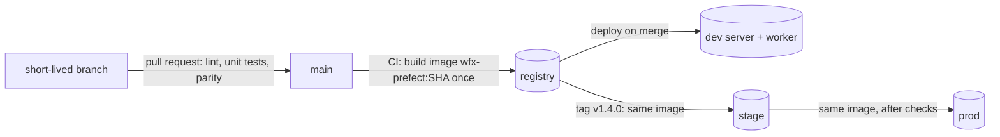
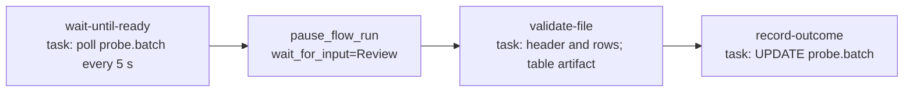

# Prefect as the Retool Workflows replacement

How to run the Prefect implementation yourself, how a change moves from your laptop to
production without merge conflicts, and what Prefect gives you for each capability the Retool
replacement needs ([D-022](../decisions.md) to [D-024](../decisions.md)). Everything here is
**Prefect OSS 3.9.3**, self-hosted, without Prefect Cloud. The comparison with Retool, Kestra
and AWS Step Functions is in [retool-replacement.md](retool-replacement.md).

Each claim is marked with where it comes from:

- **[measured]**: run in this repo, with a link to the data.
- **[docs]**: Prefect's or AWS's documentation, checked 2026-11-15 and 2026-11-16.
- **[src]**: the source code at the release tag in use.
- **[proposal]**: a recommendation that wasn't built or run here.

## In short

| Retool pain point or need | With Prefect |
|---|---|
| Merge conflicts from dev > stage > prod | **Solved by design.** Flows are a Python package. Deployments are declared in [`prefect.yaml`](../../prefect/prefect.yaml). The code runs from an image built from the repo, so nobody can edit it in the UI. Trunk-based development fits: one `main`, one image per commit, promotion as a deploy. |
| Postgres work of up to 30 minutes (Retool stops at 600 s) | **Nothing to work around.** A 30-minute statement, `select pg_sleep(1800)`, finished `COMPLETED` 1,825.0 s after the API call, the worker's pickup included, through the ordinary connector block, with no setting changed [measured]. Prefect, `prefect-sqlalchemy` and psycopg set no default timeouts [docs, src]. On AWS, set libpq keepalives (`keepalives_idle=240`) in the connector's `connect_args`. |
| Gates on Postgres control tables | **In code.** A task polls the table; plain Python decides. The probe held a run until its control row turned READY [measured]. There is no Postgres trigger. Event-driven starts need your code to emit an event that a deployment trigger listens to [docs]. |
| People enter values and upload files | **Values yes, files no.** `pause_flow_run(wait_for_input=Model)` turns a Pydantic model into a form with text boxes and dropdowns [measured, [screenshot](../comparison/data/screenshots/prefect-review-01-form.png)]. The form has **no file upload** [docs, measured]. A file has to reach the flow another way, such as pasted text, object storage or a Retool app. OSS has no assignment or roles. |
| Validating artifacts | **Good.** The probe's validation task published a table artifact, shown on the run and on the Artifacts page [measured, [screenshot](../comparison/data/screenshots/prefect-review-03-artifact-table.png)]. Files themselves aren't stored: image artifacts must be public URLs, and task outputs aren't kept unless you configure result storage [docs]. |
| Webhook calls (native in Retool) | **Not in OSS.** Webhooks are Prefect Cloud only, from the $100/month Starter tier. The OSS substitute: the caller posts an event to `POST /api/events`, and a deployment trigger turns it into a run. It worked, but the caller needs the server's admin credential and gets no answer: 204, no run id [measured]. Put a small proxy in front (API Gateway + Lambda). |
| Lambda calls | **Synchronous and asynchronous, with one trap.** `LambdaFunction.invoke` builds a default boto3 client: a 60 s read timeout and automatic retries. A synchronous call longer than a minute fails on the client side, and each retry runs the function again [src]. Use `AwsCredentials.get_client("lambda")` with a longer `read_timeout` and one attempt instead (below). |
| ECS task triggering | **Two ways, neither a ready-made task.** For Prefect's own flows: `run_deployment()` against a deployment on an ECS work pool. Each flow run is its own Fargate task, and `run_deployment` waits for it with no timeout by default. For any other task definition: boto3 `run_task` in a task, and a waiter with a longer `WaiterConfig`, since the default stops at 10 minutes. `prefect-aws` has had no ECS task block since `EcsTask` was removed in 2024 [src]. |
| S3, RDS, Secrets Manager | **Covered well in OSS.** `prefect-aws` has `S3Bucket` and `AwsSecret`, which reads Secrets Manager at runtime. It uses the ECS task role or IRSA automatically. No S3 trigger [docs]. |
| Self-hosted on AWS | **ECS-native.** The ECS worker (OSS) starts every flow run as its own ECS task with its own task role. The server is a stateless container next to RDS, with an official Helm chart for EKS [docs]. |
| Spec-driven development | **Strongest of the three.** Everything is Python: logic, the flow's branching, the alert text. All of it is testable with pytest against the golden vectors (127 tests in about 1 s). `prefect_test_harness` runs whole flows in tests against a temporary database [docs]. |

Prefect's costs, covered below:

- A slower loop in this setup: a code change needs a new worker image, about 23 s from edit to
  a sent email.
- Runs start 5 to 10 s late, because the worker polls.
- Thin data visibility in the UI.
- A run whose worker dies stays `Running` unless you add an automation.
- Run metrics need a separate exporter.
- Its Lambda block breaks on calls longer than a minute; use a client you configure.
- No LTS releases.

## What's in the repo

| Path | What it is |
|---|---|
| [`prefect/src/email_summarizer/`](../../prefect/src/email_summarizer/) | The package: `flows.py` (two flows, one task per n8n node), the ported logic (`imap.py`, `ingest.py`, `summarize.py`, `markdown.py`, `js.py`), SQL, clients, config |
| [`prefect/tests/`](../../prefect/tests/) | pytest against the golden vectors; no Prefect server needed |
| [`prefect/prefect.yaml`](../../prefect/prefect.yaml) | The two deployments with their schedules and concurrency |
| [`prefect/compose.yaml`](../../prefect/compose.yaml), [`Dockerfile`](../../prefect/Dockerfile), [`deploy.sh`](../../prefect/deploy.sh) | The stack: server, worker, their Postgres, the shared infra. The worker image holds the package, installed from `uv.lock`. |
| [`bootstrap.py`](../../prefect/src/email_summarizer/bootstrap.py) | Writes blocks (secrets, the DB connection) and variables from the environment at deploy time |
| [`probes.py`](../../prefect/src/email_summarizer/probes.py), [`probes.yaml`](../../prefect/probes.yaml) | The capability probes: the 30-minute statement, the control-table gate with a human step, and the webhook substitute |
| [README](../prefect/README.md), [node mapping](../prefect/node-mapping.md), [effort log](../prefect/effort-log.md) | Architecture, versions, the construct used per n8n node, and what was hard |

## Run it yourself

You need Docker Desktop, GNU Make and [uv](https://docs.astral.sh/uv/). No `.env` is needed:
the Makefile falls back to `.env.example`, which points everything at local mocks.

```bash
make prefect-up                      # build the worker image, start, wait until healthy, deploy: about 20 s
make prefect-seed                    # 9 fixture emails into the IMAP folder
make prefect-run FLOW=email-ingest   # ingest now (it also polls every minute)
make prefect-run                     # one summarize-and-send tick (it also runs every 10 minutes)
open http://localhost:4200           # UI: the auth string admin:prefect-local-only (.env.example)
make test-prefect                    # unit tests: about 1 s, no server needed
make parity-prefect                  # the 13 parity scenarios: about 8 minutes
make probe-prefect                   # the capability probes: about 32 minutes (PROBE_ARGS="--probes webhook" for one)
make screenshots-review-prefect      # the probe's human step done through the UI form, captured
make prefect-down                    # stop and delete everything
```

Run one stack at a time: Kestra and Prefect use the same host ports for the shared infra.

## The development lifecycle

### Inner loop on your laptop [measured]

| You change | Then | Time |
|---|---|---|
| Logic or a flow (`prefect/src/email_summarizer/*.py`) | `make test-prefect`, then `make prefect-up` (rebuilds the worker image, recreates the worker, redeploys) and `make prefect-run` | Tests about 1 s; `prefect-up` 10 to 20 s; a run 6 to 13 s, mostly the worker's 10 s poll. From edit to a sent email: 22.7 s ([data](../comparison/data/measure-prefect-2026-11-15.json)) |
| A deployment (`prefect.yaml`: schedules, concurrency) | `make prefect-deploy` | A few seconds |
| Configuration (`.env`) | `make prefect-deploy`, which rewrites the blocks and variables | A few seconds |
| Anything, before a pull request | `make lint`, `make test-prefect`, `make parity-prefect` | About 8 minutes for parity |

**A faster loop [proposal].** Most of the 23 s is rebuilding the image. Two documented ways
around it, neither built here:

- Mount `prefect/src` into a dev worker with an editable install, so a change is live at the
  next run.
- Run a flow straight from your laptop (`python -c "from email_summarizer.flows import ...;
  email_summarize_send()"`) against the dev server. The run still shows in the UI. It needs the
  app database and services reachable from your laptop.

### Spec-driven: adding a requirement [measured]

This repo already works this way for the n8n workflow, and the same steps fit a new pipeline:

1. **Write the requirement** with an ID in the spec, like `SUM-5` in
   [workflow-spec.md](../baseline/workflow-spec.md). Quirks get `Q-` IDs; deliberate
   deviations get a `D-` entry in [decisions.md](../decisions.md).
2. **Pin the expected behavior first.**
   - Golden cases for logic: [golden.md](../golden.md).
   - A parity scenario for orchestration: [parity.md](../parity.md).
   - With Prefect you can also unit-test the flow itself. Call the flow function under
     `prefect_test_harness`, or call a task's `.fn()` to skip state tracking [docs].
3. **Watch them fail, then implement.** It's all Python.
4. **Pass them.** `make test-prefect`, `make parity-prefect`, then open a pull request.

The golden-vector and parity tooling is tool-agnostic. It is the same suite Kestra passes.

### Branching and promotion without merge conflicts [proposal]



- **One `main`, short branches.** No environment branches. A release is a Git tag pointing at
  an image built once.
- **The same image and the same `prefect.yaml` everywhere.**
  - Each environment is its own Prefect server, its own worker and its own database.
    Workspaces, the Cloud way to separate environments, don't exist in OSS [docs].
  - The CI job deploys with that environment's `PREFECT_API_URL` and auth string.
  - [`bootstrap.py`](../../prefect/src/email_summarizer/bootstrap.py) writes that
    environment's blocks and variables from its secrets.
  - If a deployment must differ per environment, such as a schedule, use `prefect.yaml`
    templating (`{{ $ENV_VAR }}`) rather than a second file [docs].
- **Nothing to drift.**
  - Code can't be edited in the UI: it's in the image.
  - Blocks and variables can be edited, but the next deploy rewrites them.
  - Two gaps for CI to close: `prefect deploy` doesn't delete deployments removed from
    `prefect.yaml`, and it re-activates schedules someone paused [measured, effort log].
- **Why this avoids conflicts:**
  - Flows are ordinary Python modules, reviewed and merged like any code.
  - `prefect.yaml` is small and hand-written.
  - Nothing is generated or exported from a UI.

A sketch of the deploy job, not built or run here:

```yaml
# .github/workflows/deploy.yml (sketch): build once, deploy the same image to dev, then stage/prod by tag
on:
  push: { branches: [main], tags: ["v*"] }
jobs:
  deploy:
    runs-on: ubuntu-latest
    environment: ${{ startsWith(github.ref, 'refs/tags/') && 'stage' || 'dev' }}  # a second job targets prod
    steps:
      - uses: actions/checkout@v4
      - run: docker build -t "$REGISTRY/wfx-prefect:${GITHUB_SHA}" prefect && docker push "$REGISTRY/wfx-prefect:${GITHUB_SHA}"
      - run: >-   # same steps as prefect/deploy.sh, run in that image against this environment's server
          docker run --rm --env-file <(env | grep -E '^(PREFECT_|APP_DB_|IMAP_|GEMINI_|TELEGRAM_)')
          "$REGISTRY/wfx-prefect:${GITHUB_SHA}" sh deploy.sh
        env:
          PREFECT_API_URL: ${{ vars.PREFECT_API_URL }}
          PREFECT_API_AUTH_STRING: ${{ secrets.PREFECT_API_AUTH_STRING }}
          # ...plus this environment's APP_DB_*, IMAP_*, GEMINI_*, TELEGRAM_* secrets
      # then roll the environment's worker to the new image tag
```

### Configuration per environment

| What | Where it lives | In the code |
|---|---|---|
| The app database connection, password included | `SqlAlchemyConnector` block `app-db`, encrypted at rest | `SqlAlchemyConnector.load("app-db")` |
| API keys, passwords, chat ids | `Secret` blocks, encrypted at rest | `Secret.load(name).value.get_secret_value()`. Not `.get()`, which JSON-decodes the value ([effort log](../prefect/effort-log.md)) |
| URLs, model names, IMAP host and mailbox | Variables (plain JSON, visible in the UI) | `Variable.get(name)` |

All of these are written by `make prefect-deploy` from the environment. The server encrypts
block data with a key that it stores in the same database, unless `PREFECT_SERVER_ENCRYPTION_KEY`
is set; set it in production [docs]. `AwsSecret` and `GcpSecret` blocks can read from an
external secret manager instead [docs].

## The control-table gate with a human step [measured]

`probe_gate` in [`probes.py`](../../prefect/src/email_summarizer/probes.py) is the pattern the
Retool replacement needs:



```python
class Review(RunInput):
    approver: str = Field(description="Who reviewed the batch")
    decision: Literal["APPROVE", "REJECT"]
    data_csv: str = Field(description="The batch's data file, pasted as CSV with the header id,amount")

@flow(name="probe-gate")
def probe_gate(batch_id: int = 1) -> str:
    wait_until_ready(batch_id)
    review = pause_flow_run(wait_for_input=Review, timeout=REVIEW_TIMEOUT_SECONDS)  # the default is 1 hour
    report = validate_file(review.data_csv, review.decision)
    record_outcome(batch_id, review, report)
    return str(report["status"])
```

What the probe showed ([data](../comparison/data/probes-prefect-2026-11-15.json)):

| Step | Result |
|---|---|
| Waiting on the control table | The run held, shown as `Running`, until the row turned READY. It paused for review 4.1 s later. |
| The human step | Prefect drew the form from `Review`: a text box, a dropdown, and a text box for the CSV ([form](../comparison/data/screenshots/prefect-review-01-form.png)). In the 3.9 UI, Resume is behind the run page's menu, not a button on the page. The form was filled in and submitted through the UI, and through the API (`POST /api/flow_runs/{id}/resume` with `{"run_input": {...}}`). The paused process picks the input up within its 10 s poll. |
| Validation | A good CSV wrote `APPROVED`, 3 of 3 rows valid. A bad one wrote `INVALID`, 1 of 3 valid. The report is a table artifact ([shot](../comparison/data/screenshots/prefect-review-03-artifact-table.png)). |
| Long statement | `select pg_sleep(1800)` through the connector block: `COMPLETED` 1,825.0 s after the API call, including the worker's pickup, on 2026-11-16 ([data](../comparison/data/probes-prefect-2026-11-16.json)). Earlier, 660 s: `COMPLETED`, 675.2 s after the API call (660.3 s of run time). |

Notes for a team:

- **Files need another path.** Paste the file into a text field (fine for small CSVs), or have
  people upload to object storage or through a Retool app and type the path or URL into the
  form. Then validate the file from there.
- **Long waits.** `pause_flow_run` keeps the worker's process alive and fails after its timeout:
  one hour by default. `suspend_flow_run` releases the process and has no default timeout, but
  needs a deployment and persisted results [docs]. It wasn't probed.
- **Who may approve is not enforced.** OSS has one shared auth string. Record the approver, as
  the probe does.

## Webhooks [measured]

Prefect OSS has no webhooks. Prefect Cloud webhooks live at `api.prefect.cloud/hooks/...`.
The probe uses the nearest OSS substitute: a deployment trigger in
[`probes.yaml`](../../prefect/probes.yaml) listens for an event, and the caller posts that
event to the server.

```yaml
  - name: probe-webhook
    entrypoint: email_summarizer.probes.probe_webhook
    triggers:
      - type: event
        match: { prefect.resource.id: probe.batch.* }
        expect: [probe.batch.announced]
        parameters: { batch_id: "{{ event.payload.batch_id }}" }
```

```bash
curl -u "$PREFECT_ADMIN_USER:$PREFECT_ADMIN_PASSWORD" -H 'Content-Type: application/json'   -d '[{"id":"<uuid>","occurred":"<now>","event":"probe.batch.announced",
        "resource":{"prefect.resource.id":"probe.batch.7"},"payload":{"batch_id":7}}]'   http://localhost:4200/api/events
```

| | Result ([data](../comparison/data/probes-prefect-2026-11-16.json)) |
|---|---|
| Without the auth string | 401 "Unauthorized" |
| With it | 204 in 0.01 s, with no body: the caller learns nothing about the run |
| The triggered run | Registered the batch 3.1 s and 11.2 s after the call in two runs (the worker's 10 s poll), and `COMPLETED` |

What to know [docs]:

- **One credential for the whole API.** OSS checks a single basic-auth string on every route.
  A caller that can post events can also do anything else.
- **Webhooks for callers outside the private network:** put API Gateway + Lambda in front.
  The Lambda holds the auth string and checks the caller with its own key or signature. It then
  either posts the event, or calls `POST /api/deployments/{id}/create_flow_run` and returns the
  run id.
- **No synchronous answer.** For a result, the caller (or the proxy) polls the run.
- Prefect Cloud has real webhooks, with templates that turn the request into an event, from the
  Starter tier.

## AWS: Lambda, ECS, long statements, services and deployment [docs, src, proposal]

Nothing here ran against AWS. It's from Prefect's and AWS's docs and the sources of
`prefect-aws` 0.8.0, Prefect 3.9.3 and botocore 1.44.3.

| Service | In Prefect OSS |
|---|---|
| **AWS Lambda** | `LambdaFunction(function_name=..., aws_credentials=...).invoke(payload, invocation_type=...)`: `RequestResponse` (synchronous), `Event` (asynchronous) or `DryRun`. It returns boto3's raw response; read `response["Payload"]`. **Its client ignores the block's client parameters,** so it gets botocore's defaults: a 60 s read timeout, and retries (3 attempts) that include read timeouts. A synchronous function that runs longer than a minute fails in the flow, and each retry starts the function again. `Event` calls are unaffected. For long synchronous calls, use the client from `AwsCredentials.get_client("lambda")`, which does apply `aws_client_parameters` (below). |
| **Amazon ECS** | No ECS task or block in `prefect-aws` 0.8.0 (`EcsTask` was removed in May 2024). **Prefect flows:** `run_deployment(name)` on a deployment in an ECS work pool starts the flow run as its own Fargate task and, by default, waits for its final state with no timeout (it polls every 5 s; with `timeout=N` it returns quietly when the time is up, so check the state). **Any other task definition:** boto3 `run_task` from a task, then the `tasks_stopped` waiter with a `WaiterConfig`; its default stops at 10 minutes (6 s × 100). `prefect_aws.client_waiter` passes the waiter settings through. |
| **Amazon S3** | `S3Bucket` block: `upload_from_path`, `download_object_to_path`, `list_objects`, `read_path`, `write_path`, `copy_object`, `move_object`, `stream_from`. No delete method (use boto3) and **no S3 trigger**: watch a bucket with a schedule, or an EventBridge rule to a Lambda that creates a run. This is also the way in for files people upload, since the pause form takes no files. |
| **Postgres (RDS)** | `prefect-sqlalchemy`'s `SqlAlchemyConnector`, what this repo uses. It sets no timeouts and passes `connect_args` to the driver: add libpq's `keepalives_idle=240` (keepalives are on by default, but the idle time is the OS's); see the [AWS network notes](retool-replacement.md#5-postgres-work-of-up-to-30-minutes). RDS IAM authentication is "experimental". The server's own database is RDS Postgres 14.9 or newer, with the `pg_trgm` extension. |
| **Secrets Manager** | **`AwsSecret` block:** `read_secret`, `write_secret` and `delete_secret`, at runtime, in OSS. A rotated secret is picked up by the next read, with no restart. |
| **Credentials** | `AwsCredentials`: with no keys set, boto3's default chain, which picks up **the ECS task role** or **IRSA**. `assume_role_arn`; `AwsClientParameters(endpoint_url=...)` points at LocalStack or MinIO for local tests. |

A long synchronous Lambda call and an ECS task, from a flow (a sketch, not run):

```python
import json

from prefect import task
from prefect_aws import AwsClientParameters, AwsCredentials

aws = AwsCredentials(  # no keys: the ECS task role or IRSA, through boto3's default chain
    aws_client_parameters=AwsClientParameters(
        config={"read_timeout": 910, "retries": {"max_attempts": 1}, "tcp_keepalive": True}
    )
)

@task(retries=1)  # retries here, where you can see them, not inside botocore
def enrich(batch_id: int) -> dict:
    response = aws.get_client("lambda").invoke(FunctionName="enrich-batch", Payload=json.dumps({"batch_id": batch_id}))
    if response.get("FunctionError"):
        raise RuntimeError(response["Payload"].read().decode())
    return json.loads(response["Payload"].read())

@task
def rebuild_batch(batch_id: int) -> None:
    ecs = aws.get_client("ecs")
    arn = ecs.run_task(cluster=CLUSTER, taskDefinition="sql-runner", launchType="FARGATE",
                       networkConfiguration=NETWORK, overrides=overrides(batch_id))["tasks"][0]["taskArn"]
    ecs.get_waiter("tasks_stopped").wait(cluster=CLUSTER, tasks=[arn], WaiterConfig={"Delay": 30, "MaxAttempts": 240})
    stopped = ecs.describe_tasks(cluster=CLUSTER, tasks=[arn])["tasks"][0]
    if stopped["containers"][0].get("exitCode") != 0:
        raise RuntimeError(f"{arn}: {stopped.get('stoppedReason')}")
```

If the long statement is itself Prefect code, skip the SQL-runner image: give it its own
deployment on the ECS work pool and call `run_deployment()` from the parent flow.

What happens when a timeout fires (from the docs and source, not tested): a task's
`timeout_seconds` can't interrupt a blocking call in a thread-pool task. On the main thread it
raises through a signal, but psycopg only cancels the server-side statement on
`KeyboardInterrupt` or `SystemExit`. So the statement probably keeps running on the server. Use
Postgres's `statement_timeout` for a hard limit.

Deploying on AWS:

| | |
|---|---|
| **Server** | `prefect server start` in a container, with RDS Postgres. Official guidance covers Docker, Docker Compose and **Helm on EKS** (`prefect-server` chart, packaged for 3.9.3). No ECS guide, but the server is a stateless container. To scale out: several API servers (`--no-services`), the background services, and Redis (ElastiCache, not in cluster mode). |
| **Workers** | **The ECS worker** (`prefect worker start --pool <pool> --type ecs`, documented for self-hosted servers): it starts every flow run as an ECS task (Fargate or EC2), each with a `task_role_arn` for S3, Lambda, Secrets Manager and the app database. Roles: an execution role for image pulls and logs; a worker role that can register task definitions and run tasks; a flow-run role. In 0.8.0 the worker returns as soon as the task is created; an observer reads ECS task-state events from an SQS queue fed by EventBridge to detect crashes. So a 30-minute flow run doesn't tie up the worker, and nothing in the worker caps it. |
| **Not for self-hosted** | Push work pools (`ecs:push`) are Cloud only. The `terraform-prefect-ecs-worker` module and the `prefect-aws ecs-worker deploy-service` command expect Prefect Cloud credentials. With a self-hosted server, follow the manual ECS worker guide and set `PREFECT_API_AUTH_STRING`. |
| **Proposed layout** | Server as an ECS service behind an internal load balancer; RDS; an ECS worker service; flow runs as Fargate tasks; API Gateway + Lambda as the webhook proxy; one server per environment, deployed from the same image tag. |
| **Sizing** | 416 MiB at idle and 530 MiB at peak for server, worker and database here; with the ECS worker, each flow run is its own Fargate task instead of a process in the worker. |

## Price [docs]

| | Prefect OSS | Prefect Cloud (hybrid) | Customer-Managed Prefect |
|---|---|---|---|
| Hosting | Everything in your AWS | The control plane is Prefect's SaaS. Workers, code and data stay in your AWS; workers connect outbound only. | The Cloud API in your own Kubernetes |
| Price | Free (Apache-2.0) | Hobby $0 (2 users, 5 deployments); Starter $100/month (3 users, 20 deployments); Team $100 per user per month (4–8 users, 100 deployments); Enterprise custom | Current docs, but **not on the pricing page**: ask sales whether it's still sold |
| Adds | — | Webhooks (Starter+); service accounts (Team+); audit logs (Team: 24 h); SSO, SCIM, custom roles, object-level RBAC (Enterprise); managed unresponsive-run detection; push and serverless work pools | SSO and the Cloud feature set, self-hosted |

What Prefect Cloud stores [docs]:

- run state;
- flow parameter values;
- logs, which you can turn off;
- encrypted blocks;
- artifacts.

Results stay in your storage, such as S3.

## Pros and cons by capability

| Capability | How Prefect does it | Pros | Cons |
|---|---|---|---|
| Version control, merge conflicts | A Python package plus `prefect.yaml`; code baked into the worker image | Ordinary code review and merges; nothing exported from a UI; code can't drift | `prefect deploy` doesn't delete removed deployments; a redeploy re-activates paused schedules |
| Promotion dev > stage > prod | A server per environment; the same image and `prefect.yaml`; config written by `bootstrap.py` | Build once, deploy many; trunk-based fits | Workspaces and push work pools are Cloud-only; the documented CI/CD guide assumes Cloud; you build the pipeline yourself |
| Spec-driven development and tests | pytest for everything; `prefect_test_harness` for whole flows | The best testability of the three; the alert text and the branching are unit-testable | Integration still needs the stack (the parity suite takes about 8 minutes, mostly worker polling) |
| Long Postgres work (30 min) | `SqlAlchemyConnector`; no default timeouts | A 30-minute statement passed [measured]; with the ECS worker it runs in the flow run's own Fargate task | A task timeout can't cancel a blocking database call [src]: use Postgres `statement_timeout` |
| Lambda | `LambdaFunction` block, or a boto3 client from `AwsCredentials.get_client` | Synchronous and asynchronous; plain Python around the call | The block's 60 s read timeout and silent retries break calls longer than a minute [src] |
| ECS tasks | `run_deployment()` on an ECS work pool; boto3 `run_task` for other task definitions | Each flow run is its own Fargate task with its own role; `run_deployment` waits by default | No ready-made task for arbitrary task definitions; the default waiter stops at 10 minutes |
| Gates on control tables | Polling in a task; Python `if`; events and deployment triggers | Any logic you can write; the run stays readable (`Running`, one task) | No native database trigger; polling holds a worker process |
| Human input: fields, files, approvals | `pause_flow_run` / `suspend_flow_run` with a `RunInput` model | Forms generated from a typed model, validated by Pydantic | No file upload; Resume is hidden in a menu; 1 h default pause timeout; no assignment or roles |
| Artifacts and validation | Table, markdown, link, progress and image artifacts | Clear reports on the run and on an Artifacts page, with versions per key | Files aren't stored; task inputs show as references, and outputs aren't kept unless you configure result storage |
| Error handling | Python control flow; `return_state=True`; task retries | Plain code, fast failures, configurable retries | A run whose worker dies stays `Running` until an automation catches it ([effort log](../prefect/effort-log.md)) |
| Scheduling and triggers | Cron per deployment; concurrency limits; automations; events | Event triggers in OSS | No backfill; webhooks are Cloud-only |
| Webhooks | None in OSS; `POST /api/events` + deployment trigger, or `create_flow_run` | Event triggers map the payload into parameters [measured] | Cloud-only webhooks; the caller holds the admin credential and gets no answer; needs a proxy for outside callers |
| S3, Secrets Manager, other AWS | `prefect-aws` (OSS): `S3Bucket`, `AwsSecret`, any boto3 client; ECS task role or IRSA | Secrets Manager read at runtime (rotation without restart) | No S3 or SQS trigger (react through schedules or your own code); no `S3Bucket` delete |
| Deployment on AWS | Server container with RDS (Helm on EKS); the ECS worker runs each flow run as a task | ECS-native execution; isolation and a task role per flow run | No ECS guide for the server; the Terraform module and push pools assume Prefect Cloud |
| Observability | Run graph, logs with tracebacks, artifacts | Clear graph and logs | Little data in the UI; `/api/metrics` is off and has no run metrics (needs the exporter) ([results C9](../comparison/results.md#c9-observability)) |
| Secrets and config | Encrypted blocks, variables | Encrypted at rest and editable in the UI, in OSS | Set `PREFECT_SERVER_ENCRYPTION_KEY`, or the key sits next to the data |
| Operations | Server, worker and Postgres | About 420 MiB at idle; a documented OSS scale-out (several servers, Redis) | No LTS; minor versions every 2 to 3 months may break things; zombie-run detection needs a self-made automation |
| Learning curve | Python plus Prefect's concepts | Natural for Python developers; current docs, with Markdown versions of every page | Deployments, work pools, workers, blocks and variables to learn; less natural for people used to n8n's or Retool's canvas |

## Costs and risks

| Risk | Mitigation |
|---|---|
| No file upload in human steps | Upload through object storage or a Retool app, and pass the path in the form; or keep files small enough to paste |
| A run left `Running` when its worker dies | Create the zombie-detection automation from Prefect's docs ([detect zombie flows](https://www.prefect.io/docs/v3/advanced/detect-zombie-flows.md)) |
| Slow edit loop with code in the image | A dev compose override that mounts the source; keep images for stage and prod |
| No access control in OSS (one auth string) | Record approvers; keep approvals in a tool with access control if that matters; Prefect Cloud adds RBAC |
| No webhooks in OSS; one admin credential for the API | API Gateway + Lambda proxy holding the auth string, with its own caller key or signature; or Prefect Cloud (Starter+) |
| Long Lambda calls fail and run twice | A Lambda client from `AwsCredentials.get_client` with `read_timeout` 910 and one attempt; retries at the task level |
| An ECS waiter that gives up at 10 minutes | Pass a `WaiterConfig`; or run the work as a Prefect deployment on the ECS pool and use `run_deployment()` |
| Upgrades (no LTS) | Pin the image digest (done here); upgrade deliberately, running the parity suite before rollout |

## Evidence

- Measurements: [results.md](../comparison/results.md) and [measure-prefect](../comparison/data/measure-prefect-2026-11-15.json)
- Parity: [parity.md](../parity.md) and [parity-prefect](../comparison/data/parity-prefect-2026-11-15.json)
- Probes: [probes.md](../probes.md), [probes-prefect (11-15)](../comparison/data/probes-prefect-2026-11-15.json) and [probes-prefect (11-16: webhook, 30-minute statement)](../comparison/data/probes-prefect-2026-11-16.json)
- Screenshots: [the UI walkthrough](../comparison/data/screenshots/) (`prefect-*.png`, `prefect-review-*.png`)
- Prefect's docs:
  - [interactive workflows](https://www.prefect.io/docs/v3/advanced/interactive.md), [artifacts](https://www.prefect.io/docs/v3/concepts/artifacts.md)
  - [prefect.yaml](https://www.prefect.io/docs/v3/how-to-guides/deployments/prefect-yaml.md), [CI/CD](https://www.prefect.io/docs/v3/advanced/deploy-ci-cd.md)
  - [testing](https://www.prefect.io/docs/v3/how-to-guides/workflows/test-workflows.md), [webhooks (Cloud)](https://www.prefect.io/docs/v3/concepts/webhooks.md), [self-hosted](https://www.prefect.io/docs/v3/advanced/self-hosted.md)
  - [events](https://www.prefect.io/docs/v3/concepts/events), [deployment triggers](https://www.prefect.io/docs/v3/how-to-guides/automations/creating-deployment-triggers), [prefect-aws](https://www.prefect.io/docs/integrations/prefect-aws), [ECS worker](https://www.prefect.io/docs/integrations/prefect-aws/ecs-worker/manual-deployment), [Helm](https://www.prefect.io/docs/v3/advanced/server-helm)
  - [pricing](https://www.prefect.io/pricing), [Customer-Managed docs](https://docs-customer-managed.prefect.io/), [security](https://www.prefect.io/security), [task timeouts](https://www.prefect.io/docs/v3/develop/write-tasks)
- Source, at the tags in use:
  - `prefect-aws` 0.8.0: [`lambda_function.py`](https://github.com/PrefectHQ/prefect/blob/prefect-aws-0.8.0/src/integrations/prefect-aws/prefect_aws/lambda_function.py), [`credentials.py`](https://github.com/PrefectHQ/prefect/blob/prefect-aws-0.8.0/src/integrations/prefect-aws/prefect_aws/credentials.py), [`client_parameters.py`](https://github.com/PrefectHQ/prefect/blob/prefect-aws-0.8.0/src/integrations/prefect-aws/prefect_aws/client_parameters.py), [`ecs_worker.py`](https://github.com/PrefectHQ/prefect/blob/prefect-aws-0.8.0/src/integrations/prefect-aws/prefect_aws/workers/ecs_worker.py), [`client_waiter.py`](https://github.com/PrefectHQ/prefect/blob/prefect-aws-0.8.0/src/integrations/prefect-aws/prefect_aws/client_waiter.py), [`EcsTask` removal](https://github.com/PrefectHQ/prefect/pull/13417)
  - Prefect 3.9.3: [`run_deployment`](https://github.com/PrefectHQ/prefect/blob/3.9.3/src/prefect/deployments/flow_runs.py); botocore 1.44.3: [read timeout](https://github.com/boto/botocore/blob/1.44.3/botocore/endpoint.py), [retries](https://github.com/boto/botocore/blob/1.44.3/botocore/retries/standard.py), [the ECS waiter](https://github.com/boto/botocore/blob/1.44.3/botocore/data/ecs/2014-11-13/waiters-2.json); [psycopg 3.3.9 cancellation](https://github.com/psycopg/psycopg/blob/3.3.9/psycopg/psycopg/connection.py)
