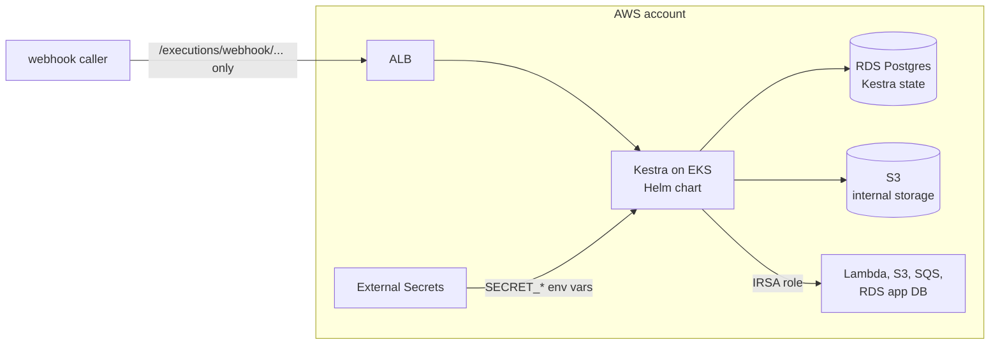
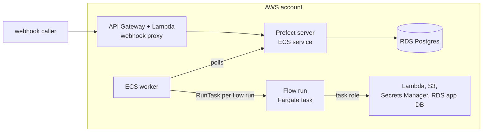

# Retool Workflows vs Kestra vs Prefect

A detailed comparison of the current tool, Retool Workflows (self-hosted on AWS ECS), with the
two candidates built and measured in this repository: Kestra OSS 2.0.10 and Prefect OSS 3.9.3.
It is judged against what the replacement has to deliver ([D-022](../decisions.md),
[D-023](../decisions.md)):

1. Promotion from dev to stage to prod without merge conflicts, possibly trunk-based.
2. Postgres work that runs past Retool's 600 s limit.
3. Decision gates driven by Postgres control tables.
4. Human steps: values typed into UI fields, data files uploaded, artifacts validated.
5. Spec-driven development.
6. Webhook calls that start a workflow. Retool has them built into its workflow triggers.
7. AWS integration: Lambda, S3, Postgres (RDS) and Secrets Manager.
8. A self-hosted deployment on AWS.

Per-tool guides, with how to run each one yourself: [kestra.md](kestra.md) and [prefect.md](prefect.md).

**Where each claim comes from:**

- **[measured]** — run in this repository on 2026-11-15 or 2026-11-16, with a link to the data.
  Only Kestra and Prefect can be measured. Retool is a commercial product and can't run here
  ([D-006](../decisions.md)). No AWS account was used, so AWS behavior is [docs] for all three.
- **[docs]** — the vendor's documentation or source, fetched on 2026-11-15 or 2026-11-16.
- **[owner]** — your experience running Retool Workflows: merge conflicts in promotion, the
  600 s timeout, deployment on ECS.

## Bottom line

**Kestra and Prefect both remove the two Retool pain points.** Each keeps flows as plain files
in Git, so promotion becomes a deploy of one commit, not a merge between environments. Each ran
a 660 s Postgres statement with no timeout configured [measured].

**Kestra fits the workflow needs best,** all in its free edition:

- The human step takes values *and* a file, in a form Kestra draws itself.
- Gates on Postgres are built in.
- Its webhook trigger answers the caller with the flow's result and can check an HMAC
  signature. Retool's webhooks use an API key; their docs mention no signature check.

**Prefect fits AWS operations and code-first development best:**

- Its free ECS worker runs every flow run as its own ECS task.
- It reads Secrets Manager at runtime.
- It calls Lambda synchronously or asynchronously.
- Everything is unit-testable Python.

Its free edition has no file upload in human steps and no webhooks. The nearest substitute is
an event post, which needs the server's admin credential, so put a small proxy in front.

**Deployment on AWS points to EKS for everyone.** Retool 4.0 (2026-06) no longer supports ECS:
Kubernetes with Helm is its only supported path. Kestra's docs rule out ECS Fargate for script
tasks; its official AWS paths are EKS with Helm, or EC2. Prefect's server has an official Helm
chart; its workers run natively on ECS.

**Recommendation:** Kestra on EKS for the pipelines, their human steps and their webhooks, if
you're moving off ECS anyway; you are, if you keep Retool on 4.0 or later.

- **If ECS is a hard requirement,** or the team is Python-first, choose Prefect: the server and
  workers on ECS, files through S3, and a small API Gateway + Lambda in front of its events API
  for webhooks.
- **If approvals must be tied to identities and permissions** without a paid edition, keep the
  data-entry screens in Retool Apps writing to the control tables. Either tool works behind
  them; Prefect tests better.

| Need | Retool Workflows | Kestra OSS | Prefect OSS |
|---|---|---|---|
| 1. Promotion without merge conflicts | **Weak** in practice [owner]. Git sync is Enterprise-only; Retool advises against one branch per environment [docs] | **Strong**: one YAML file per flow, config outside it [docs] | **Strong**: Python package and `prefect.yaml`, code in an immutable image [docs] |
| 2. Postgres work past 600 s | **Limited**: Cloud caps a block at 600 s; self-hosted can raise it, but defaults sit near 10 min [docs, owner] | **Strong**: 660.6 s, no timeouts by default [measured] | **Strong**: 660.3 s, no timeouts by default [measured] |
| 3. Gates on control tables | **Good**: Branch, Wait and Loop blocks; no Postgres trigger [docs] | **Strong**: `LoopUntil`, Postgres `Trigger`, `If`, `Switch` [measured, docs] | **Good**: any logic in Python; polling [measured] |
| 4a. Values typed in a UI | **Strong**: full app builder; User Tasks (beta) with assignment [docs] | **Good**: generated form on resume; no assignment [measured] | **Good**: generated form from a typed model; no assignment [measured] |
| 4b. File uploads in the human step | **Good**: app file inputs; a file inside a User Task isn't documented [docs] | **Strong**: file input in the resume form [measured] | **Missing**: no upload in the form [docs, measured] |
| 4c. Artifact validation and visibility | **Partial**: per-block JSON in run history [docs] | **Strong**: output files with Preview and Download [measured] | **Good**: table and markdown artifacts [measured] |
| 5. Spec-driven development and tests | **Weak**: no unit tests or mocks for workflows [docs] | **Good**: Python logic tested; flows end to end; flow tests are Enterprise [measured, docs] | **Strong**: everything in pytest [measured, docs] |
| 6. Webhooks | **Strong**: native trigger, API key, synchronous Response block [docs, owner] | **Strong**: native trigger, HMAC signature, synchronous outputs [measured] | **Weak**: Cloud only; OSS can post an event with the admin credential, no answer [measured, docs] |
| 7. Lambda, S3, RDS, Secrets Manager | **Strong**: resources for each; task role; Secrets Manager on Enterprise [docs] | **Good**: S3 and SQS triggers, Lambda (sync only); Secrets Manager only as injected env vars in OSS [docs] | **Strong**: blocks for S3, Lambda (sync and async) and Secrets Manager at runtime; no S3 trigger [docs] |
| 8. Self-hosted on AWS | **Changing**: 4.0+ is EKS only; needs Temporal [docs] | **Good on EKS or EC2**: Helm chart, RDS, S3; not ECS Fargate for script tasks [docs] | **Good, ECS-native**: Helm for the server; an ECS worker per flow run [docs] |
| Price, self-hosted | Enterprise only, no public price [docs] | Free (Apache-2.0); Enterprise per instance, no public price [docs] | Free (Apache-2.0); the paid path is Prefect Cloud (control plane SaaS), from $100/month [docs] |

## 1. Merge conflicts and promotion

**Retool Workflows** [docs, owner]

How it's built:

- Git source control is generally available, on **Enterprise only**.
- A protected workflow is changed only through a branch and a pull request. Since 2025-08,
  protected workflows also need a manual release.
- Workflows are stored as YAML (`startTrigger.yml` among them). Releases are zip files under
  `dist/workflows/<uuid>/`.
- Each instance has a manifest (`manifests/prod.yaml`) naming the release it runs.
  Multi-instance releases need self-hosted 3.252 or later.

What goes wrong:

- How a workflow's files are laid out isn't documented.
- Retool's conflict-resolution guidance is written for app Toolscript, not workflows.
- In-product branch merging is a public beta. The alternative "catch-up commits" cherry-pick.

What Retool recommends:

- **A single protected `main` that every instance points to,** with promotion through release
  manifests.
- It calls a branch per environment (Gitflow) "high-complexity" and refers you to its
  Professional Services. If your dev, stage and prod are branches that get merged, that alone
  explains much of the conflict pain.

**Kestra and Prefect** [docs, proposal]

The same model works for both, and it is what Retool also recommends, minus the generated
files:

- **One `main`, short-lived branches, releases as tags.**
- **Promotion is a deploy.** A tag goes to dev, then stage, then prod. No branch ever merges
  into an environment.
- **The flow files never name an environment.**
  - Kestra reads `{{ envs.x }}`, `{{ secret('X') }}` and `{{ kv('X') }}`, set per instance.
  - Prefect reads blocks and variables written per server at deploy time.
- **Changes are ordinary text diffs.**
  - Kestra: one YAML file per flow, plus Python namespace files.
  - Prefect: a Python package and a hand-written `prefect.yaml`.
  - Nothing is exported from a UI, and neither has generated IDs or canvas positions.

Their remaining risks are different:

| | Kestra | Prefect |
|---|---|---|
| Can the UI drift from the repo? | Yes: the UI editor saves to the server. The deploy (`delete=true`) overwrites it. `system.readOnly` disables the editor, but OSS can't block API edits. | Code, no (it's in the image). Blocks and variables, yes, until the next deploy. |
| Removing something | The deploy deletes flows that aren't in the repo | `prefect deploy` doesn't delete removed deployments; CI must |
| Environment separation | Separate instances (Kestra's recommendation); Promote is Enterprise | Separate servers; Workspaces are Cloud-only |
| CI tooling | REST deploy (here `deploy.sh`), `kestractl`, a GitHub Action (pin `kestractlVersion`) | `prefect deploy --all`, a GitHub Action (its guide assumes Cloud) |

Pipelines for both are sketched in the tool reports. No CI was built in this repo.

## 2. Long Postgres work and Retool's 600 s

**Retool** [docs]

Where the 600 s comes from:

- On **Retool Cloud**, a resource-query or code block in an asynchronous run can take at most
  **10 minutes (600 s)**, or 2 minutes in a synchronous run. The default is 10 s.
- A whole asynchronous run can last 30 hours.

On **self-hosted**, the block maximum is 24 days, but other defaults sit near 10 minutes:

- `WORKFLOW_DBCONNECTOR_QUERY_TIMEOUT_MS`, the timeout for queries run from workflows, defaults
  to 12 minutes.
- Retool's reference compose file sets the proxy's `PROXY_READ_TIMEOUT` to 600 s.
- The docs never reconcile these limits.

Retool's advice for long jobs: respond early and run the rest asynchronously, split into
several workflows, paginate, batch in loops, and wait in Wait blocks. There is nothing specific
for one long database statement.

> On self-hosted ECS (your setup), the 600 s most likely comes from the proxy or the workflow
> query timeout, which can be raised. On Cloud, the 600 s per-block maximum is fixed.

**Kestra and Prefect** [measured, docs]

- Both ran `select pg_sleep(660)` through their normal database task: Kestra's JDBC `Query`,
  Prefect's `SqlAlchemyConnector` block. Kestra: `SUCCESS` after 660.6 s, and 11 min 0.6 s in
  an earlier run. Prefect: `COMPLETED` with 660.3 s of run time.
- Neither sets a timeout by default on tasks, runs or queries. Limits are opt-in:
  - Kestra: `timeout` on a task, or an SLA with `MAX_DURATION`.
  - Prefect: `timeout_seconds`, which can't interrupt a blocking database call.
  - Either: Postgres `statement_timeout`.
- Both can also wait as long as needed between steps:
  - A Kestra `Pause` without a duration waits until resumed.
  - A Prefect `suspend_flow_run` has no default timeout. `pause_flow_run` defaults to 1 hour.
- On AWS, put the load balancer's idle timeout above your longest synchronous call. That only
  matters for webhooks answered synchronously (section 6); a scheduled run doesn't hold an HTTP
  connection.

## 3. Gates on Postgres control tables

| | Retool Workflows [docs] | Kestra [measured, docs] | Prefect [measured, docs] |
|---|---|---|---|
| Branch on a query result | Branch block | `If`, `Switch`; `Fail` and `Assert` stop the run | Python `if` |
| Wait until a row changes | Loop blocks, or a Wait block (up to 60 days) between checks | `LoopUntil` with a check interval and a maximum duration; the run shows `PAUSED` between checks | A polling task; the run shows `Running` |
| Start a run when rows appear | Schedules (at most once a minute); query triggers from SQS or Kafka (beta) | Postgres `Trigger`: polls a query and starts a flow when it returns rows | A schedule that exits early; or the writer emits an event that a deployment trigger reacts to |
| Write the decision back | A resource query | JDBC `Query` (parameters bind as text: cast in SQL) | `SqlAlchemyConnector` (typed parameters) |

The probe's gate ([probes.md](../probes.md)): the run waited on `probe.batch` until its row
turned READY, paused for a reviewer, validated the file and wrote `APPROVED` or `INVALID` back.
It worked the same in both tools, about 4 s from READY to the review step.

## 4. Human steps: values, files, validation

| | Retool Workflows [docs] | Kestra OSS [measured, docs] | Prefect OSS [measured, docs] |
|---|---|---|---|
| Pause for a person | **User Tasks** (beta): the run pauses, a task goes to assigned users or groups, and they complete it in a Retool app built from a template; expiry in days | `Pause` with `onResume` inputs; waits forever unless given a duration; Resume button on the run | `pause_flow_run` / `suspend_flow_run` with a `RunInput` model; Resume in the run page's menu |
| The form | Any Retool app: the richest UI of the three | Drawn by Kestra from the inputs; text fields are a code editor ([form](../comparison/data/screenshots/kestra-review-01-form.png)) | Drawn by Prefect from the model: text boxes, dropdowns, numbers, JSON ([form](../comparison/data/screenshots/prefect-review-01-form.png)) |
| File upload | App file inputs (base64, or Retool Storage; Retool advises passing URLs); a file inside a User Task isn't documented | **Yes**: a `FILE` input in the resume form; the probe's CSV went through the UI | **No**: the probe's reviewer pasted the CSV; real files go through S3 (section 7) |
| Who may act | Assigned users or groups; admins reassign in the Tasks Console | Anyone with the shared login (assignment via `HumanTask` and custom forms via Apps are Enterprise) | Anyone with the shared auth string (roles are Cloud Enterprise) |
| Showing the validation result | Block output in run history | The report file, with Preview and Download, on the run ([shot](../comparison/data/screenshots/kestra-review-02-outputs.png)) | A table artifact on the run and on the Artifacts page ([shot](../comparison/data/screenshots/prefect-review-03-artifact-table.png)) |

Retool is the best at building the screens people work in. Kestra is the only one that takes a
file in its own human step without extra infrastructure. Prefect needs a separate upload path.

## 5. Spec-driven development and testing

| | Retool Workflows [docs] | Kestra [measured, docs] | Prefect [measured, docs] |
|---|---|---|---|
| Test the logic outside the tool | Not documented | Yes: Python namespace files, 141 golden-vector tests in 0.3 s | Yes: 127 tests in about 1 s |
| Test the orchestration | Manual runs in the IDE; single-block runs; a "test deploy" dry run of a commit as a CI check | End to end through the API (the parity suite); Kestra's flow unit tests are Enterprise | `prefect_test_harness` runs whole flows in pytest; plus the parity suite |
| Linting and review | Review in Git pull requests (Enterprise); no linting for workflow files | YAML validated by the server on deploy; ruff for the Python | ruff and pytest for everything |
| Edit to result | Immediate in the IDE | 2.4 s, from edit to a sent email [measured] | 22.7 s with code in the image [measured] |

This repo shows the spec-driven loop working with both candidates:

- A written spec with requirement IDs ([workflow-spec.md](../baseline/workflow-spec.md)).
- Golden vectors generated from the reference implementation ([golden.md](../golden.md)).
- A tool-agnostic parity suite that both tools pass, 13 of 13 ([parity.md](../parity.md)).

The method carries over to any new pipeline.

## 6. Webhooks

| | Retool Workflows [docs] | Kestra OSS [measured, docs] | Prefect OSS [measured, docs] |
|---|---|---|---|
| Native webhook trigger | Yes: a URL per workflow, with an alias and path parameters | Yes: `POST` (also GET, PUT) `/api/v1/main/executions/webhook/{namespace}/{flow}/{key}`; multipart parts land in internal storage | **No.** Webhooks are Prefect Cloud only, from the Starter tier at $100/month. OSS has two substitutes: `POST /api/events` matched by a deployment trigger, or `POST /api/deployments/{id}/create_flow_run`. |
| How the caller authenticates | `X-Workflow-Api-Key` header (or a query parameter), or a public webhook | The key in the URL, plus an optional HMAC signature (SHA1, SHA256 or SHA512) of the body. The server's login doesn't apply: webhook paths are open by default. | The server's single basic-auth string, which opens the **whole API**. A caller holding it is an admin. |
| Answering the caller | A Response block returns a status and a JSON body; up to 15 minutes to the first response | `wait` + `returnOutputs` return the flow's outputs; `responseCode` and content type are configurable; a failed run returns 500 | The event post returns 204 with no body: no run id, no result. A caller that needs the result must create the run through the REST API and poll it. |
| Filtering | Path parameters | A `when` expression (204 when false); `conditions` were removed in 2.0 | The trigger's `match` and `expect` on the event |
| Limits | Sync runs: 15 min to the first response, 120 s per block; Cloud concurrency 100 | Bodies over 1 MiB with the default `FETCH` return 413; use `fetchType: STORE` | — |
| Probe ([probes.md](../probes.md#webhook-2026-11-16)) | — | Unsigned or wrongly signed: 401 before any execution. Signed: **200 in 0.35 s** with `{"batch":{"id":7,"status":"PENDING"}}` | Without the auth string: 401. With it: **204 in 0.01 s**, then the triggered run registered the batch 3 to 11 s later |

For callers outside the private network:

- **Kestra:** publish only the webhook path on the load balancer and keep the UI and API
  internal. Use a long random key and a signing secret.
- **Prefect:** put API Gateway + Lambda in front. The Lambda holds the auth string, checks the
  caller with its own key or signature, and posts the event or creates the run.

## 7. AWS integration: Lambda, S3, Postgres, Secrets Manager

None of this was run against AWS. Everything is from the docs and plugin sources [docs, src].

| | Retool (self-hosted) | Kestra OSS 2.0.10 (`plugin-aws` 4.0.0, Apache-2.0) | Prefect OSS 3.9.3 (`prefect-aws` 0.8.0) |
|---|---|---|---|
| **AWS Lambda** | Lambda resource | `lambda.Invoke`: **synchronous only**. The response is saved as a file (read it with `read()`); the task fails on a function error and copies the function's CloudWatch logs into the task log. | `LambdaFunction.invoke`: `RequestResponse`, `Event` (asynchronous) or `DryRun`; returns boto3's raw response |
| **Amazon S3** | S3 resource | `Upload`, `Download`, `List`, `Delete`, `Copy` and more, plus **`s3.Trigger`**, which polls a bucket and starts a flow per new object (optionally moving or deleting them) | `S3Bucket` block: upload, download, list, read, write, copy, move. **No delete** (use boto3) and **no S3 trigger** |
| **Postgres (RDS)** | Postgres resource; IAM authentication recommended for RDS and Aurora | `plugin-jdbc-postgres` (what this repo uses), any JDBC URL | `prefect-sqlalchemy` (what this repo uses); RDS IAM authentication is "experimental" |
| **Secrets Manager** | Self-hosted Enterprise, v3.4+: secrets per Space, read as `{{ secrets.name }}` | As Kestra's secret store: **Enterprise only**. OSS: inject them into the container as environment variables (ECS `secrets`, or Kubernetes External Secrets). They're read once at start, so a rotation needs a restart. Kestra wants them base64-encoded; this repo's [`secrets-entrypoint.sh`](../../kestra/secrets-entrypoint.sh) encodes plain values at start. No Secrets Manager task, only the generic AWS CLI task. | **`AwsSecret` block**: read, write, delete at runtime, in OSS. So rotation needs no restart. |
| **AWS credentials** | Keys, or on self-hosted the default chain (**the ECS task role**, IRSA), plus "role to assume" | Keys, or the SDK's default chain, which picks up **the ECS task role** and IRSA; assume-role (`stsRoleArn`); `endpointOverride` for LocalStack or MinIO | Keys or profile, or boto3's default chain (**the ECS task role**, IRSA); `assume_role_arn`; `endpoint_url` |
| **Other AWS triggers** | SQS and Kafka query triggers (beta) | SQS `RealtimeTrigger` (one run per message), SQS, S3 and CloudWatch polling triggers; EventBridge `PutEvents`, SNS, Athena, DynamoDB, Glue, Bedrock tasks | None built in: react to AWS events through your own code, such as an EventBridge rule to a Lambda that creates a run |

In short, both cover the four services with the ECS task role.

- **Kestra** has more ready-made triggers: S3 and SQS. Lambda calls are synchronous only.
  Secrets Manager comes through environment variables unless you buy Enterprise.
- **Prefect** reads Secrets Manager at runtime and calls Lambda either way. Bucket and queue
  watching is your own code.

## 8. Self-hosting on AWS

| | Retool [docs, owner] | Kestra [docs] | Prefect [docs] |
|---|---|---|---|
| Today and official path | You run it on ECS. **Retool 4.0 (2026-06-11) supports only Kubernetes with Helm**, because its code sandbox needs a seccomp profile that Fargate can't provide. Retool's Terraform blueprints build EKS (Karpenter, Multi-AZ RDS Postgres, S3, ALB, Secrets Manager). Retool can also operate the instance in your AWS account. | **EKS with the official Helm chart** (now in `kestra-io/kestra`, `charts/kestra`), with RDS and S3; or **EC2 with Docker Compose** (from 4 GiB and 2 vCPU, e.g. t3.medium) | Server: **Helm on EKS** (`prefect-server` chart) or Docker Compose. Workers: **the ECS worker** (documented for self-hosted), which starts every flow run as an ECS task |
| On ECS | Below 4.0 only | **Fargate isn't supported for script tasks:** they need Docker-in-Docker. Undocumented options: ECS on EC2 with the host's Docker socket (as this repo's compose does), or the Process runner, with Python and its packages in the Kestra image. The AWS Batch runner, which can use Fargate, is Enterprise. | **Natural fit:** the server is a stateless container next to RDS (no ECS guide, but no special needs), and the ECS worker launches flow runs as Fargate tasks with their own task role |
| Its own state | Postgres; **Temporal** for workflows (Retool-managed Temporal Cloud recommended); a privileged code executor | RDS Postgres ≥ 14 (Kestra's queue and repository); **S3 internal storage** (`storage-s3`, Apache-2.0) | RDS Postgres ≥ 14.9 with `pg_trgm`; Redis (ElastiCache) only to scale out |
| Footprint measured here | — | 699 MiB at idle, 825 MiB at peak (Kestra and its database) | 416 MiB at idle, 530 MiB at peak (server, worker, database) |
| Scaling and HA | Kubernetes | Split webserver, scheduler, executor and workers on the Postgres backend (OSS); Kafka, Redis or AMQP queues and worker groups are Enterprise | Several API servers + background services + Redis (OSS); one ECS task per flow run |

Both diagrams are proposals, not built here.

## 9. Pricing and features for self-hosting

Prices as published on 2026-11-16. Two of the three have no public price for self-hosting.

| | Retool | Kestra | Prefect |
|---|---|---|---|
| Free and self-hosted | **No**: self-hosting is Enterprise only | **OSS (Apache-2.0)**: everything in this repo; webhooks; `plugin-aws`; S3 storage; human steps with forms and files; Prometheus | **OSS (Apache-2.0)**: server, process and ECS workers, `prefect-aws`, automations and event triggers, artifacts |
| Paid self-hosted | **Enterprise**, "contact sales"; workflow runs "custom" on Enterprise | **Enterprise**: annual subscription per instance, unlimited flows and executions, "contact sales". Support tiers: Standard (24 h P0, 8×5), Premium (6 h), Platinum (1 h, 24×7). Upgrade by adding a license key. | **Customer-Managed Prefect** (the Cloud API in your Kubernetes) has current docs but isn't on the pricing page: ask sales whether it's still sold |
| Paid hosted | Cloud plans: builders $10/$50 a month (Team/Business, annual), internal users $5/$15; 5,000 workflow runs a month on Team and Business | **Kestra Cloud**: usage-based, by request, no public price | **Prefect Cloud, hybrid**: the control plane is SaaS while workers and data stay in your AWS. Hobby $0, Starter $100/month, Team $100 per user per month (4–8 users), Enterprise custom |
| What paying adds that matters here | Source control and Spaces (Enterprise); Secrets Manager integration (Enterprise self-hosted); audit logs from Business | RBAC, SSO and SCIM; audit logs; **Secrets Manager as secret store**; worker groups; **AWS Batch, EC2 and Lambda task runners**; Apps and `HumanTask` (assigned approvals); Promote; flow unit tests; Kafka, Redis and AMQP queues | Webhooks (Starter+); RBAC, SSO and SCIM (Enterprise); audit logs (Team: 24 h); managed unresponsive-run detection; push and serverless work pools; service accounts (Team+) |

What stays the same on every tier:

- **Kestra:** the workflow features (forms, files, webhooks, AWS plugins) are free. You pay for
  governance (who may do what), secret backends and remote runners.
- **Prefect:** the engine is free. You pay, in practice through Prefect Cloud, for webhooks,
  roles and managed operations. Cloud keeps flow-run metadata, flow parameter values and
  (optionally) logs; your code and data stay in your account.
- **Retool:** self-hosting means Enterprise, and Retool 4.0 means EKS.

Retool's run-overage price differed between fetches. On 2026-11-15 the page showed $75 per
5,000 runs on Team and Business; on 2026-11-16 that wasn't on the page. Confirm with Retool.

## Other capabilities

| | Retool Workflows [docs] | Kestra OSS [measured, docs] | Prefect OSS [measured, docs] |
|---|---|---|---|
| Error handling | Per-block retries (up to 9, with backoff); error connectors and global error handlers | `allowFailure`, `runIf`, `errorLogs()`, task retries; some plugin defaults are slow (a 73 s HTTP connect timeout) | Python control flow; task retries; a run whose worker dies stays `Running` without an automation |
| Scheduling | Cron or interval, at most once a minute, with up to 6 min of random jitter, never overlapping | Cron with concurrency limits; backfill; missed-run policy | Cron with concurrency limits; no backfill |
| Observability | Run history (30 days by default; up to 90 on Cloud, 365 self-hosted); analytics and Datadog/Sentry (beta) | Topology, Gantt, per-task logs and outputs, Prometheus on by default | Run graph, logs, artifacts; metrics need an exporter |
| Releases | Continuous (Cloud); self-hosted versions | LTS every 6 months, supported for a year | Minor versions every 2 to 3 months, no LTS |

Measured details: [results.md](../comparison/results.md). The weighted score there, for the
n8n-based criteria, is Kestra 3.76 and Prefect 3.59.

## Options

| Option | What it looks like | When it fits |
|---|---|---|
| **A. Kestra for everything, on EKS** | Pipelines, gates, human steps (forms with file upload) and webhooks in Kestra. Helm chart on EKS with RDS and S3. Secrets from Secrets Manager through External Secrets. Trunk-based CI. | You're moving to EKS anyway (Retool 4.0 requires it). People approving and uploading can share one login, or Enterprise is an option. |
| **B. Prefect for everything, on ECS** | Pipelines and gates in Python. The server as an ECS service; flow runs as Fargate tasks through the ECS worker. Secrets Manager read at runtime. Files through S3. A webhook proxy on API Gateway + Lambda. | ECS must stay. The team is Python-first. Spec-driven testing matters most. Files arrive through S3 anyway. |
| **C. Retool Apps in front, Kestra or Prefect behind** | People use Retool apps (forms, uploads, permission groups) that write to Postgres control tables and S3. Pipelines in Kestra or Prefect wait on those tables or are called by webhook. No Retool Workflows. | Approvals must be tied to identities and permissions without paying for Kestra Enterprise or Prefect Cloud, and the team already builds Retool apps. Retool apps are kept in Git as Toolscript, for which Retool documents conflict resolution [docs]. Retool's own move to EKS still applies. |

**Recommendation:** **A**, Kestra on EKS. It covers the workflow needs (1 to 6) natively in its
free edition, its webhooks match Retool's, and EKS is where Retool itself is heading.

- **Choose B** if ECS is a hard requirement. Prefect is the better ECS citizen and the better
  code-first tool, but plan for its two gaps: no webhooks and no file upload.
- **Move to C** if approvals must be tied to people. In C, Prefect is an equally good back end
  and better for testing, since the human step moves to Retool.

## Before deciding

1. **Find out which Retool limit you hit.** On self-hosted ECS, check
   `WORKFLOW_DBCONNECTOR_QUERY_TIMEOUT_MS` and the proxy timeout first: raising them may be a
   stopgap.
2. **Check your Retool version and its ECS future.** Moving to 4.0 means EKS. That changes the
   comparison of deployment cost: one EKS cluster could host Retool apps and the new
   orchestrator.
3. **Check how promotion works today.** Branch per environment, or one `main` with
   multi-instance releases? The first explains conflicts on its own.
4. **Pilot one real workflow** with a hard gate, a human step, a webhook and AWS calls. On
   Kestra, start from the probes ([probe-gate.yml](../../kestra/probes/probe-gate.yml),
   [probe-webhook.yml](../../kestra/probes/probe-webhook.yml)) and add `plugin-aws` tasks. Run
   it in an AWS sandbox account with the task role. That's the part this experiment couldn't
   cover.
5. **Decide on access control:**
   - a shared login with recorded approvers (OSS);
   - Kestra Enterprise or Prefect Cloud;
   - Retool apps in front (option C).
6. **Get quotes** for Kestra Enterprise (per instance) and for Prefect Cloud or Customer-Managed
   Prefect, if governance features are needed. Compare them with your Retool Enterprise renewal.
7. **Retool facts here are from the docs as of 2026-11-16.** Several relevant features are
   beta: User Tasks, in-product branch merging, protected triggers. Confirm them for your plan
   and version.

## Sources

- **Measured here:**
  - [probes.md](../probes.md): the long statement, the gate, the UI review, the webhooks.
  - [results.md](../comparison/results.md): Phase 6 measurements and scorecard.
  - [parity.md](../parity.md).
  - The raw data and screenshots in [comparison/data/](../comparison/data/).
- **Retool:**
  - Limits and long jobs: [workflow limits](https://docs.retool.com/workflows/concepts/limits), [troubleshooting](https://docs.retool.com/workflows/guides/troubleshooting), [Wait block](https://docs.retool.com/workflows/guides/blocks/wait), [query environment variables](https://docs.retool.com/self-hosted/self-managed/reference/environment-variables/queries), [reference compose](https://raw.githubusercontent.com/tryretool/retool-onpremise/master/compose.yaml)
  - Source control and promotion: [protect workflows](https://docs.retool.com/source-control/guides/protect/workflows), [branch merging](https://docs.retool.com/source-control/guides/branch-merging), [multi-instance releases](https://docs.retool.com/source-control/guides/multi-instance-releases/classic-apps-workflows), [source control best practices](https://docs.retool.com/source-control/concepts/best-practices), [test deploy](https://docs.retool.com/source-control/guides/test-deploy)
  - Human steps and files: [User Tasks](https://docs.retool.com/workflows/guides/user-tasks), [file inputs](https://docs.retool.com/classic-apps/guides/forms-inputs/file-inputs)
  - Webhooks: [webhooks](https://docs.retool.com/workflows/guides/webhooks), [Response block](https://docs.retool.com/workflows/guides/blocks/response)
  - AWS: [Lambda](https://docs.retool.com/data-sources/quickstarts/api/lambda), [S3](https://docs.retool.com/data-sources/guides/connect/amazon-s3), [PostgreSQL](https://docs.retool.com/data-sources/guides/connect/postgresql), [AWS Secrets Manager](https://docs.retool.com/self-hosted/guides/secrets/aws)
  - Deployment: [Retool 4.0 stable](https://docs.retool.com/changelog/self-hosted-retool-40-stable), [ECS to Kubernetes](https://docs.retool.com/self-hosted/self-managed/guides/upgrade/migrate/ecs-to-kubernetes), [AWS tutorial](https://docs.retool.com/self-hosted/self-managed/tutorials/kubernetes/aws), [architecture](https://docs.retool.com/self-hosted/concepts/architecture)
  - Cost: [error handlers](https://docs.retool.com/workflows/guides/error-handlers), [schedules](https://docs.retool.com/workflows/guides/schedule), [logs](https://docs.retool.com/workflows/concepts/logs), [billing](https://docs.retool.com/support/billing-usage/workflows), [pricing](https://retool.com/pricing)
- **Kestra:**
  - Workflow: [Pause](https://kestra.io/plugins/core/flow/io.kestra.plugin.core.flow.pause), [inputs](https://kestra.io/docs/workflow-components/inputs), [LoopUntil](https://kestra.io/plugins/core/flow/io.kestra.plugin.core.flow.loopuntil), [Postgres trigger](https://kestra.io/plugins/plugin-jdbc-postgres/io.kestra.plugin.jdbc.postgresql.trigger), [timeouts](https://kestra.io/docs/workflow-components/timeout), [webhook trigger](https://kestra.io/docs/workflow-components/triggers/webhook-trigger)
  - AWS: [plugin-aws](https://kestra.io/plugins/plugin-aws), [S3 trigger](https://kestra.io/plugins/plugin-aws/s3/io.kestra.plugin.aws.s3.trigger), [Lambda Invoke](https://kestra.io/plugins/plugin-aws/lambda/io.kestra.plugin.aws.lambda.invoke), [Secrets Manager (Enterprise)](https://kestra.io/docs/enterprise/governance/secrets-manager), [storage](https://kestra.io/docs/configuration/runtime-and-storage), [EKS](https://kestra.io/docs/installation/kubernetes-aws-eks), [EC2](https://kestra.io/docs/installation/aws-ec2), [requirements](https://kestra.io/docs/administrator-guide/requirements), [task runners](https://kestra.io/docs/task-runners/types)
  - Operations and cost: [environments](https://kestra.io/docs/best-practices/manage-environments), [Git](https://kestra.io/docs/version-control-cicd/git), [OSS vs paid](https://kestra.io/docs/oss-vs-paid), [pricing](https://kestra.io/pricing)
- **Prefect:**
  - Workflow: [interactive workflows](https://www.prefect.io/docs/v3/advanced/interactive.md), [artifacts](https://www.prefect.io/docs/v3/concepts/artifacts.md), [prefect.yaml](https://www.prefect.io/docs/v3/how-to-guides/deployments/prefect-yaml.md), [CI/CD](https://www.prefect.io/docs/v3/advanced/deploy-ci-cd.md), [testing](https://www.prefect.io/docs/v3/how-to-guides/workflows/test-workflows.md)
  - Webhooks and events: [webhooks (Cloud)](https://www.prefect.io/docs/v3/concepts/webhooks), [events](https://www.prefect.io/docs/v3/concepts/events), [deployment triggers](https://www.prefect.io/docs/v3/how-to-guides/automations/creating-deployment-triggers)
  - AWS: [prefect-aws](https://www.prefect.io/docs/integrations/prefect-aws), [S3](https://www.prefect.io/docs/integrations/prefect-aws/api-ref/prefect_aws-s3), [Lambda](https://www.prefect.io/docs/integrations/prefect-aws/api-ref/prefect_aws-lambda_function), [Secrets Manager](https://www.prefect.io/docs/integrations/prefect-aws/api-ref/prefect_aws-secrets_manager), [ECS worker](https://www.prefect.io/docs/integrations/prefect-aws/ecs-worker/manual-deployment)
  - Deployment and cost: [Helm](https://www.prefect.io/docs/v3/advanced/server-helm), [self-hosted](https://www.prefect.io/docs/v3/advanced/self-hosted), [pricing](https://www.prefect.io/pricing), [Customer-Managed docs](https://docs-customer-managed.prefect.io/), [security](https://www.prefect.io/security)
