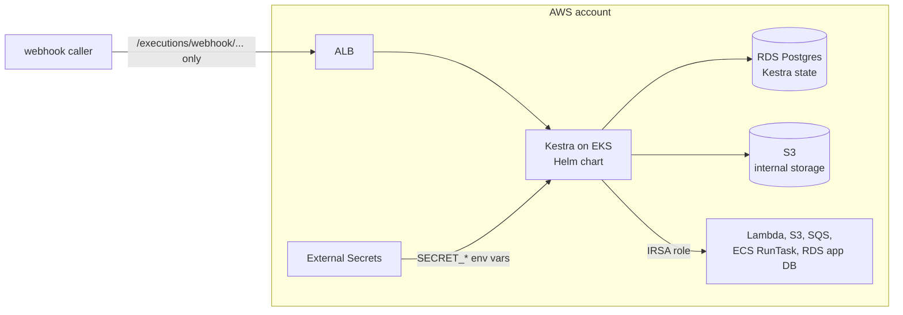
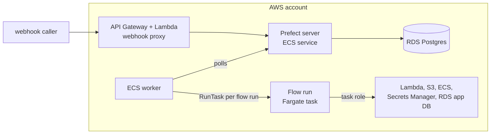
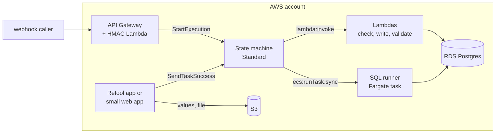

# Replacing Retool Workflows: Retool, Kestra, Prefect and AWS Step Functions

A detailed comparison of the current tool, Retool Workflows (self-hosted on AWS ECS), with three
replacements:

- **Kestra OSS 2.0.10** and **Prefect OSS 3.9.3**, both built and measured in this repository;
- **AWS Step Functions**, assessed from AWS's documentation.

They are judged against what the replacement has to deliver ([D-022](../decisions.md),
[D-023](../decisions.md), [D-024](../decisions.md)).

How you work:

1. Promotion from dev to stage to prod without merge conflicts, possibly trunk-based.
2. Spec-driven development.

What the workflows do:

3. Decision gates driven by Postgres control tables.
4. Human steps: values typed into UI fields, data files uploaded, artifacts validated.
5. Postgres work of up to 30 minutes. Retool stops at 600 s.
6. Lambda calls.
7. Triggering ECS tasks, and waiting for them.
8. Webhook calls that start a workflow. Retool has them built into its workflow triggers.
9. S3, Postgres (RDS) and Secrets Manager.

Where it runs and what it costs:

10. Running on AWS. Retool is self-hosted on ECS today.
11. Price against features.

One report per replacement, with how to build and run it: [kestra.md](kestra.md),
[prefect.md](prefect.md) and [step-functions.md](step-functions.md).

**Where each claim comes from:**

- **[measured]** — run in this repository on 2026-11-15 or 2026-11-16, with a link to the data.
  Only Kestra and Prefect could run here. Retool is a commercial product, Step Functions is an
  AWS service, and no AWS account was used ([D-006](../decisions.md), [D-024](../decisions.md)).
  So AWS behavior is [docs] for all four.
- **[docs]** — the vendor's documentation, fetched on 2026-11-15 or 2026-11-16.
- **[src]** — the source code at the release tag in use.
- **[owner]** — your experience running Retool Workflows: merge conflicts in promotion, the
  600 s timeout, deployment on ECS.
- **[proposal]** — a design that wasn't built or run.

## Bottom line

**All three replacements remove Retool's two pain points.**

- **No merges between environments.** Each keeps workflows as text files in Git, so promotion
  is deploying one commit.
- **30-minute Postgres work.**
  - Kestra and Prefect ran a 30-minute statement through their ordinary database step, with
    nothing configured [measured].
  - Step Functions runs such a statement in an ECS task that it starts and waits for [docs].
  - Retool Cloud caps a block at 10 minutes. Self-hosted Retool can be configured past that,
    but its workflow queries time out at 12 minutes by default [docs].

**They differ in where the work happens:**

- **Kestra has the workflow features built in, free.** It has gates on Postgres, a human step
  that takes values and a file, validation reports on the run, and signed webhooks that answer
  with the result. Lambda calls are native; ECS tasks need a short script. It runs on EKS or
  EC2, not ECS Fargate.
- **Prefect is Python, and ECS-native.** Every flow run can be its own Fargate task, and
  everything is unit-testable. But its free edition has no file upload in human steps and no
  webhooks. Its Lambda block breaks on calls over a minute; a few lines fix that.
- **Step Functions is the AWS-native one.** Lambda calls and ECS tasks (start and wait) are
  built in. Promotion is infrastructure as code with canary rollouts, and there's nothing to
  host. But it has no human-step UI at all, no SQL step, and no local development loop.

**Staying on Retool also means leaving ECS:** Retool 4.0 (2026-06) supports only Kubernetes.

**Recommendation.** One question decides it: **where will people do their part** — enter
values, upload files, approve?

- **In the workflow tool: Kestra on EKS ([option A](#options)).** It's the only option that
  covers the human steps, the gates and the webhooks without building anything. It also handles
  Lambda calls and 30-minute statements. Budget a short script for ECS tasks, and an EKS cluster
  to run it on.
- **In Retool apps you keep, or a small app of your own: Step Functions behind them
  ([option C](#options)).** Lambda, ECS, promotion and hosting are its strengths. The human
  step becomes "the app writes the values and the file to Postgres and S3, then resumes the
  run".
- **Prefect ([option B](#options))** if ECS must stay and the team is Python-first. Plan for its
  gaps: files, webhooks and the Lambda client.

| Need | Retool Workflows | Kestra OSS | Prefect OSS | AWS Step Functions |
|---|---|---|---|---|
| 1. Promotion without merge conflicts | **Weak** in practice [owner]. Git sync is Enterprise-only; Retool advises against one branch per environment [docs] | **Strong**: one YAML file per flow, config outside it [docs] | **Strong**: a Python package and `prefect.yaml`, code in an immutable image [docs] | **Strong**: the definition in IaC, one account per environment; versions, aliases, canary rollouts with alarm rollback [docs] |
| 2. Spec-driven development and tests | **Weak**: no unit tests or mocks for workflows [docs] | **Good**: logic tested in Python; flows end to end; flow tests are Enterprise [measured, docs] | **Strong**: everything in pytest, flows included [measured, docs] | **Good**: `TestState` with mocks per state; logic in plain code; no local emulator, so the loop runs in AWS [docs] |
| 3. Gates on control tables | **Good**: Branch, Wait and Loop blocks; no Postgres trigger [docs] | **Strong**: `LoopUntil`, Postgres `Trigger`, `If`, `Switch` [measured, docs] | **Good**: any logic in Python; polling [measured] | **Good**: a Lambda reads, a Choice branches, a Wait loops; or a callback token parked on the row; no SQL step [docs] |
| 4a. Values typed in a UI | **Strong**: full app builder; User Tasks (beta) with assignment [docs] | **Good**: generated form on resume; no assignment [measured] | **Good**: generated form from a typed model; no assignment [measured] | **Missing**: a callback token; you build the UI [docs] |
| 4b. File uploads in the human step | **Good**: app file inputs; a file inside a User Task isn't documented [docs] | **Strong**: file input in the resume form [measured] | **Missing**: no upload in the form [docs, measured] | **Missing**: your UI uploads to S3 [docs] |
| 4c. Artifact validation and visibility | **Partial**: per-block JSON in run history [docs] | **Strong**: output files with Preview and Download [measured] | **Good**: table and markdown artifacts [measured] | **Partial**: step input and output up to 256 KiB; reports in S3 [docs] |
| 5. Postgres work of up to 30 minutes | **Weak**: Cloud caps a block at 10 min; self-hosted needs the block timeout and the 12-minute workflow query timeout raised [docs] | **Strong**: `select pg_sleep(1800)` finished `SUCCESS` in 1,801 s; no timeouts by default [measured] | **Strong**: `select pg_sleep(1800)` finished `COMPLETED` in 1,825 s from the API call; no timeouts by default [measured] | **Good**: in an ECS task that it starts and waits for, not in Lambda (15 min); you build the SQL-runner image [docs] |
| 6. Lambda calls | **Good**: a Lambda resource; sync or async and the client timeout aren't documented; block limits apply [docs] | **Strong**: `lambda.Invoke` waits up to 15 min 10 s; synchronous only [src] | **Good, with a fix**: the block's 60 s read timeout and retries break long calls; a configured client works [src] | **Strong**: optimized `lambda:invoke`, documented retries, callbacks [docs] |
| 7. ECS tasks | **Weak**: no ECS resource; signed REST calls to `RunTask`, then polling in a code block [docs] | **Weak**: no ECS task in OSS; a boto3 script or the CLI; the AWS Batch runner is Enterprise [src, docs] | **Good**: `run_deployment()` on an ECS work pool waits for the Fargate task; boto3 for other task definitions [src] | **Strong**: `ecs:runTask.sync` starts the task and waits for it [docs] |
| 8. Webhooks | **Strong**: native trigger, API key, synchronous Response block [docs, owner] | **Strong**: native trigger, HMAC signature, synchronous outputs [measured] | **Weak**: Cloud only; OSS can post an event with the admin credential, no answer [measured, docs] | **Good**: API Gateway starts a run and returns its ID; synchronous only for Express (5 min); HMAC needs a Lambda [docs] |
| 9. S3, RDS, Secrets Manager | **Strong**: resources for each; task role; Secrets Manager on Enterprise [docs] | **Good**: S3 and SQS triggers; Secrets Manager only as injected env vars in OSS [docs] | **Strong**: S3 and Secrets Manager at runtime; no S3 trigger [docs] | **Strong**: SDK integrations and IAM; secrets read in a state stay in the history [docs] |
| 10. Running on AWS | **Changing**: 4.0+ is Kubernetes only; needs Temporal [docs] | **Good on EKS or EC2**: Helm chart, RDS, S3; not ECS Fargate for script tasks [docs] | **Good, ECS-native**: the server as a container; an ECS task per flow run [docs] | **Nothing to host**: managed; you deploy Lambdas, task definitions and the UI [docs] |
| 11. Price | Enterprise only for self-hosting, no public price [docs] | Free (Apache-2.0); Enterprise per instance, no public price [docs] | Free (Apache-2.0); the paid path is Prefect Cloud, from $100/month [docs] | $0.025 per 1,000 state transitions after 4,000 free a month, plus Lambda, Fargate and API Gateway [docs] |

## 1. Merge conflicts and promotion

**Retool Workflows** [docs, owner]

How it's built:

- Git source control is generally available, on **Enterprise only**.
- A protected workflow is changed only through a branch and a pull request. Since 2025-08,
  protected workflows also need a manual release.
- Workflows are stored as YAML (`startTrigger.yml` among them). Releases are zip files under
  `dist/workflows/<uuid>/`.
- Each instance has a manifest (`manifests/prod.yaml`) naming the release it runs.
  Multi-instance releases need self-hosted 3.252 or later.

What goes wrong:

- How a workflow's files are laid out isn't documented.
- Retool's conflict-resolution guidance is written for app Toolscript, not workflows.
- In-product branch merging is a public beta. The alternative "catch-up commits" cherry-pick.

What Retool recommends:

- **A single protected `main` that every instance points to,** with promotion through release
  manifests.
- It calls a branch per environment (Gitflow) "high-complexity" and refers you to its
  Professional Services. If your dev, stage and prod are branches that get merged, that alone
  explains much of the conflict pain.

**Kestra, Prefect and Step Functions** [docs, proposal]

The same model works for all three. It's what Retool also recommends, minus the generated
files:

- **One `main`, short-lived branches, releases as tags.**
- **Promotion is a deploy.** A tag goes to dev, then stage, then prod. No branch ever merges
  into an environment.
- **The workflow files never name an environment.**
  - Kestra reads `{{ envs.x }}`, `{{ secret('X') }}` and `{{ kv('X') }}`, set per instance.
  - Prefect reads blocks and variables written per server at deploy time.
  - Step Functions gets ARNs and names through `DefinitionSubstitutions` or CDK references.
- **Changes are ordinary text diffs.**
  - Kestra: one YAML file per flow, plus Python namespace files.
  - Prefect: a Python package and a hand-written `prefect.yaml`.
  - Step Functions: an ASL definition (JSON or YAML) in a SAM, CDK or CloudFormation app, plus
    the Lambda and container code.
  - Nothing is exported from a UI, and none has generated IDs or canvas positions.

Their remaining risks differ:

| | Kestra | Prefect | Step Functions |
|---|---|---|---|
| Can the live copy drift from the repo? | Yes: the UI editor saves to the server. The deploy (`delete=true`) overwrites it. `system.readOnly` disables the editor, but OSS can't block API edits. | Code, no (it's in the image). Blocks and variables, yes, until the next deploy. | Yes: Workflow Studio in the console edits the live machine, and `sam sync --watch` drifts on purpose in dev. The next IaC deploy overwrites it. |
| Removing something | The deploy deletes flows that aren't in the repo | `prefect deploy` doesn't delete removed deployments; CI must | Removing it from the template deletes it on the next deploy |
| Environment separation | Separate instances (Kestra's recommendation); Promote is Enterprise | Separate servers; Workspaces are Cloud-only | Separate accounts or stacks; no Step Functions-specific guidance |
| Safe rollout | Deploy and watch | Deploy and watch | Immutable versions; an alias can shift traffic as a canary or linearly, with alarm rollback; running executions keep their version |
| CI tooling | REST deploy (here `deploy.sh`), `kestractl`, a GitHub Action (pin `kestractlVersion`) | `prefect deploy --all`, a GitHub Action (its guide assumes Cloud) | `sam deploy` or `cdk deploy`; `ValidateStateMachineDefinition` (1 call/s); `TestState` |

Pipelines for each are sketched in the per-tool reports. No CI was built in this repo.

## 2. Spec-driven development and testing

| | Retool Workflows [docs] | Kestra [measured, docs] | Prefect [measured, docs] | Step Functions [docs] |
|---|---|---|---|---|
| Test the logic outside the tool | Not documented | Yes: Python namespace files, 141 golden-vector tests in 0.3 s | Yes: 127 tests in about 1 s | Yes: Lambda and container code is plain code |
| Test the orchestration | Manual runs in the IDE; single-block runs; a "test deploy" dry run of a commit as a CI check | End to end through the API (the parity suite); Kestra's flow unit tests are Enterprise | `prefect_test_harness` runs whole flows in pytest; plus the parity suite | `TestState` (Nov 2025) runs one state with mocked service results, retries included; an AWS API call, throttled at 50/10 |
| A local environment | — | Docker Compose, here | Docker Compose, here | None supported: AWS calls Step Functions Local "unsupported"; each developer needs a sandbox account or stack |
| Linting and review | Review in Git pull requests (Enterprise); no linting for workflow files | YAML validated by the server on deploy; ruff for the Python | ruff and pytest for everything | `ValidateStateMachineDefinition`; your linters for the code |
| Edit to result | Immediate in the IDE | 2.4 s, from edit to a sent email [measured] | 22.7 s with code in the image [measured] | A `sam sync --watch` push to your sandbox, then a run (not measured) |

This repo shows the spec-driven loop working with both candidates it could run:

- A written spec with requirement IDs ([workflow-spec.md](../baseline/workflow-spec.md)).
- Golden vectors generated from the reference implementation ([golden.md](../golden.md)).
- A tool-agnostic parity suite that both tools pass, 13 of 13 ([parity.md](../parity.md)).

The method carries over to any new pipeline, and to Step Functions: golden vectors for the
Lambda logic, `TestState` cases for the states, and the parity suite against a deployed stack.

## 3. Gates on Postgres control tables

| | Retool Workflows [docs] | Kestra [measured, docs] | Prefect [measured, docs] | Step Functions [docs, proposal] |
|---|---|---|---|---|
| Branch on a query result | Branch block | `If`, `Switch`; `Fail` and `Assert` stop the run | Python `if` | A Lambda runs the query; a Choice branches on its result |
| Wait until a row changes | Loop blocks, or a Wait block (up to 60 days) between checks | `LoopUntil` with a check interval and a maximum duration; the run shows `PAUSED` between checks | A polling task; the run shows `Running` | A Wait + Lambda + Choice loop: about 9 history events per check, 25,000 at most (9 to 10 days at 5 minutes). Or a callback token parked on the row, resumed by whoever changes it |
| Start a run when rows appear | Schedules (at most once a minute); query triggers from SQS or Kafka (beta) | Postgres `Trigger`: polls a query and starts a flow when it returns rows | A schedule that exits early; or the writer emits an event that a deployment trigger reacts to | A schedule (EventBridge Scheduler); or Postgres calls a Lambda through the `aws_lambda` extension, which starts or resumes the run |
| Write the decision back | A resource query | JDBC `Query` (parameters bind as text: cast in SQL) | `SqlAlchemyConnector` (typed parameters) | A Lambda with parameterized SQL |

The probe's gate ([probes.md](../probes.md)): the run waited on `probe.batch` until its row
turned READY, paused for a reviewer, validated the file and wrote `APPROVED` or `INVALID` back.
It worked the same in both tools, about 4 s from READY to the review step. The same gate for
Step Functions is sketched in [step-functions.md](step-functions.md#the-batch-pipeline-gate-long-statement-lambda-human-step-proposal).

## 4. Human steps: values, files, validation

| | Retool Workflows [docs] | Kestra OSS [measured, docs] | Prefect OSS [measured, docs] | Step Functions [docs] |
|---|---|---|---|---|
| Pause for a person | **User Tasks** (beta): the run pauses, a task goes to assigned users or groups, and they complete it in a Retool app built from a template; expiry in days | `Pause` with `onResume` inputs; waits forever unless given a duration; Resume button on the run | `pause_flow_run` / `suspend_flow_run` with a `RunInput` model; Resume in the run page's menu | `.waitForTaskToken`: waits up to a year until something calls `SendTaskSuccess` with the token |
| The form | Any Retool app: the richest UI of the four | Drawn by Kestra from the inputs; text fields are a code editor ([form](../comparison/data/screenshots/kestra-review-01-form.png)) | Drawn by Prefect from the model: text boxes, dropdowns, numbers, JSON ([form](../comparison/data/screenshots/prefect-review-01-form.png)) | **None.** AWS's sample sends e-mail with Approve and Reject links: unauthenticated GETs carrying the token |
| File upload | App file inputs (base64, or Retool Storage; Retool advises passing URLs); a file inside a User Task isn't documented | **Yes**: a `FILE` input in the resume form; the probe's CSV went through the UI | **No**: the probe's reviewer pasted the CSV; real files go through S3 | **No**: your UI uploads to S3 (a presigned URL) and passes the key |
| Who may act | Assigned users or groups; admins reassign in the Tasks Console | Anyone with the shared login (assignment via `HumanTask` and custom forms via Apps are Enterprise) | Anyone with the shared auth string (roles are Cloud Enterprise) | Whoever your UI lets act, and whoever IAM allows to call `SendTaskSuccess` |
| Showing the validation result | Block output in run history | The report file, with Preview and Download, on the run ([shot](../comparison/data/screenshots/kestra-review-02-outputs.png)) | A table artifact on the run and on the Artifacts page ([shot](../comparison/data/screenshots/prefect-review-03-artifact-table.png)) | Step output (256 KiB at most) in the console; the report in S3, shown in your UI |

Retool is the best at building the screens people work in. Kestra is the only one that takes a
file in its own human step without extra infrastructure. Prefect needs a separate upload path.
Step Functions needs the whole screen built, which is a natural job for the Retool apps you
already run.

## 5. Postgres work of up to 30 minutes

**Retool** [docs]

- **Retool Cloud:** a resource-query or code block can take at most **10 minutes** in an
  asynchronous run, or 2 minutes in a synchronous one. The default is 10 s. A whole
  asynchronous run can last 30 hours. 30 minutes in one block isn't possible.
- **Self-hosted:** the block maximum is 24 days, but other defaults sit near 10 minutes:
  - `WORKFLOW_DBCONNECTOR_QUERY_TIMEOUT_MS`, the timeout for queries run from workflows,
    defaults to 12 minutes, with no documented maximum.
  - Retool's reference compose file sets the proxy's timeouts to 600 s. In its reference
    Fargate template, workflow workers call the backend directly, not through the proxy.
  - So 30 minutes is plausible on self-hosted, by raising the block's timeout and the workflow
    query timeout. How these interact with the proxy settings isn't documented.
- **Retool's advice for long jobs:** respond early and run the rest asynchronously, split work
  into several workflows, paginate, batch in loops, and wait in Wait blocks. There is nothing
  specific for one long database statement.

**Kestra and Prefect** [measured, src]

Both ran `select pg_sleep(1800)` through their ordinary database task: Kestra's JDBC `Query`,
Prefect's `SqlAlchemyConnector` block.

| | Kestra 2.0.10 | Prefect 3.9.3 |
|---|---|---|
| 30-minute statement (2026-11-16) | `SUCCESS` in 1,801.3 s from the API call | `COMPLETED` in 1,825.0 s from the API call, including the worker's pickup |
| 660 s statement (2026-11-15) | `SUCCESS` in 660.6 s | `COMPLETED` in 675.2 s from the API call (660.3 s of run time) |
| Timeouts configured | None | None |
| Who holds the statement | One worker thread (CPU count × 8 by default) | The flow run's process; with the ECS worker, the flow run's own Fargate task |
| If you add a timeout | A task `timeout` probably doesn't cancel the running statement; a manual Kill does | `timeout_seconds` can't cancel a blocking database call |
| Data | [probes-kestra (11-16)](../comparison/data/probes-kestra-2026-11-16.json) | [probes-prefect (11-16)](../comparison/data/probes-prefect-2026-11-16.json) |

Neither tool sets a timeout on tasks, runs or queries, and neither do their Postgres drivers
(pgjdbc's `socketTimeout` is 0; psycopg sets none). For a hard limit, use Postgres's
`statement_timeout`. Both can also wait as long as needed *between* steps. A Kestra `Pause`
without a duration waits until resumed. A Prefect `suspend_flow_run` has no default timeout,
while `pause_flow_run` defaults to 1 hour.

**Step Functions** [docs]

Step Functions has no SQL step, and two of the obvious places to run one can't hold 30 minutes:

- **Lambda** stops at 900 s. Lambda Managed Instances allow 5,400 s, but only for asynchronous
  invocations.
- **The RDS Data API** exists only for Aurora, not RDS for PostgreSQL. A call returns after
  45 s. With `continueAfterTimeout`, the statement keeps running, but you don't get its result.

That leaves an **ECS task that the state machine starts and waits for** (`ecs:runTask.sync`), or
an Activity worker that polls for work. `.sync` has no default timeout, and Fargate tasks have
no runtime limit. A standalone task due for retirement is stopped and not replaced, with 7 to
14 days' notice, so retry the state. You build and maintain the small SQL-runner image.

**On AWS, for all four** [docs]

The local runs prove the tools don't stop a 30-minute statement. On AWS, the network path and
the database settings decide whether one survives:

| Where | The limit | What to do |
|---|---|---|
| Lambda | 900 s (Managed Instances: 5,400 s, asynchronous only) | Don't run the statement in Lambda |
| A synchronous HTTP call | API Gateway REST: 29 s by default (raisable for Regional and private APIs); HTTP APIs: 30 s, fixed; ALB idle timeout: 60 s by default, up to 4,000 s | Never wait on a long statement over a synchronous call |
| RDS Proxy | Client idle timeout 1,800 s by default. "Idle" means no new request after the previous one completed, so a running statement shouldn't count, though AWS doesn't say so outright. Client connections live 24 hours at most, and `SET` pins the session. | Connect directly for long statements |
| Connection tracking | Security groups drop idle tracked TCP connections after 432,000 s on most instances, but **350 s on Nitro v6 instances** (since June 2025). NAT gateways: 350 s. NLB: 350 s by default. | Client keepalives at 240 s or less: libpq `keepalives_idle=240` (Prefect); pgjdbc `tcpKeepAlive=true` plus the host's keepalive time (Kestra) |
| RDS for PostgreSQL | Server keepalives after 300 s idle, every 30 s, 2 probes. AWS notes that a dead client may only be noticed after the statement ends. `statement_timeout` is 0 by default. Aurora sets `idle_in_transaction_session_timeout` to 24 hours. | Check `statement_timeout` for the role that runs long statements |

## 6. Lambda calls

| | Retool [docs] | Kestra OSS [src, docs] | Prefect OSS [src] | Step Functions [docs] |
|---|---|---|---|---|
| How | The AWS Lambda resource: keys and an optional role ARN, or the default chain on self-hosted | `io.kestra.plugin.aws.lambda.Invoke` (`plugin-aws` 4.0.0) | `LambdaFunction.invoke` (`prefect-aws` 0.8.0), or any boto3 client | `arn:aws:states:::lambda:invoke`, the optimized integration |
| A long synchronous call | Invocation type and client timeout aren't documented; block limits apply (10 min on Cloud) | Waits up to `socketTimeout`, `PT15M10S` by default: past Lambda's own 15-minute maximum | **Fails after 60 s.** The block's client ignores its client parameters, so it gets botocore's 60 s read timeout. A client from `AwsCredentials.get_client("lambda")` with `read_timeout` 910 works | Waits for the function, up to its 900 s |
| Asynchronous | Not documented | No: send to SQS or EventBridge instead | Yes: `invocation_type="Event"` | Callbacks: `lambda:invoke.waitForTaskToken`, and the function reports back later |
| Retries | Per-block retries | `sdkMaxAttempts`: each SDK retry after a timeout **runs the function again**, so set `1` and use the task's `retry` | botocore retries read timeouts too (3 attempts), so a slow call **runs the function again**; set `max_attempts` to 1 | `Retry` on the state; AWS's recommended policy is 6 attempts, from 2 s, doubling |
| Errors and logs | Block error | A function error fails the task; the function's CloudWatch logs are copied into the task log | The raw response: check `FunctionError` yourself | The error name, for `Retry` and `Catch` |

## 7. ECS task triggering

| | Retool [docs] | Kestra OSS [src, docs] | Prefect OSS [src] | Step Functions [docs] |
|---|---|---|---|---|
| Start a task | No ECS resource. A REST API resource with AWS SigV4 signing calls `RunTask` | No ECS task in `plugin-aws` 4.0.0. A Python script task with boto3, or the `AwsCLI` task. The AWS Batch task runner, which runs a task on Fargate, is Enterprise | Prefect flows: `run_deployment()` on a deployment in an ECS work pool. Other task definitions: boto3 `run_task` | `ecs:runTask`, with command and environment overrides |
| Wait for it | Poll `DescribeTasks` from a code block (block limits apply). Loop blocks iterate over arrays only; Wait blocks wait a fixed time | In the script, a waiter with a `WaiterConfig`; or a `LoopUntil` around `describe-tasks` | `run_deployment` waits by default, with no timeout. boto3: a waiter with a `WaiterConfig` | `.sync`: EventBridge events plus polling, with no default timeout. Or `.waitForTaskToken`: the container reports back |
| The 10-minute trap | — | The CLI's `wait tasks-stopped` and boto3's waiter give up after 10 minutes (6 s × 100) | The same, for boto3 | — |
| A non-zero exit code | Your code | Your script checks it | Your code; a flow run's state for `run_deployment` | Not documented by AWS; check it in a pilot |
| Ready-made | No | No | For Prefect's own flows | Yes |

## 8. Webhooks

| | Retool Workflows [docs] | Kestra OSS [measured, docs] | Prefect OSS [measured, docs] | Step Functions [docs] |
|---|---|---|---|---|
| Native webhook trigger | Yes: a URL per workflow, with an alias and path parameters | Yes: `POST` (also GET, PUT) `/api/v1/main/executions/webhook/{namespace}/{flow}/{key}`; multipart parts land in internal storage | **No.** Webhooks are Prefect Cloud only, from the Starter tier at $100/month. OSS has two substitutes: `POST /api/events` matched by a deployment trigger, or `POST /api/deployments/{id}/create_flow_run`. | **No native URL.** API Gateway with a direct `StartExecution` integration, or a Lambda that starts the run. EventBridge for AWS events. |
| How the caller authenticates | `X-Workflow-Api-Key` header (or a query parameter), or a public webhook | The key in the URL, plus an optional HMAC signature (SHA1, SHA256 or SHA512) of the body. The server's login doesn't apply: webhook paths are open by default. | The server's single basic-auth string, which opens the **whole API**. A caller holding it is an admin. | API Gateway: API keys, IAM, Cognito or a Lambda authorizer. Authorizers don't get the body, so an HMAC check needs a Lambda in front. |
| Answering the caller | A Response block returns a status and a JSON body; up to 15 minutes to the first response | `wait` + `returnOutputs` return the flow's outputs; `responseCode` and content type are configurable; a failed run returns 500 | The event post returns 204 with no body: no run id, no result. A caller that needs the result must create the run through the REST API and poll it. | `StartExecution` returns the execution ARN and start time; the result needs polling. `StartSyncExecution` answers synchronously, but only for Express workflows (5 minutes at most), and returns 200 even when the run failed. |
| Filtering and idempotency | Path parameters | A `when` expression (204 when false); `conditions` were removed in 2.0 | The trigger's `match` and `expect` on the event | Execution names are unique for 90 days: a batch ID as the name makes a repeated call harmless |
| Limits | Sync runs: 15 min to the first response, 120 s per block; Cloud concurrency 100 | Bodies over 1 MiB with the default `FETCH` return 413; use `fetchType: STORE` | — | 256 KiB per payload; API Gateway's integration timeout for a synchronous answer |
| Probe ([probes.md](../probes.md#webhook-2026-11-16)) | — | Unsigned or wrongly signed: 401 before any execution. Signed: **200 in 0.35 s** with `{"batch":{"id":7,"status":"PENDING"}}` | Without the auth string: 401. With it: **204 in 0.01 s**, then the triggered run registered the batch 3 to 11 s later | Not run |

For callers outside the private network:

- **Kestra:** publish only the webhook path on the load balancer and keep the UI and API
  internal. Use a long random key and a signing secret.
- **Prefect:** put API Gateway + Lambda in front. The Lambda holds the auth string, checks the
  caller with its own key or signature, and posts the event or creates the run.
- **Step Functions:** API Gateway is already the front door. Add a Lambda when you need HMAC
  checks or a custom answer.

## 9. S3, Postgres and Secrets Manager

None of this was run against AWS. Everything is from the docs and plugin sources [docs, src].

| | Retool (self-hosted) | Kestra OSS 2.0.10 (`plugin-aws` 4.0.0) | Prefect OSS 3.9.3 (`prefect-aws` 0.8.0) | Step Functions |
|---|---|---|---|---|
| **Amazon S3** | S3 resource | `Upload`, `Download`, `List`, `Delete`, `Copy` and more, plus **`s3.Trigger`**, which polls a bucket and starts a flow per new object (optionally moving or deleting them) | `S3Bucket` block: upload, download, list, read, write, copy, move. **No delete** (use boto3) and **no S3 trigger** | SDK integrations (`GetObject`, `PutObject`, ...); S3 events through EventBridge start runs; Distributed Map runs a child workflow per item of a CSV, JSON or Parquet file |
| **Postgres (RDS)** | Postgres resource; IAM authentication recommended for RDS and Aurora | `plugin-jdbc-postgres` (what this repo uses), any JDBC URL | `prefect-sqlalchemy` (what this repo uses); RDS IAM authentication is "experimental" | No SQL step: a Lambda in the VPC, an ECS task, or the Data API on Aurora (section 5) |
| **Secrets Manager** | Self-hosted Enterprise, v3.4+: secrets per Space, read as `{{ secrets.name }}` | As Kestra's secret store: **Enterprise only**. OSS: inject them into the container as environment variables (ECS `secrets`, or Kubernetes External Secrets). They're read once at start, so a rotation needs a restart. | **`AwsSecret` block**: read, write, delete at runtime, in OSS. So rotation needs no restart. | `aws-sdk:secretsmanager:getSecretValue` works, but the value **stays in the execution history for 90 days**. Read secrets inside the Lambda or container; a customer-managed KMS key restricts who can read the history |
| **AWS credentials** | Keys, or on self-hosted the default chain (**the ECS task role**, IRSA), plus "role to assume" | Keys, or the SDK's default chain, which picks up **the ECS task role** and IRSA; assume-role (`stsRoleArn`); `endpointOverride` for LocalStack or MinIO | Keys or profile, or boto3's default chain (**the ECS task role**, IRSA); `assume_role_arn`; `endpoint_url` | One IAM role per state machine, plus each Lambda's and task's own role; no keys |
| **Other AWS triggers** | SQS and Kafka query triggers (beta) | SQS `RealtimeTrigger` (one run per message), SQS, S3 and CloudWatch polling triggers; EventBridge `PutEvents`, SNS, Athena, DynamoDB, Glue, Bedrock tasks | None built in: react to AWS events through your own code, such as an EventBridge rule to a Lambda that creates a run | EventBridge rules, Pipes (SQS, Kinesis, DynamoDB streams) and Scheduler |

In short:

- **Step Functions** is the most integrated: IAM roles, SDK integrations and EventBridge
  starts. Keep secrets out of its states.
- **Kestra** has ready-made S3 and SQS triggers. Secrets Manager comes through environment
  variables unless you buy Enterprise.
- **Prefect** reads Secrets Manager at runtime. Bucket and queue watching is your own code.

## 10. Running on AWS

| | Retool [docs, owner] | Kestra [docs] | Prefect [docs] | Step Functions [docs] |
|---|---|---|---|---|
| Today and official path | You run it on ECS. **Retool 4.0 (2026-06-11) supports only Kubernetes with Helm**, because its code sandbox needs a seccomp profile that Fargate can't provide. Retool's Terraform blueprints build EKS (Karpenter, Multi-AZ RDS Postgres, S3, ALB, Secrets Manager). Retool can also operate the instance in your AWS account. | **EKS with the official Helm chart** (now in `kestra-io/kestra`, `charts/kestra`), with RDS and S3; or **EC2 with Docker Compose** (from 4 GiB and 2 vCPU, e.g. t3.medium) | Server: **Helm on EKS** (`prefect-server` chart) or Docker Compose. Workers: **the ECS worker** (documented for self-hosted), which starts every flow run as an ECS task | **A managed service** in your account and region. You deploy the state machines, Lambdas and task definitions with SAM, CDK or CloudFormation |
| On ECS | Below 4.0 only | **Fargate isn't supported for script tasks:** they need Docker-in-Docker. Undocumented options: ECS on EC2 with the host's Docker socket (as this repo's compose does), or the Process runner, with Python and its packages in the Kestra image. The AWS Batch runner, which can use Fargate, is Enterprise. | **Natural fit:** the server is a stateless container next to RDS (no ECS guide, but no special needs), and the ECS worker launches flow runs as Fargate tasks with their own task role | Uses your ECS cluster to run tasks, but needs no service of its own |
| Its own state | Postgres; **Temporal** for workflows (Retool-managed Temporal Cloud recommended); a privileged code executor | RDS Postgres ≥ 14 (Kestra's queue and repository); **S3 internal storage** (`storage-s3`, Apache-2.0) | RDS Postgres ≥ 14.9 with `pg_trgm`; Redis (ElastiCache) only to scale out | Kept by AWS; history for 90 days |
| Footprint measured here | — | 699 MiB at idle, 825 MiB at peak (Kestra and its database) | 416 MiB at idle, 530 MiB at peak (server, worker, database) | — |
| Scaling and HA | Kubernetes | Split webserver, scheduler, executor and workers on the Postgres backend (OSS); Kafka, Redis or AMQP queues and worker groups are Enterprise | Several API servers + background services + Redis (OSS); one ECS task per flow run | AWS's; quotas such as 1,000,000 open executions and 256 KiB per payload |

All three diagrams are proposals, not built here.

## 11. Pricing and features

Prices as published on 2026-11-16. Two of the four have no public price for what you'd buy.

| | Retool | Kestra | Prefect | Step Functions |
|---|---|---|---|---|
| Free | **No self-hosting** without Enterprise | **OSS (Apache-2.0)**: everything in this repo; webhooks; `plugin-aws`; S3 storage; human steps with forms and files; Prometheus | **OSS (Apache-2.0)**: server, process and ECS workers, `prefect-aws`, automations and event triggers, artifacts | 4,000 state transitions a month, forever |
| Paid self-hosted | **Enterprise**, "contact sales"; workflow runs "custom" on Enterprise | **Enterprise**: annual subscription per instance, unlimited flows and executions, "contact sales". Support tiers: Standard (24 h P0, 8×5), Premium (6 h), Platinum (1 h, 24×7). Upgrade by adding a license key. | **Customer-Managed Prefect** (the Cloud API in your Kubernetes) has current docs but isn't on the pricing page: ask sales whether it's still sold | — |
| Paid hosted | Cloud plans: builders $10/$50 a month (Team/Business, annual), internal users $5/$15; 5,000 workflow runs a month on Team and Business | **Kestra Cloud**: usage-based, by request, no public price | **Prefect Cloud, hybrid**: the control plane is SaaS while workers and data stay in your AWS. Hobby $0, Starter $100/month, Team $100 per user per month (4–8 users), Enterprise custom | **Pay per use** (us-east-1): Standard $0.025 per 1,000 state transitions; Express $1.00 per million requests plus duration |
| What paying adds that matters here | Source control and Spaces (Enterprise); Secrets Manager integration (Enterprise self-hosted); audit logs from Business | RBAC, SSO and SCIM; audit logs; **Secrets Manager as secret store**; worker groups; **AWS Batch, EC2 and Lambda task runners**; Apps and `HumanTask` (assigned approvals); Promote; flow unit tests; Kafka, Redis and AMQP queues | Webhooks (Starter+); RBAC, SSO and SCIM (Enterprise); audit logs (Team: 24 h); managed unresponsive-run detection; push and serverless work pools; service accounts (Team+) | Nothing to unlock: every feature is in the per-transition price |
| Infrastructure you also run | Kubernetes from 4.0, Postgres, Temporal | EKS ($0.10 an hour per cluster on standard support, plus nodes) or EC2; RDS; S3 | ECS services (server, worker), RDS, a Fargate task per flow run | Lambda, Fargate (per second, for the SQL runner), API Gateway, CloudWatch Logs |

What stays the same on every tier:

- **Kestra:** the workflow features (forms, files, webhooks, AWS plugins) are free. You pay for
  governance (who may do what), secret backends and remote runners.
- **Prefect:** the engine is free. You pay, in practice through Prefect Cloud, for webhooks,
  roles and managed operations. Cloud keeps flow-run metadata, flow parameter values and
  (optionally) logs; your code and data stay in your account.
- **Step Functions:** no license and no servers. For this kind of workload the bill is small:
  a 30-step run costs $0.00075, and 10,000 of them a month about $7.40. A 2-hour gate polling
  every 5 minutes is about $0.0018. The Lambdas, Fargate tasks and logs around it usually cost
  more than the state machine.
- **Retool:** self-hosting means Enterprise, and Retool 4.0 means Kubernetes.

Retool's run-overage price differed between fetches. On 2026-11-15 the page showed $75 per
5,000 runs on Team and Business; on 2026-11-16 that wasn't on the page. Confirm with Retool.

## Other capabilities

| | Retool Workflows [docs] | Kestra OSS [measured, docs] | Prefect OSS [measured, docs] | Step Functions [docs] |
|---|---|---|---|---|
| Error handling | Per-block retries (up to 9, with backoff); error connectors and global error handlers | `allowFailure`, `runIf`, `errorLogs()`, task retries; some plugin defaults are slow (a 73 s HTTP connect timeout) | Python control flow; task retries; a run whose worker dies stays `Running` without an automation | `Retry` and `Catch` per state, with jitter and `MaxDelaySeconds`; redrive a failed run from the failed step within 14 days |
| Scheduling | Cron or interval, at most once a minute, with up to 6 min of random jitter, never overlapping | Cron with concurrency limits; backfill; missed-run policy | Cron with concurrency limits; no backfill | EventBridge Scheduler |
| Observability | Run history (30 days by default; up to 90 on Cloud, 365 self-hosted); analytics and Datadog/Sentry (beta) | Topology, Gantt, per-task logs and outputs, Prometheus on by default | Run graph, logs, artifacts; metrics need an exporter | Graph and table per execution, CloudWatch metrics, logs and X-Ray; finding a run by business key needs it as the execution name |
| Access control | Permission groups | One shared login (RBAC is Enterprise) | One shared auth string (roles are Cloud) | IAM |
| Releases | Continuous (Cloud); self-hosted versions | LTS every 6 months, supported for a year | Minor versions every 2 to 3 months, no LTS | Continuous, by AWS; your own machines are versioned |
| Portability | Retool only | Runs anywhere | Runs anywhere | AWS only |

Measured details: [results.md](../comparison/results.md). The weighted score there, for the
n8n-based criteria, is Kestra 3.76 and Prefect 3.59.

## Options

| Option | What it looks like | When it fits |
|---|---|---|
| **A. Kestra for everything, on EKS** | Pipelines, gates, human steps (forms with file upload) and webhooks in Kestra. Lambda through `lambda.Invoke`; ECS tasks through a short boto3 script task; 30-minute statements through the JDBC task. Helm chart on EKS with RDS and S3. Secrets from Secrets Manager through External Secrets. Trunk-based CI. | People do their part in the workflow tool. You'd rather run one platform than build screens. You're moving to EKS anyway, as Retool 4.0 requires. People approving and uploading can share one login, or Enterprise is an option. |
| **B. Prefect for everything, on ECS** | Pipelines and gates in Python. The server as an ECS service; flow runs as Fargate tasks through the ECS worker. Secrets Manager read at runtime. Files through S3. A configured boto3 client for Lambda. A webhook proxy on API Gateway + Lambda. | ECS must stay. The team is Python-first. Spec-driven testing matters most. Files arrive through S3 anyway. |
| **C. Step Functions behind an app for people** | Orchestration in Step Functions: Lambdas for checks and writes, `ecs:runTask.sync` for 30-minute statements and other ECS work, API Gateway for webhooks, deployed with SAM or CDK to one account per environment. People use Retool apps (or a small app) that write values and files to Postgres and S3 and resume runs through `SendTaskSuccess`. No Retool Workflows. | People do their part in Retool apps you keep, or in an app you'll build. You want nothing to host, AWS-native Lambda and ECS, IAM identities, and canary rollouts. You accept a development loop in AWS sandbox accounts and AWS lock-in. |

A variant of C keeps the apps and puts Kestra or Prefect behind them instead of Step Functions.
That trades Step Functions' AWS integration and zero hosting for a local development loop and
portability. With the human step in the apps, Kestra's form advantage no longer counts, and
Prefect tests better.

**Recommendation:** decide first where people do their part.

- **In the workflow tool: A, Kestra on EKS.** It covers needs 1 to 6 and 8 natively in its free
  edition, and ran the 30-minute statement. Its one real gap, ECS tasks, is a short script.
  EKS is where Retool itself is heading.
- **In apps: C, Step Functions behind them.** It's strongest where Kestra is weakest: Lambda,
  ECS tasks, AWS services, hosting and promotion (needs 1, 6, 7, 9 and 10). Gates and 30-minute
  statements are assembled from Lambdas and ECS tasks. The human step becomes the app's job,
  and Retool apps are good at exactly that. Pilot it first: nothing about it ran here.
- **Choose B** only if ECS is a hard requirement and the team is Python-first. Prefect is the
  better ECS citizen and the better code-first tool, but plan for its gaps: no webhooks, no file
  upload, and the Lambda client.

## Before deciding

1. **Decide where people do their part:** in the workflow tool (A), or in apps (C).
2. **Find out which Retool limit you hit.** On self-hosted, check the block's timeout,
   `WORKFLOW_DBCONNECTOR_QUERY_TIMEOUT_MS` and the proxy's timeouts. Raising them may be a
   stopgap for the 30-minute statements.
3. **Check your Retool version and its ECS future.** Moving to 4.0 means Kubernetes. One EKS
   cluster could then host the Retool apps and Kestra; Step Functions needs none.
4. **Check how promotion works today.** Branch per environment, or one `main` with
   multi-instance releases? The first explains conflicts on its own.
5. **Pilot the finalist in an AWS sandbox account**, with this repo's probes:
   - a 30-minute statement;
   - a gate with a human step, values and a file;
   - a webhook;
   - plus a 14-minute Lambda and an ECS task that exits non-zero.

   On Kestra, start from the probes ([probe-gate.yml](../../kestra/probes/probe-gate.yml),
   [probe-webhook.yml](../../kestra/probes/probe-webhook.yml)) and add `plugin-aws` tasks. On
   Step Functions, follow the [pilot plan](step-functions.md#pilot-plan).
6. **Set up the network for long statements:** direct connections (not RDS Proxy), client
   keepalives at 240 s or less, and a deliberate `statement_timeout` for the role (section 5).
7. **Decide on access control:**
   - a shared login with recorded approvers (Kestra or Prefect OSS);
   - Kestra Enterprise or Prefect Cloud;
   - an app with its own users in front (option C, or its variant).
8. **Get quotes** for Kestra Enterprise (per instance) and for Prefect Cloud or Customer-Managed
   Prefect, if governance features are needed. Compare them with your Retool Enterprise renewal,
   and with Step Functions' usage price plus the app you'd build.
9. **Retool facts here are from the docs as of 2026-11-16.** Several relevant features are
   beta: User Tasks, in-product branch merging, protected triggers. Confirm them for your plan
   and version.

## Sources

- **Measured here:**
  - [probes.md](../probes.md): the 660 s and 30-minute statements, the gate, the UI review, the
    webhooks.
  - [results.md](../comparison/results.md): Phase 6 measurements and scorecard.
  - [parity.md](../parity.md).
  - The raw data and screenshots in [comparison/data/](../comparison/data/).
- **Retool:**
  - Limits and long jobs: [workflow limits](https://docs.retool.com/workflows/concepts/limits), [troubleshooting](https://docs.retool.com/workflows/guides/troubleshooting), [Wait block](https://docs.retool.com/workflows/guides/blocks/wait), [Loop block](https://docs.retool.com/workflows/guides/blocks/logic/loop), [Python blocks](https://docs.retool.com/workflows/guides/blocks/python), [query environment variables](https://docs.retool.com/self-hosted/self-managed/reference/environment-variables/queries), [reference compose](https://github.com/tryretool/retool-onpremise/blob/c47dd80df369f378ba0b63435b589c94282132b4/compose.yaml), [reference Fargate template](https://github.com/tryretool/retool-onpremise/blob/c47dd80df369f378ba0b63435b589c94282132b4/cloudformation/retool-workflows.fargate.yaml)
  - Source control and promotion: [protect workflows](https://docs.retool.com/source-control/guides/protect/workflows), [branch merging](https://docs.retool.com/source-control/guides/branch-merging), [multi-instance releases](https://docs.retool.com/source-control/guides/multi-instance-releases/classic-apps-workflows), [source control best practices](https://docs.retool.com/source-control/concepts/best-practices), [test deploy](https://docs.retool.com/source-control/guides/test-deploy)
  - Human steps and files: [User Tasks](https://docs.retool.com/workflows/guides/user-tasks), [file inputs](https://docs.retool.com/classic-apps/guides/forms-inputs/file-inputs)
  - Webhooks: [webhooks](https://docs.retool.com/workflows/guides/webhooks), [Response block](https://docs.retool.com/workflows/guides/blocks/response)
  - AWS: [Lambda](https://docs.retool.com/data-sources/guides/connect/aws-lambda), [S3](https://docs.retool.com/data-sources/guides/connect/amazon-s3), [PostgreSQL](https://docs.retool.com/data-sources/guides/connect/postgresql), [AWS Secrets Manager](https://docs.retool.com/self-hosted/guides/secrets/aws), [REST API authentication (AWS v4)](https://docs.retool.com/data-sources/guides/authentication/api)
  - Deployment: [Retool 4.0 stable](https://docs.retool.com/changelog/self-hosted-retool-40-stable), [ECS to Kubernetes](https://docs.retool.com/self-hosted/self-managed/guides/upgrade/migrate/ecs-to-kubernetes), [AWS tutorial](https://docs.retool.com/self-hosted/self-managed/tutorials/kubernetes/aws), [architecture](https://docs.retool.com/self-hosted/concepts/architecture)
  - Cost: [error handlers](https://docs.retool.com/workflows/guides/error-handlers), [schedules](https://docs.retool.com/workflows/guides/schedule), [logs](https://docs.retool.com/workflows/concepts/logs), [billing](https://docs.retool.com/support/billing-usage/workflows), [pricing](https://retool.com/pricing)
- **Kestra:**
  - Workflow: [Pause](https://kestra.io/plugins/core/flow/io.kestra.plugin.core.flow.pause), [inputs](https://kestra.io/docs/workflow-components/inputs), [LoopUntil](https://kestra.io/plugins/core/flow/io.kestra.plugin.core.flow.loopuntil), [Postgres trigger](https://kestra.io/plugins/plugin-jdbc-postgres/io.kestra.plugin.jdbc.postgresql.trigger), [timeouts](https://kestra.io/docs/workflow-components/timeout), [SLA](https://kestra.io/docs/workflow-components/sla), [webhook trigger](https://kestra.io/docs/workflow-components/triggers/webhook-trigger)
  - AWS: [plugin-aws](https://kestra.io/plugins/plugin-aws), [S3 trigger](https://kestra.io/plugins/plugin-aws/s3/io.kestra.plugin.aws.s3.trigger), [Lambda Invoke](https://kestra.io/plugins/plugin-aws/lambda/io.kestra.plugin.aws.lambda.invoke), [Secrets Manager (Enterprise)](https://kestra.io/docs/enterprise/governance/secrets-manager), [AWS Batch task runner (Enterprise)](https://kestra.io/docs/task-runners/types/aws-batch-task-runner), [storage](https://kestra.io/docs/configuration/runtime-and-storage), [EKS](https://kestra.io/docs/installation/kubernetes-aws-eks), [EC2](https://kestra.io/docs/installation/aws-ec2), [requirements](https://kestra.io/docs/administrator-guide/requirements), [task runners](https://kestra.io/docs/task-runners/types)
  - Source: [Lambda `Invoke` 4.0.0](https://github.com/kestra-io/plugin-aws/blob/v4.0.0/src/main/java/io/kestra/plugin/aws/lambda/Invoke.java), [plugin-aws 4.0.0 packages](https://github.com/kestra-io/plugin-aws/tree/v4.0.0/src/main/java/io/kestra/plugin/aws), [pgjdbc properties](https://github.com/pgjdbc/pgjdbc/blob/REL42.7.14/pgjdbc/src/main/java/org/postgresql/PGProperty.java); more in [kestra.md](kestra.md#evidence)
  - Operations and cost: [environments](https://kestra.io/docs/best-practices/manage-environments), [Git](https://kestra.io/docs/version-control-cicd/git), [OSS vs paid](https://kestra.io/docs/oss-vs-paid), [pricing](https://kestra.io/pricing)
- **Prefect:**
  - Workflow: [interactive workflows](https://www.prefect.io/docs/v3/advanced/interactive.md), [artifacts](https://www.prefect.io/docs/v3/concepts/artifacts.md), [prefect.yaml](https://www.prefect.io/docs/v3/how-to-guides/deployments/prefect-yaml.md), [CI/CD](https://www.prefect.io/docs/v3/advanced/deploy-ci-cd.md), [testing](https://www.prefect.io/docs/v3/how-to-guides/workflows/test-workflows.md), [task timeouts](https://www.prefect.io/docs/v3/develop/write-tasks)
  - Webhooks and events: [webhooks (Cloud)](https://www.prefect.io/docs/v3/concepts/webhooks), [events](https://www.prefect.io/docs/v3/concepts/events), [deployment triggers](https://www.prefect.io/docs/v3/how-to-guides/automations/creating-deployment-triggers)
  - AWS: [prefect-aws](https://www.prefect.io/docs/integrations/prefect-aws), [S3](https://www.prefect.io/docs/integrations/prefect-aws/api-ref/prefect_aws-s3), [Lambda](https://www.prefect.io/docs/integrations/prefect-aws/api-ref/prefect_aws-lambda_function), [Secrets Manager](https://www.prefect.io/docs/integrations/prefect-aws/api-ref/prefect_aws-secrets_manager), [ECS worker](https://www.prefect.io/docs/integrations/prefect-aws/ecs-worker/manual-deployment)
  - Source: [`lambda_function.py`](https://github.com/PrefectHQ/prefect/blob/prefect-aws-0.8.0/src/integrations/prefect-aws/prefect_aws/lambda_function.py), [`credentials.py`](https://github.com/PrefectHQ/prefect/blob/prefect-aws-0.8.0/src/integrations/prefect-aws/prefect_aws/credentials.py), [`run_deployment`](https://github.com/PrefectHQ/prefect/blob/3.9.3/src/prefect/deployments/flow_runs.py), [botocore read timeout](https://github.com/boto/botocore/blob/1.44.3/botocore/endpoint.py); more in [prefect.md](prefect.md#evidence)
  - Deployment and cost: [Helm](https://www.prefect.io/docs/v3/advanced/server-helm), [self-hosted](https://www.prefect.io/docs/v3/advanced/self-hosted), [pricing](https://www.prefect.io/pricing), [Customer-Managed docs](https://docs-customer-managed.prefect.io/), [security](https://www.prefect.io/security)
- **AWS Step Functions:** listed in [step-functions.md](step-functions.md#sources).
- **AWS, for long statements:**
  - [Lambda timeout](https://docs.aws.amazon.com/lambda/latest/dg/configuration-timeout.html), [API Gateway quotas](https://docs.aws.amazon.com/apigateway/latest/developerguide/api-gateway-execution-service-limits-table.html), [HTTP API quotas](https://docs.aws.amazon.com/apigateway/latest/developerguide/http-api-quotas.html), [ALB attributes](https://docs.aws.amazon.com/elasticloadbalancing/latest/application/edit-load-balancer-attributes.html)
  - [RDS Proxy connections](https://docs.aws.amazon.com/AmazonRDS/latest/UserGuide/rds-proxy-connections.html), [RDS Proxy pinning](https://docs.aws.amazon.com/AmazonRDS/latest/UserGuide/rds-proxy-pinning.html), [dead-connection handling on RDS for PostgreSQL](https://docs.aws.amazon.com/AmazonRDS/latest/UserGuide/Appendix.PostgreSQL.CommonDBATasks.DeadConnectionHandling.html), [Aurora PostgreSQL parameters](https://docs.aws.amazon.com/AmazonRDS/latest/AuroraUserGuide/AuroraPostgreSQL.Reference.ParameterGroups.html)
  - [Security group connection tracking](https://docs.aws.amazon.com/AWSEC2/latest/UserGuide/security-group-connection-tracking.html), [TCP connection management](https://aws.amazon.com/blogs/networking-and-content-delivery/best-practices-for-tcp-connection-management-on-ec2/), [NAT gateway timeouts](https://docs.aws.amazon.com/vpc/latest/userguide/nat-gateway-troubleshooting.html), [NLB idle timeout](https://docs.aws.amazon.com/elasticloadbalancing/latest/network/update-idle-timeout.html)
  - [Data API engines](https://docs.aws.amazon.com/AmazonRDS/latest/AuroraUserGuide/Concepts.Aurora_Fea_Regions_DB-eng.Feature.Data_API.html), [Data API timeouts](https://docs.aws.amazon.com/AmazonRDS/latest/AuroraUserGuide/data-api-timeouts.html), [Fargate or Lambda](https://docs.aws.amazon.com/decision-guides/latest/fargate-or-lambda/fargate-or-lambda.html), [ECS task maintenance](https://docs.aws.amazon.com/AmazonECS/latest/developerguide/task-maintenance.html), [`aws_lambda` extension](https://docs.aws.amazon.com/AmazonRDS/latest/UserGuide/PostgreSQL-Lambda.html)
