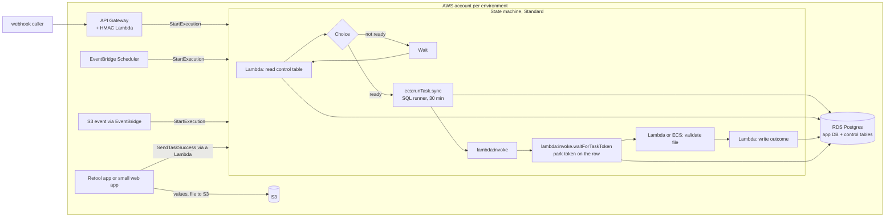
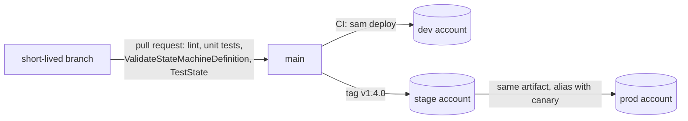

# AWS Step Functions as the Retool Workflows replacement

How the Retool replacement would be built on AWS Step Functions, how a change would move from
a developer to production without merge conflicts, and what Step Functions gives for each need
in [D-022](../decisions.md), [D-023](../decisions.md) and [D-024](../decisions.md).

**Nothing in this report ran.** Step Functions is a managed AWS service, and no AWS account was
used in this experiment ([D-024](../decisions.md)). Every claim is from AWS's documentation,
read on 2026-11-16 **[docs]**, or is a design that wasn't built or validated **[proposal]**. The
YAML below is a sketch for a pilot. It hasn't been through `ValidateStateMachineDefinition`.

Step Functions runs state machines written in the Amazon States Language (ASL). Each step is a
state: a Task that calls an AWS service, a Choice, a Wait, a Map, and so on. It has two
workflow types:

- **Standard:** runs up to a year, with exactly-once steps and 90 days of history.
- **Express:** runs up to 5 minutes and keeps no history of its own.

Everything here is Standard. Only Standard waits on ECS tasks (`.sync`) and on callbacks
(`.waitForTaskToken`), and only Standard can be redriven.

## In short

| Retool pain point or need | With Step Functions |
|---|---|
| Merge conflicts from dev > stage > prod | **Solved by design, through infrastructure as code.** The definition is a file in Git, deployed by SAM, CDK or CloudFormation to each environment's account. Environment differences are `DefinitionSubstitutions` (`${ClusterArn}`). Trunk-based development fits: one `main`, promotion as a deploy. Versions and aliases add canary or linear rollouts with alarm rollback, run by CloudFormation [docs]. The console's visual editor (Workflow Studio) is the one way to drift. |
| Postgres work of up to 30 minutes | **Possible, but not in one step.** Step Functions has no SQL step. Lambda stops at 15 minutes. The RDS Data API is Aurora only and returns after 45 s. So the 30-minute statement runs in an **ECS task that the state machine starts and waits for** (`ecs:runTask.sync`, no time limit of its own). You build and maintain that small SQL-runner image [docs, proposal]. |
| Lambda calls | **Native: the best of the four options.** `lambda:invoke` is an optimized integration with AWS's recommended retry policy, and a callback variant (`.waitForTaskToken`) for work that finishes later [docs]. |
| ECS task triggering | **Native.** `ecs:runTask.sync` starts a task with overrides (command, environment) and waits for it to stop, through EventBridge events plus polling [docs]. AWS doesn't document how a non-zero exit code is treated; check that in the pilot. |
| Gates on Postgres control tables | **Built from parts.** A Lambda reads the table, a Choice branches, a Wait loops. That's cheap, but every loop adds events toward the 25,000-event history limit: about 9 to 10 days of 5-minute polling. Or event-driven: the run parks a callback token on the control row, and whoever flips the row resumes it, even Postgres itself through the `aws_lambda` extension [docs, proposal]. |
| People enter values and upload files | **Not built in.** Step Functions has no forms and no file upload. A run waits on a callback token for up to a year; your own UI, such as a Retool app you already have, collects the values and the file (to S3), then calls `SendTaskSuccess` [docs]. AWS's human-approval sample is e-mailed Approve/Reject links: unauthenticated GETs with the token in the URL. |
| Validating artifacts | **Your code.** A Lambda or ECS task validates the file and writes the report to S3. The run shows each step's input and output (256 KiB at most), not files [docs]. |
| Webhook calls (native in Retool) | **Through API Gateway.** No native webhook URL. API Gateway can start an execution directly, but the caller only gets the execution ARN back. Synchronous answers exist only for Express workflows (5 minutes at most), and they return 200 even when the run failed. A Lambda authorizer can't see the body, so an HMAC check needs a Lambda in front [docs]. |
| S3, Secrets Manager, RDS | **Native through AWS SDK integrations and IAM.** One role per state machine. But a secret read in a state lands in the execution history for 90 days. Read secrets inside the Lambda or ECS task instead [docs]. |
| Hosting on AWS | **Nothing to host.** No servers, database, upgrades or Kubernetes. Retool 4.0's move to EKS doesn't touch it. What you do run: the Lambdas, the ECS task definitions and the UI for human steps. |
| Spec-driven development | **Good, once you accept a cloud dev loop.** The ASL file is itself a declarative spec. The logic lives in Lambda and container code, testable as in this repo. Since Nov 2025, the `TestState` API tests single states with mocked service results, retries included. But it's an AWS API call, and AWS calls Step Functions Local "unsupported". There's no local emulator to rely on [docs]. |
| Price | **Pay per use, no license:** $0.025 per 1,000 state transitions after 4,000 free a month. A 30-step run costs $0.00075; 10,000 such runs a month cost about $7.40. Lambda, Fargate, API Gateway and CloudWatch Logs are billed on top [docs]. |

Step Functions' costs, covered below:

- You build the human-step UI yourself.
- Development needs an AWS account per developer or per branch.
- SQL lives in Lambdas and containers, not in the workflow.
- History, payload and secret-handling limits shape the design.
- Lock-in to AWS: ASL runs nowhere else.

## What it would look like [proposal]



What's deployed per environment:

- the state machine, with one IAM role;
- a few Lambdas: check, write and validate, in the VPC to reach RDS;
- one ECS task definition for the SQL runner, on an existing ECS cluster;
- API Gateway for webhooks;
- the human-step UI.

All of it is in one SAM or CDK app in the repo.

## The development lifecycle [docs, proposal]

### Inner loop

There's no supported local Step Functions. AWS calls Step Functions Local "unsupported" and
without feature parity; its last image (2.0.0, May 2024) still runs on arm64. The loop
happens in the cloud:

| You change | Then | Time |
|---|---|---|
| Lambda or SQL-runner logic | Unit tests locally (pytest, golden vectors as in this repo), then deploy | Tests in seconds; a deploy to your sandbox stack in seconds with `sam sync --watch`, which pushes code and definitions through the service APIs (dev only; it drifts from the CloudFormation stack) |
| The state machine | `TestState` for the states you changed, with mocked results; then run the whole machine in your sandbox stack | One API call per state; a full run as long as the run |
| Anything, before a pull request | Lint and unit tests; `ValidateStateMachineDefinition`; `TestState` with mocks; a deploy and parity run against a CI stack | Minutes; `ValidateStateMachineDefinition` is throttled to 1 call/s |

What this means for a team:

- **Every developer needs an AWS sandbox:** an account, or at least a stack with its own names.
  There's no `docker compose up`.
- **`TestState` (Nov 2025) is the unit-test tool for the workflow.** It runs one state with
  mocked integration results or errors, including Map, Parallel, `.sync` and callback states,
  and simulates retries. Mocks are validated against the service's API shape (STRICT, PRESENT
  or NONE). It needs `states:TestState` permission, is throttled at 50/10, and calls the real
  service when not mocked.
- **Workflow Studio** (the visual editor in the console, VS Code with the AWS Toolkit, and
  Infrastructure Composer) is good for drafting. Copy its output back into the repo; a console
  edit is drift.

### Spec-driven: adding a requirement

The same steps as in this repo:

1. **Write the requirement** with an ID in the spec (like `SUM-5`).
2. **Pin the expected behavior first.**
   - Golden cases for the logic in Lambdas and the SQL runner, tested locally.
   - `TestState` cases with mocks for the states that branch or retry.
   - A parity scenario against a deployed CI stack for the whole flow.
3. **Implement**: ASL for the wiring, Python for the logic.
4. **Pass them,** then open a pull request.

ASL is declarative and readable, much like a Kestra flow. JSONata expressions and variables
(Nov 2024) remove most of the old JSONPath plumbing. JSONata follows spec 2.0.6 without
`$eval`, with a 1 s limit per expression.

### Branching and promotion without merge conflicts



- **One `main`, short branches, releases as tags.** Promotion deploys the same template to the
  next account. Nothing merges between environments.
- **The definition never names an environment.** ARNs, subnets and table names come in through
  `DefinitionSubstitutions` or CDK references.
- **Safe rollout.**
  - Each deploy publishes an immutable version, up to 1,000 per state machine.
  - An alias points at one version, or splits traffic between two.
  - SAM's `AutoPublishAlias` with `DeploymentPreference` (`CANARY`, `LINEAR` or `ALL_AT_ONCE`)
    shifts traffic and rolls back on CloudWatch alarms, run by CloudFormation.
- **Running executions keep their definition** when you deploy. A 30-minute statement or a
  two-week approval isn't disturbed by a release. Executions started a few seconds after an
  update may still get the old one.
- **Why this avoids conflicts:**
  - One definition per state machine, as text, with no canvas positions or generated IDs.
  - Lambdas and SQL are ordinary code.
  - As with Kestra, a large definition in one file is the place two people can collide; split
    large flows into child state machines.

AWS has no Step Functions-specific guidance for multi-account dev, stage and prod. Its general
multi-account practice applies.

## The batch pipeline: gate, long statement, Lambda, human step [proposal]

The probes from [probes.md](../probes.md), as one Standard state machine, in JSONata mode:

```yaml
# Definition of an AWS::Serverless::StateMachine (sketch: not validated or run)
QueryLanguage: JSONata
StartAt: Start
States:
  Start:
    Type: Pass
    Assign: { batchId: "" }
    Next: CheckReady
  CheckReady:                              # gate on the control table: a Lambda reads probe.batch
    Type: Task
    Resource: arn:aws:states:::lambda:invoke
    Arguments:
      FunctionName: ${BatchFunctionArn}
      Payload: { action: status, batchId: "" }
    Output: ""
    Retry:
      - ErrorEquals: [Lambda.ServiceException, Lambda.AWSLambdaException, Lambda.SdkClientException, Lambda.TooManyRequestsException]
        IntervalSeconds: 2
        MaxAttempts: 6
        BackoffRate: 2
    Next: IsReady
  IsReady:
    Type: Choice
    Choices:
      - Condition: ""
        Next: LongStatement
    Default: WaitBeforeCheck
  WaitBeforeCheck:
    Type: Wait
    Seconds: 300                           # each loop adds about 9 history events (limit 25,000)
    Next: CheckReady
  LongStatement:                           # 30 minutes: past Lambda's 15, so an ECS task, awaited
    Type: Task
    Resource: arn:aws:states:::ecs:runTask.sync
    Arguments:
      Cluster: ${ClusterArn}
      TaskDefinition: ${SqlRunnerTaskDefinitionArn}
      LaunchType: FARGATE
      NetworkConfiguration:
        AwsvpcConfiguration: { Subnets: ["${SubnetA}", "${SubnetB}"], SecurityGroups: ["${SqlRunnerSecurityGroup}"] }
      Overrides:
        ContainerOverrides:
          - Name: sql-runner
            Command: ["run-sql", "sql/rebuild-batch.sql", "--batch-id", ""]
    TimeoutSeconds: 3600
    Retry:
      - ErrorEquals: [States.TaskFailed]   # a retired Fargate task is stopped, not replaced
        MaxAttempts: 1
    Next: Enrich
  Enrich:
    Type: Task
    Resource: arn:aws:states:::lambda:invoke
    Arguments: { FunctionName: "${EnrichFunctionArn}", Payload: { batchId: "" } }
    Next: HumanReview
  HumanReview:                             # park the token on the row; the UI resumes the run
    Type: Task
    Resource: arn:aws:states:::lambda:invoke.waitForTaskToken
    Arguments:
      FunctionName: ${BatchFunctionArn}
      Payload: { action: await-review, batchId: "", taskToken: "" }
    TimeoutSeconds: 1209600                # 14 days; the token itself can wait up to a year
    Assign: { review: "" }   # what the UI sent: approver, decision, s3Key
    Next: ValidateFile
  ValidateFile:
    Type: Task
    Resource: arn:aws:states:::lambda:invoke
    Arguments:
      FunctionName: ${ValidateFunctionArn}
      Payload: { batchId: "", s3Key: "" }
    Output: ""     # {status, rowsTotal, rowsValid, reportKey}
    Next: RecordOutcome
  RecordOutcome:
    Type: Task
    Resource: arn:aws:states:::lambda:invoke
    Arguments:
      FunctionName: ${BatchFunctionArn}
      Payload: { action: record, batchId: "", review: "", report: "" }
    End: true
```

The parts you write:

| Part | What it does |
|---|---|
| `BatchFunction` (Lambda, Python, in the VPC) | `status`: `select status from probe.batch where id = %s`. `await-review`: store the task token on the row, which the UI's pending list reads. `record`: the UPDATE. Parameterized SQL, as in this repo. |
| SQL runner (container image) | Runs a SQL file from the image with bound parameters, then exits 0 or non-zero. Configure client keepalives under 240 s, connect directly to RDS (not through RDS Proxy), and make sure `statement_timeout` is 0 or above 30 minutes for its role (see the [AWS notes](retool-replacement.md#5-postgres-work-of-up-to-30-minutes)). |
| `ValidateFunction` | Reads the file from S3, writes the report next to it, returns the counts |
| The UI | Lists rows waiting for review, takes the values and a file (a presigned S3 upload), and calls a small Lambda that runs `SendTaskSuccess(token, {approver, decision, s3Key})` |

**An event-driven gate instead of polling:** start `CheckReady` as a
`.waitForTaskToken` too, and park its token on the row. Whatever turns the row `READY` calls
`SendTaskSuccess`, or a Postgres trigger does through the `aws_lambda` extension (RDS for
PostgreSQL 12.6+). That gives no polling and no history growth, at the cost of more moving
parts [docs, proposal].

## Webhooks [docs, proposal]

| | |
|---|---|
| Entry point | API Gateway: a REST API with a direct `StartExecution` integration, or a Lambda that starts it |
| What the caller gets | `executionArn` and `startDate`. For the result, the caller polls `DescribeExecution`, or the Lambda does. `StartSyncExecution` answers synchronously, but only for Express workflows (5 minutes at most), and it returns 200 even when the run failed. |
| Authenticating the caller | API keys, IAM (SigV4), Cognito or a Lambda authorizer. **An HMAC of the body needs a Lambda in front**, because authorizers get headers, query and path but not the body. |
| Other starts | EventBridge Scheduler (schedules), EventBridge rules (S3 object created, other AWS events), EventBridge Pipes (SQS, Kinesis, DynamoDB streams) |
| Idempotency | The execution name is unique for 90 days. Starting a Standard execution with the same name and input is idempotent, so a batch ID makes a natural execution name. |

## AWS services [docs]

| Service | In Step Functions |
|---|---|
| **AWS Lambda** | `arn:aws:states:::lambda:invoke`: the result in `Payload`, with metadata. AWS's recommended retry: `Lambda.ServiceException`, `AWSLambdaException`, `SdkClientException` (and `TooManyRequestsException`), interval 2 s, 6 attempts, backoff 2. Lambda's own limit is 900 s. |
| **Amazon ECS** | `ecs:runTask`, `.sync` (wait for the task to stop) or `.waitForTaskToken` (the container reports back). Overrides for command and environment. `.sync` needs `ecs:RunTask`, `StopTask`, `DescribeTasks`, the EventBridge rule permissions and `iam:PassRole`. No default timeout; an aborted execution only tries to stop the task. Fargate has no runtime limit, but a standalone task due for retirement is stopped and not replaced (7 days' notice, up to 14). |
| **Postgres (RDS)** | No SQL step. Lambda in the VPC for short statements; an ECS task for long ones; the RDS Data API (`rdsdata`) only on Aurora, with a 45 s call timeout (`continueAfterTimeout` keeps the statement running but gives no result) and 1 MiB responses. |
| **Amazon S3** | SDK integrations (`GetObject`, `PutObject`, ...). Distributed Map reads CSV, JSON, JSONL, Parquet and manifests from S3 (10 GB per file) and runs a child workflow per item. |
| **Secrets Manager** | `aws-sdk:secretsmanager:getSecretValue` works, but **state input and output, secrets included, stay in the execution history for 90 days.** Logging can exclude data (`includeExecutionData: false`), but the history can't. A customer-managed KMS key restricts who can read the history. No masking feature exists. Read secrets inside the Lambda or container. |
| **Credentials** | One IAM role per state machine, plus each Lambda's and task's own role. No keys anywhere. |

## Price [docs]

| | Standard (what this design uses) | Express |
|---|---|---|
| Price (us-east-1) | $0.000025 per state transition ($0.025 per 1,000), 4,000 free a month, forever. Retries and redrives count. | $1.00 per million requests, plus duration by GB-second |
| This workload | A 30-step run is $0.00075. A 2-hour gate polling every 5 minutes is about 72 transitions, $0.0018. | — |
| Billed separately | Lambda, Fargate (per second for the SQL runner), API Gateway, CloudWatch Logs (vended-logs rate), KMS keys, data transfer | The same |

There's no license and no instance to pay for. Compare the infrastructure Kestra or Prefect
needs: an EKS cluster ($0.10 an hour for the control plane on standard support, plus nodes) or
ECS services, and an RDS instance for the orchestrator's own state.

## Pros and cons by capability

| Capability | How Step Functions does it | Pros | Cons |
|---|---|---|---|
| Version control, merge conflicts | ASL in Git, deployed by SAM, CDK or CloudFormation | Plain text, no generated IDs; IaC is the only deploy path | Console edits drift; a big machine in one file can conflict |
| Promotion dev > stage > prod | One template, an account per environment, substitutions | Versions, aliases, canary and linear rollouts with alarm rollback; running executions keep their version | No Step Functions-specific multi-account guide; you build the pipeline |
| Spec-driven development and tests | ASL as the spec; `TestState` with mocks; logic tested in plain code | Declarative definition; per-state tests with mocked services (Nov 2025) | No supported local emulator; tests of the workflow need AWS credentials; throttled APIs in CI |
| Long Postgres work (30 min) | `ecs:runTask.sync` with a SQL-runner image | Waits without limits; Fargate tasks have no runtime limit | An image to build and run; task start-up adds seconds to minutes; retirement stops tasks |
| Lambda | Optimized `lambda:invoke`, callbacks | Native, retries documented, payload parsed | Lambda's own 15-minute cap still applies |
| ECS tasks | `ecs:runTask`, `.sync`, `.waitForTaskToken` | Native start and wait with overrides | Exit-code handling undocumented; abort only tries to stop the task |
| Gates on control tables | Lambda + Choice + Wait, or callback tokens on rows | Cheap; the event-driven version needs no polling | No SQL in the workflow; polling counts toward the 25,000-event history |
| Human input: fields, files, approvals | `.waitForTaskToken` + your UI | Waits up to a year; any UI and any identity provider you choose | Nothing built in: no form, no upload, no task list |
| Artifacts and validation | Lambda or ECS writes reports to S3 | Any format, stored where you choose | Not visible in the console beyond 256 KiB of step output |
| Error handling | `Retry` and `Catch` per state, jitter, `MaxDelaySeconds`; redrive within 14 days | The best-documented error model of the four | `States.ALL` doesn't catch every error; retries and redrives are billed |
| Webhooks | API Gateway, EventBridge, Scheduler, Pipes | Many entry points, AWS-grade auth | No native URL; no synchronous answer for Standard; HMAC needs a Lambda |
| S3, Secrets Manager | SDK integrations, IAM roles | Hundreds of services without code | Secrets read in a state stay in history for 90 days |
| Hosting | Managed by AWS | Nothing to patch, scale or upgrade; HA built in | Region-bound; quotas (payload 256 KiB, history 25,000 events) |
| Observability | Console graph and table, CloudWatch metrics and logs, X-Ray, a metrics dashboard (Oct 2025) | Every step's input and output, in one console | Finding a run by business key needs the execution name; `ListExecutions` can't filter by name, tag or input |
| Access control | IAM | Real identities, fine-grained, no shared logins | The human-step UI's own permissions are yours to build |
| Portability | ASL is AWS-only | — | Full lock-in; Kestra and Prefect run anywhere |
| Learning curve | ASL, JSONata, IAM, SAM or CDK | Familiar to an AWS team; good visual editor | IAM and VPC wiring dominate the first weeks |

## Costs and risks

| Risk | Mitigation |
|---|---|
| The human-step UI has to be built | Keep it in Retool apps you already run (they're good at forms and uploads), or a small web app with Cognito; one Lambda calls `SendTaskSuccess` |
| A cloud-only dev loop | A sandbox account per developer; `sam sync --watch`; push logic into plain code with local tests; `TestState` with mocks in CI |
| The 25,000-event history limit | Poll every few minutes, not seconds; use callback tokens for long waits; split work into child executions or a Distributed Map |
| Secrets in the execution history | Read them inside Lambdas and containers; encrypt the history with a customer-managed KMS key |
| Exit codes and retirements on ECS | Probe exit-code handling in the pilot; `Retry` on the ECS state; make the SQL runner's work idempotent |
| A synchronous webhook answer | Use a Lambda that starts the run and answers with the execution ARN; callers poll, or get a callback |
| AWS lock-in | Keep the logic in plain code and the SQL in files; only the wiring is ASL |

## Pilot plan

What a pilot in a sandbox account should prove, mirroring this repo's probes:

1. **Long statement:** `ecs:runTask.sync` with a SQL-runner image running `select pg_sleep(1800)`
   against RDS. Then run one that exits non-zero, and see what the state does.
2. **Lambda:** a 14-minute synchronous Lambda through `lambda:invoke`, and one that fails, with
   AWS's retry policy.
3. **Gate:** the definition above, with a control row flipped to `READY` by hand and by the
   `aws_lambda` extension.
4. **Human step:** a Retool app (or a form) that uploads a CSV to S3 and resumes the run;
   validation writes the report.
5. **Webhook:** API Gateway with an HMAC-checking Lambda that starts the execution, named after
   the batch ID, and answers with its ARN.
6. **Lifecycle:** two accounts, one template, a canary alias, `TestState` with mocks in CI.

## Sources

AWS documentation, read 2026-11-16:

- Workflow types and limits: [choosing a workflow type](https://docs.aws.amazon.com/step-functions/latest/dg/choosing-workflow-type.html), [quotas](https://docs.aws.amazon.com/step-functions/latest/dg/service-quotas.html), [best practices](https://docs.aws.amazon.com/step-functions/latest/dg/sfn-best-practices.html), [pricing](https://aws.amazon.com/step-functions/pricing/)
- Integrations: [integration patterns](https://docs.aws.amazon.com/step-functions/latest/dg/connect-to-resource.html), [Task state](https://docs.aws.amazon.com/step-functions/latest/dg/state-task.html), [Lambda](https://docs.aws.amazon.com/step-functions/latest/dg/connect-lambda.html), [ECS](https://docs.aws.amazon.com/step-functions/latest/dg/connect-ecs.html), [SDK integrations](https://docs.aws.amazon.com/step-functions/latest/dg/supported-services-awssdk.html), [Lambda timeout](https://docs.aws.amazon.com/lambda/latest/dg/configuration-timeout.html), [ECS task maintenance](https://docs.aws.amazon.com/AmazonECS/latest/developerguide/task-maintenance.html)
- Postgres: [Data API engines](https://docs.aws.amazon.com/AmazonRDS/latest/AuroraUserGuide/Concepts.Aurora_Fea_Regions_DB-eng.Feature.Data_API.html), [Data API timeouts](https://docs.aws.amazon.com/AmazonRDS/latest/AuroraUserGuide/data-api-timeouts.html), [`aws_lambda` extension](https://docs.aws.amazon.com/AmazonRDS/latest/UserGuide/PostgreSQL-Lambda.html)
- Human steps and triggers: [human approval tutorial](https://docs.aws.amazon.com/step-functions/latest/dg/tutorial-human-approval.html), [API Gateway](https://docs.aws.amazon.com/step-functions/latest/dg/tutorial-api-gateway.html), [StartSyncExecution](https://docs.aws.amazon.com/step-functions/latest/apireference/API_StartSyncExecution.html), [StartExecution](https://docs.aws.amazon.com/step-functions/latest/apireference/API_StartExecution.html), [Lambda authorizers](https://docs.aws.amazon.com/apigateway/latest/developerguide/http-api-lambda-authorizer.html), [S3 events](https://docs.aws.amazon.com/step-functions/latest/dg/tutorial-cloudwatch-events-s3.html)
- Data and secrets: [logging](https://docs.aws.amazon.com/step-functions/latest/dg/cw-logs.html), [logging configuration](https://docs.aws.amazon.com/step-functions/latest/apireference/API_LoggingConfiguration.html), [encryption at rest](https://docs.aws.amazon.com/step-functions/latest/dg/encryption-at-rest.html), [ItemReader](https://docs.aws.amazon.com/step-functions/latest/dg/input-output-itemreader.html)
- Authoring and testing: [JSONata](https://docs.aws.amazon.com/step-functions/latest/dg/transforming-data.html), [variables](https://docs.aws.amazon.com/step-functions/latest/dg/workflow-variables.html), [Workflow Studio](https://docs.aws.amazon.com/step-functions/latest/dg/workflow-studio.html), [TestState](https://docs.aws.amazon.com/step-functions/latest/dg/test-state-isolation.html), [ValidateStateMachineDefinition](https://docs.aws.amazon.com/step-functions/latest/apireference/API_ValidateStateMachineDefinition.html), [Step Functions Local](https://docs.aws.amazon.com/step-functions/latest/dg/sfn-local.html), [sam sync](https://docs.aws.amazon.com/serverless-application-model/latest/developerguide/sam-cli-command-reference-sam-sync.html)
- Lifecycle and operations: [CloudFormation resource](https://docs.aws.amazon.com/AWSCloudFormation/latest/TemplateReference/aws-resource-stepfunctions-statemachine.html), [SAM resource](https://docs.aws.amazon.com/serverless-application-model/latest/developerguide/sam-resource-statemachine.html), [versions](https://docs.aws.amazon.com/step-functions/latest/dg/concepts-state-machine-version.html), [gradual deployments](https://docs.aws.amazon.com/step-functions/latest/dg/version-rolling-deployment.html), [UpdateStateMachine](https://docs.aws.amazon.com/step-functions/latest/apireference/API_UpdateStateMachine.html), [redrive](https://docs.aws.amazon.com/step-functions/latest/dg/redrive-executions.html), [error handling](https://docs.aws.amazon.com/step-functions/latest/dg/concepts-error-handling.html), [ListExecutions](https://docs.aws.amazon.com/step-functions/latest/apireference/API_ListExecutions.html), [EKS pricing](https://aws.amazon.com/eks/pricing/)
